# Design System: Diddit

## The signed-off picture is the spec

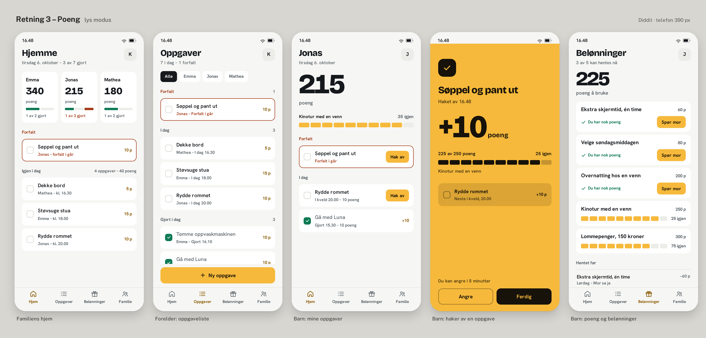

`reference/poeng-signed-off.png` — "Retning 3 – Poeng · lys modus", five screens, phones at 390 px.
Signed off by Stig (owner). Source of record: ST-744.

**Everything in this guide describes that picture.** The picture outranks the guide. If a rule here
would remove, tone down, or ration something the picture visibly does, the rule is wrong — delete the
rule, keep the picture. Check your work against the picture first and against this text second.

This is not a hypothetical failure mode. On ST-729 a style guide was written whose rules were
_stricter_ than the picture ("yellow only as a surface", "one yellow area per screen", "the tick
moment goes dark"). The screens built from those rules had the yellow drained out of them, every
review passed because every review checked the rules, and Stig rejected the result. See
**Banned rules** at the end of this file.

### What else Stig has approved (ST-812 and ST-890)

The five Poeng screens are the spec for everything they show. What they do **not** show has been
approved separately, in two rounds, and both sets are locked: changing them needs a new sign-off
through Maria.

**Round one — ST-812, 2026-10-10.** Three things drawn by Astrid on ST-810: **option A, the yellow
top**, the **login screen**, and the **Diddit mark** — all three "as drawn". Those pictures are the
spec for those three things, on the same terms: they outrank the text below, and they are locked.

| Approved picture                                                                                                    | What it is the spec for                           |
| ------------------------------------------------------------------------------------------------------------------- | ------------------------------------------------- |
| [`brand-07-a-yellow-top-home.png`](reference/brand-07-a-yellow-top-home.png)                                        | A, the yellow top — family home                   |
| [`brand-08-a-yellow-top-my-chores.png`](reference/brand-08-a-yellow-top-my-chores.png)                              | A, the yellow top — a child's "mine oppgaver"     |
| [`brand-01-options-a-b-c.png`](reference/brand-01-options-a-b-c.png)                                                | the A / B / C comparison Stig chose from          |
| [`brand-02-a-vs-signed-off.png`](reference/brand-02-a-vs-signed-off.png)                                            | A beside the signed-off picture, same scale       |
| [`brand-06-diddit-mark.png`](reference/brand-06-diddit-mark.png)                                                    | the mark — app-icon grounds and lockups           |
| [`login-17-phone-empty.png`](reference/login-17-phone-empty.png)                                                    | login, empty                                      |
| [`login-14-phone-filled.png`](reference/login-14-phone-filled.png)                                                  | login, filled                                     |
| [`login-15-phone-focus-keyboard.png`](reference/login-15-phone-focus-keyboard.png)                                  | login, typing with the keyboard open              |
| [`login-16-phone-error.png`](reference/login-16-phone-error.png)                                                    | login, wrong e-mail or password                   |
| [`login-18-phone-signing-in.png`](reference/login-18-phone-signing-in.png)                                          | login, signing in                                 |
| [`login-19-desktop-1440x900.png`](reference/login-19-desktop-1440x900.png)                                          | login, desktop                                    |
| [`login-13-states.png`](reference/login-13-states.png) · [`login-03-overview.png`](reference/login-03-overview.png) | the five states and the two surfaces in one sheet |

**Round two — ST-890, 2026-10-11.** The picture is five **phones**: it has no desktop and no
chosen-state for the menu. Those two things are drawn by Ida on ST-879 and ST-878 and approved by
Stig on ST-890:

- **Desktop and tablet, layout A** — `desktop-07-opsjon-A-1440.png`,
  `desktop-10-anbefalt-A-1024.png`, `desktop-12-anbefalt-A-mine-oppgaver-1440.png`,
  `desktop-15-side-om-side-godkjent-vs-forslag.png`. See **Desktop and tablet — layout A**.
- **The chosen menu item, option A** — `nav-02-forslag-a-b-c-v2.png` (the second phone) and
  `nav-04-a-alle-faner.png`. See **Navigation → The chosen item**.

**Round three — ST-880, 2026-10-11.** The picture has no popup in it. Stig chose between three drawn
options on ST-873 and approved a four-point rule for every popup in the product: a thin dark edge and
a soft shadow on all of them, a 30 % ink veil on the ones that block, an **ink** edge rather than
grey on those, and «Slett» in Overdue Rust. Pictures: `popup-02-anbefalt-tre-popups.png`,
`popup-01-valg-a-b-c.png`, `ida-W1-kant-17120A.png`, `ida-01-verste-tilfelle.png`. See **Popups** —
and note that the last two of the four points are amendments **to** the drawings, so the four points
win where they disagree with `popup-02`.

**Round four — ST-1069, 2026-10-14.** Innstillinger, drawn by Ida on ST-955 and approved by Stig
"as drawn": [`innstillinger-01-approved.png`](reference/innstillinger-01-approved.png) (the screen and
its worst case, a long e-mail). See **Innstillinger**. The bottom nav in that picture is the
current one; it is not a nav decision. The «‹ Hjem» it draws above the title is removed by a later
rule (see **Navigation**: no link back home at the top of a page).

**Round five — ST-1066, 2026-10-14.** The feedback after «Minn på», drawn by Ida on ST-955:
Stig chose **option C**, thumbs up + «Sendt» in the button, with «Påminnelse sendt 16.49» staying in
the row, and the failure state as drawn.
[`paaminnelse-01-approved.png`](reference/paaminnelse-01-approved.png) (column C) and
[`paaminnelse-02-feil.png`](reference/paaminnelse-02-feil.png) (column C). Options A (toast) and B
(fireworks) were not chosen. See **«Minn på» feedback**.

**Round six — ST-1068, 2026-10-14.** Familie, drawn by Ida on ST-955 and approved by Stig "as
drawn": [`familie-01-approved.png`](reference/familie-01-approved.png) (the screen and its worst
case, a long name and a one-letter name). See **Familie**. The «Familien Dahl ⌄» title with the
household picker is a separate decision (ST-1065) and is not part of this approval.

**Round seven — ST-1065, 2026-10-14.** The household name as the home title, with «⌄» and the
«Bytt husstand» sheet, redrawn by Ida with the 20 px under the date line (ST-1074):
[`husstand-01-approved.png`](reference/husstand-01-approved.png) (one household, two, the sheet
open, and a three-line name). See **The household name as the home title**.

**Round eight — ST-1067, 2026-10-14.** Fremgang v2, without «‹ Hjem» and with 20 px under the week
line: [`fremgang-01-approved.png`](reference/fremgang-01-approved.png). See **Fremgang**.

**Round nine — ST-1064, 2026-10-14.** The bottom menu E6, drawn by Ida on ST-1114: a paper menu
with the chosen item on a yellow label, the other three muted, 24 px icons, 78 px high, 11 px over
and under the label: [`nav-e6-signed-off.png`](reference/nav-e6-signed-off.png), with the five
variants in [`nav-e-runde-4.png`](reference/nav-e-runde-4.png) (build only E6) and the 360 px check
in [`nav-e-360.png`](reference/nav-e-360.png). It replaces the ink pill in the bottom menu; the desktop
tab row keeps the pill. See **Navigation → The chosen item**.

**Round ten — ST-1370, 2026-10-18.** Eight rules for **every page on desktop**, with all 18 desktop
pages drawn today-against-the-rules by Ida on ST-1409 and ST-1410 and checked by Astrid. Stig
approved the rules and the pictures together ("Approved. Thank you."). The four overview sheets —
[`desktop-rules-overview-parent-1.png`](reference/desktop-rules-overview-parent-1.png),
[`desktop-rules-overview-parent-2.png`](reference/desktop-rules-overview-parent-2.png),
[`desktop-rules-overview-child-setup-1.png`](reference/desktop-rules-overview-child-setup-1.png),
[`desktop-rules-overview-child-setup-2.png`](reference/desktop-rules-overview-child-setup-2.png) —
and the 18 `desktop-rules-*-1440.png` files are the spec for the pages layout A does not draw. See
**Desktop: rules for all pages**. Popups (step 2) and the single-page points (step 3) were
deliberately **not** in this approval.

**Order of precedence.** `poeng-signed-off.png` → the approved pictures above → this guide → generic
rules. Where an approved picture and the signed-off picture disagree about something the signed-off
picture already settles (a card width, a gutter, a row), the signed-off picture wins and the
difference is recorded as a drawing slip rather than fixed silently. **One case in the approved set
does disagree today.** `brand-07-a-yellow-top-home.png` and `brand-08-a-yellow-top-my-chores.png`
draw the bottom nav with a different, smaller icon set — 14.0–14.5 px of house ink against the
signed-off picture's 18.0 px. Those pictures are the spec for the yellow band, not for the nav: the
signed-off picture wins, and the slip is recorded in [RULE-CHECK.md](RULE-CHECK.md) (Revision 6)
rather than fixed inside the approved files. An earlier recorded case turned out to be a measuring
error, kept as a method note in **Measuring a card: never inside the corner radius** below. The
ST-890 desktop pictures inherit the same `brand-07` nav slip in their tab row, and it is resolved the
same way — see **Desktop and tablet — layout A**.

**Where the two rounds disagree, the later one wins**, because Stig signed it later: ST-890's menu
decision supersedes ST-812 on the chosen nav item, and nothing else. Everything ST-812 settles about
the yellow top, the login screen and the mark stands untouched.

**Rejected, so nobody brings them back:**

- **B — yellow details** (yellow initial badge, yellow marks on group labels, a yellow pill under the
  active nav item). Rejected: too little yellow to answer "the app lacks personality" — the new yellow
  area on the family home is smaller than one card.
- **C — yellow background** (the whole screen `#F6B93B`). Rejected: it forces the yellow "Ferdig"
  buttons to turn black and takes the rust out of the "Forfalt" group label (3.73:1 on yellow), which
  rewrites what colour means in the product rather than adding to it.
- Astrid offered to carry B's **yellow pill under the active nav item** into A. Stig approved A **as
  drawn**, and the A pictures have no pill. **B's yellow pill is still rejected** — no yellow pill,
  on the yellow top or anywhere else.
  **This is not the pill the menu has today.** A day later, on ST-890, Stig approved menu A: an
  **ink** pill behind the chosen icon, on the `#F6F6F4` bottom bar. Different colour, different
  surface, different shape — and a later decision. See **Navigation → The chosen item**.

## Overview

**Creative North Star: "The Reward Is The Interface"**

Diddit is a family chore app, in Norwegian, light mode. The product promise is that a child earns
points and can see them. So the points are literally the largest thing on the screen: an 83 px black
numeral on a child's own screen, 94 px in the moment a chore is ticked off. Nothing else on the
screen competes with it. Everything around it is small, quiet and ordinary — plain white cards on a
near-white background, a 16 px row title, a 13 px line of context underneath.

The yellow is the second voice, and it is a loud one. It is not an accent reserved for one special
button; it fills primary buttons, every per-item action button, every points meter, the title band
at the top of every working screen, the brand area of the login, and the entire background of the
screen where a chore gets ticked off. On the rewards screen it appears five times. The system's
warmth comes from using it freely; the discipline is in the _text colour on top of it_ (always
near-black ink), not in rationing the yellow itself.

Depth is tonal, not shadowed. A white card on a near-white screen is the only layering device on the
light screens; on the yellow screen, depth is a _darker shade of the same yellow_. There are no drop
shadows and no card borders anywhere in the picture.

**Key Characteristics:**

- Points are the hero: one enormous tabular numeral per child screen, never a second hero near it.
- Yellow is used freely and is always one hex (`#F6B93B`), never lightened, muted or greyed.
- Near-black ink on yellow, always (10.57:1). White on yellow never appears.
- Flat: no shadows, no card strokes. Strokes exist, but only for state, a control boundary, a
  structural divider — or, since 2026-10-11, the boundary of a popup sitting above the page; that
  layer is the one approved exception to both (see **Popups**). Never decoration.
- Every state that uses colour also uses a word: "Forfalt", "Gjort 16.10", "35 igjen".
- Light mode only. The picture is "lys modus" and there is no signed-off dark mode.

## Measurement basis

Everything below is CSS px at **390 × 844**, the viewport the picture's own "telefon 390 px" caption
describes.

The reference board is 4260 × 2044 px and holds five phone frames, each **780 × 1688 board px**
(frames start at x = 88, 924, 1760, 2596, 3432; content runs y = 194…1881; gutters are 56 board px).
780 ÷ 390 = **exactly 2 board px per CSS px**, and 1688 ÷ 2 = 844, the standard 390 × 844 logical
viewport. So the board is five device-true screens rendered at `deviceScaleFactor: 2`.

> **Correction, 2026-10-07.** The first version of this guide assumed 1.846 board px per CSS px,
> from reading the phone frame as 720 px wide rather than 780. Every CSS px value in it was ~8% too
> large, and the screen gutter and card width were wrong outright because screen 1's three
> side-by-side child cards were read as one full-width card. All sizes below were re-measured.
> If you have a copy of the earlier numbers, discard them.

> **Correction, 2026-10-09 (ST-756).** Redrawing the five screens against the picture (ST-740)
> proved ten more lines of this guide wrong, and they are corrected below. Six were wrong
> independently of which font the picture used — they are ratios and geometry _inside_ the picture:
> Display was 100 px and is **94 px**; "Display sm" covered both «215» and «225» at one size and is
> now **two** sizes, 83 px and 59 px; the word «poeng» beside «+10» had no size and is **23 px**;
> the 22 px gutter is right on screens 1, 2, 3 and 5 but the tick screen runs a **24 px** gutter and
> a **342 px** column; the bottom nav is pitched at **92 px**, not four equal quarters of 390; and
> the **initial badge** was missing from the guide entirely. Four were font-dependent sizes that
> render 20–25 % too large with the two font names this guide guesses at — Body, in-card text, and
> both button labels. Measurements and the side-by-side renders live on task ST-740
> (`screens-v2`); the corrections were made on ST-756 and Maria approved every one of them.

## Colors

A single warm yellow against warm-neutral greys, with three small semantic colours that only appear
where they carry meaning.

### Primary

- **Diddit Yellow** (`#F6B93B`): the one yellow. Primary buttons, per-row action buttons ("Ferdig"),
  per-reward buttons ("Spør mor"), filled points-meter segments, and the full-bleed background of
  the tick-off moment. It is a surface colour and a fill colour, not a text colour: at 1.76:1
  against white it must never carry type or a hairline on its own.

### Secondary

- **Ink** (`#17120A`): the near-black that lives _on_ the yellow — all text, icons, meter fills,
  the tick badge, and the solid "Ferdig" button on the yellow screen. 10.57:1 on the yellow.
- **Amber Ink** (`#8A5A00`): the small amber type — points values on a chore row ("5 p") and the
  active bottom-nav label. 5.93:1 on white. It reads as "this is about points" without adding a
  second yellow surface. It is a _white-background_ colour: on the yellow it is only 3.36:1 and
  must not be used for text there.

### Tertiary

- **Overdue Rust** (`#A43A16`): the "Forfalt" word, the 2 px border on an overdue card, the
  "1 av 3 gjort" line on a child card that is behind, **and that card's overdue meter segment**.
  6.57:1 on white.
- **Done Green** (`#0F7A54`): the filled checkmark on a completed chore, "Du har nok poeng" on an
  affordable reward, **and the filled segments of the chore meter on a family card**. 5.34:1 on
  white; white tick on the green is the same 5.34:1.

### Neutral

- **Text** (`#15181C`): headings, screen titles, the big point numerals on white, and the fill of
  an active filter chip.
- **Muted Text** (`#555E64`): dates, "Mathea – kl. 16.30", inactive nav labels, and the points value
  on a reward card ("60 p"). 6.62:1 on white.
- **Surface** (`#FFFFFF`): cards.
- **Background** (`#F6F6F4`): the screen behind the cards, and the bottom nav band — the nav is not
  a separate white bar.
- **Track** (`#ECECE8`): the unfilled segments of a meter on a white screen.
- **Hairline** (`#DFDFD9`): the structural dividers (above the bottom nav, under "Hentet før") and
  the resting outline of an unchecked checkbox. See **Elevation & Depth** for what it may and may
  not be used for.

### On-yellow neutrals

The yellow screen does not borrow greys. Its two surfaces are darker shades of the same hue:

- **Yellow Inset** (`#DBA434`): the inset card on the yellow screen (the "next chore" block).
  Ink on it is still 8.31:1.
- **Yellow Track** (`#C59430`): unfilled meter segments on the yellow screen, against ink fills
  at 6.79:1.

### Named Rules

**The Keep-The-Yellow Rule.** When contrast fails on or around the yellow, you change the _other_
side: text colour, weight, size, or a darker shade of the same hue on a small area. You never
desaturate, lighten, grey out, or replace the yellow, and you never swap a yellow surface for a
neutral one to pass a check. Black on yellow is the system's answer; it already passes AAA.

**The Ink-On-Yellow Rule.** Anything sitting on `#F6B93B` is `#17120A`. White text on the yellow
(1.76:1) does not exist in this system at any size.

**The Say-It-In-Words Rule.** No state is carried by colour alone. Overdue is red _and_ the word
"Forfalt". Done is green _and_ a timestamp. A meter always has its number beside it ("35 igjen",
"225 av 250 poeng"). This is what keeps a 1.49:1 filled-vs-empty meter conformant and legible.

## Typography

**Display Font:** Bricolage Grotesque (fallback `system-ui, sans-serif`) — weight 800 only.
**Body Font:** Hanken Grotesk (fallback `system-ui, sans-serif`) — weights 500 and 600.

> **These two names are the best available match, not a documented fact.** Both faces ship with the
> earlier Diddit design sources and their ink heights fit the picture well, but their ink widths do
> not fit as cleanly. If you set type from these names and it runs wide, that is why — try tracking
> before you change a size, and confirm the faces against the source HTML if it turns up.
>
> Two consequences, both load-bearing:
>
> 1. **The display numerals need −0.04em with _this_ font, where the token says −0.02em.** Bricolage
>    at normal width renders «215» 8 % too wide and its condensed instance 12 % too narrow; at
>    −0.04em the ink lands on the picture's 136.0 px. The token keeps −0.02em because that is a
>    property of the look, not of the picture's pixels; −0.04em is the correction Bricolage needs to
>    stand in for a face we have not identified. If the real face turns up, this goes away.
> 2. **Four text sizes were fitted _to_ this font and move if the font changes** — Button label,
>    Body, Meta and Meta sm. They were derived from ink width, not ink height, because that is the
>    only thing the picture pins down for text this small. The display and Number sizes came from
>    ink height and are far less font-dependent. See the re-derivation note after the table.
>
> After that fitting, what is left is residual and uncorrected: chore-row titles render 3.7 % wide
> (83.0 vs 80.0 px ink), chore-row meta 4 % narrow (110.5 vs 115.0), screen 4's title 2.5 % narrow.
> Full detail in [RULE-CHECK.md](RULE-CHECK.md#unverified-in-this-pass).

**Character:** A tight, heavy grotesque for every number and screen title, and a calm humanist
grotesque for everything a person reads as a sentence. The pairing does the hierarchy on its own:
there is no third font, no italic, and no uppercase tracking anywhere in the picture.

### Hierarchy

Every size was derived from one string in the picture, and the string is named so you can re-check
it. **Three different methods, and it matters which one you re-run:**

- **Display sizes — ratio against "215".** «215» is the anchor at 83 px. The other three are fixed
  by the ratio of their ink to its ink: that is a measurement _inside_ the picture and it does not
  depend on which font the picture used. Re-derive them this way, not from a font's em ratio.
- **Number, Title, Label, Caption — ink height ÷ the font's ink-height-per-em**, read from the font
  file. These are unchanged from the first pass and still check out.
- **Text sizes — ink width.** The size at which the string's drawn width reproduces the picture's.
  Ink height is too coarse at these sizes: a 1 board px threshold error is 3.5 % of a 29 px
  measurement, which is how "Body 20 px" survived a pass.

| Style            | Size   | Measured from                                 | Measured ink in the picture          |
| ---------------- | ------ | --------------------------------------------- | ------------------------------------ |
| **Display**      | 94px   | "+10", screen 4                               | 66.5 px high → 1.137 × «215»         |
| **Display sm**   | 83px   | "215", screen 3                               | 58.5 px high, 136.0 px wide — anchor |
| **Display xs**   | 59px   | "225", screen 5                               | 41.5 px high → 0.709 × «215»         |
| **Display unit** | 23px   | "poeng" beside "+10", screen 4                | 60 px wide                           |
| **Number**       | 30px   | "340" on a family card, screen 1              | 41 board px high                     |
| **Title**        | 27px   | "Oppgaver", screen 2                          | 46 board px high                     |
| **Button label** | 16.5px | "+ Ny oppgave" primary label, screen 2        | 105.5 px wide                        |
| **Body**         | 16px   | "Dekke bord" chore title, screen 2            | 80.0 px wide                         |
| **Meta**         | 15px   | "Ferdig 16.48" (drawn "Haket av 16.48"), s. 4 | 98.0 px wide                         |
| **Meta sm**      | 13px   | "Mathea – I dag 16.30" in a card, s. 2        | 115.0 px wide                        |
| **Label**        | 13px   | "Forfalt" group label, screen 2               | 18 board px high                     |
| **Caption**      | 12px   | bottom-nav labels, screen 1                   | 22 board px high                     |

> **Do not re-derive the display sizes from Bricolage's em ratio, and know where the uncertainty
> sits.** Running «+10» through the font file's own 0.687 returns 97 px where the picture's ratio
> against «215» returns 94 px. The whole 3 px hangs on one measurement: «215» ink reads **117 board
> px** at the threshold ST-740 used and 115 at the threshold revision 3 used, and the anchor is
> 83 px either way. 94 is the value that **reproduced the picture in a render measured against the
> board**, which is the stronger evidence, and it is the approved value. Treat Display, Display xs
> and Display unit as **±1 px** and leave them alone unless you are re-measuring from a render, not
> from a font file. The three ratio-derived sizes are internally consistent at 0.703–0.707 ink
> height per em against Bricolage's own 0.687–0.691 — a 2 % gap in the same direction as the text
> sizes, from the same cause: the face is a guess.

- **Display** (Bricolage 800, 0.95, −0.02em, tabular): the points won in the tick-off moment.
  The single largest thing in the product.
- **Display sm** (Bricolage 800, 0.95, −0.02em, tabular): a child's total on their own chore
  screen — "215". One per screen, top-left, with the word "poeng" under it.
- **Display xs** (Bricolage 800, 0.95, −0.02em, tabular): the balance at the top of the rewards
  screen — "225". **The picture does not set this at the same size as "215".** «215» ink is 58.5 px
  tall and «225» is 41.5 px, a ratio of 0.71, and their widths agree (136.0 vs 99.5 px). Still the
  one hero of its screen, just a smaller one — a balance you are about to spend, not a score.
- **Display unit** (Bricolage 800, 1.0): the word "poeng" sitting on the baseline beside "+10" on
  the tick screen. Not Body — it is display type, a third the height of the numeral it follows.
- **Number** (Bricolage 800, 1.0, tabular): a child's total on a family card — "340".
- **Title** (Bricolage 800, 1.15): the screen name — "Hjemme", "Oppgaver", "Belønninger". **27 px is
  the phone's title** (measured off «Oppgaver» in the signed-off picture). On a pointer screen the
  page title is **26 px / 800** — see **Desktop: rules for all pages**, rule 3.
- **Button label** (Hanken 600, 1.35): the full-width primary button only — 16.5 px, half a pixel
  above Body, which is what makes the label ink land on 105.5 px inside a 346 px button.
- **Body** (Hanken 600, 1.35): chore titles, reward titles, history-row titles, and the labels on
  row-level action buttons ("Ferdig", "Spør mor") at **16 px** — the width the picture's own
  70 px and 87 px buttons require.
- **Meta** (Hanken 500, 1.4): the line _outside_ a card — a screen's sub-line, the word "poeng"
  under a hero number, a person's name ("Emma" on a child card), and "Ferdig 16.48".
- **Meta sm** (Hanken 500, 1.4): the same voice **inside** a card, one step down at 13 px — the
  who-and-when line ("Mathea – I dag 16.30"), "Du har nok poeng", "1 av 2 gjort", "5 p", "60 p",
  "25 igjen". A card's second line is quieter than a screen's second line; that is the picture.
- **Label** (Hanken 600, 1.3): group labels — "Forfalt", "I dag", "Gjort i dag", "Hentet før".
- **Caption** (Hanken 600, 1.3): bottom-nav labels.

Note that **Label is smaller than Meta** in this picture: the group headings are quieter than the
row text they introduce. That is deliberate in the reference; do not "fix" it by swapping them.

> **Re-derive the text sizes if the real source font turns up.** Button label, Body, Meta and
> Meta sm — and only those four — were fitted by ink _width_ against Hanken Grotesk, which this
> guide names as a guess (see the caveat above). A different face of the same ink height will want
> different numbers. The display sizes were fitted by ink _height_ and move far less, but re-check
> them too. The ink measurements in the right-hand column are the picture's and do not change; the
> px sizes in the left-hand column are the ones to re-compute.

### Named Rules

**The Tabular Numbers Rule.** Every number uses `font-variant-numeric: tabular-nums`. Points change
while a child is looking at them; proportional figures make the total jiggle as it counts. This is
measurable in the picture: "215" is 7.7% wider than proportional figures of the same height would
be, which is the tabular `1`.

**The One Hero Rule.** A screen has exactly one number in Display, Display sm or Display xs. The
tick-off moment has "+10" and nothing else that size; the chore screen has "215" and the rewards
screen has "225", each with nothing else that size. The hero sizes differ between screens — that is
the picture — but a screen never carries two of them.

## Layout

A 390 × 844 phone, single column, content scrolling between a fixed title area and a fixed bottom nav.

- **Screen gutter: 22 px**, giving a **346 px content column**, on screens 1, 2, 3 and 5. Full-width
  cards, the primary button and the points meters all span that column.
- **The tick screen (4) is the exception: a 24 px gutter and a 342 px column.** The badge, the
  meter, the inset card and both buttons all start at x 24 and end at x 366. Two px wider on each
  side, on the one screen with no cards on it — don't normalise it to 22, and don't carry 24 onto
  the other four.
- **Card rhythm: 8 px between cards**, with a larger break before a group label
  ("Forfalt", "I dag", "Gjort i dag").
- **Card padding: 15 px** on full-width cards; **12 px** on the narrow child cards.
- **Chore row: 68 px tall** when the title fits on one line (see Cards and rows for long titles).
- **Primary button:** 346 × **49 px**, pinned to the bottom of the scroll area above the nav.
  The two on-yellow buttons ("Angre", "Ferdig") are the same 49 px.
- **Family screen: three child cards across** (fewer or more children: see Child card), each **109 px wide × 154 px tall** with **9 px**
  between them — not a stack of full-width cards, and **not a square**: the card is half again as
  tall as it is wide, because it carries name, total, the word "poeng", the chore meter and
  "1 av 2 gjort". This is the first screen of the app; get it right.
- **Title row: y 49…87**, with the **initial badge** right-aligned to the gutter — see Components.
- **Bottom nav: four items at 92 px pitch**, which leaves ≈11 px of padding at each edge of the
  390 px frame. Not four equal quarters: that would pitch them 97.5 px apart and run 7 px too wide.
- **Meters:** segments are **not a fixed width**. They divide the available width by the number of
  segments, with a fixed gap, so a 2-segment meter on a child card has 41 px segments and a
  10-segment meter on a reward card has 22 px segments. Only the height and the gap are fixed.
- **Spacing scale:** 4 / 8 / 12 / 15 / 20 / 24. 4 is for points-meter gaps; 8 is the default gap
  between siblings; 15 is the default padding inside a full-width surface; 22 is the screen gutter.

## Elevation & Depth

**There are no shadows and no card borders on the page.** Depth is tonal only:

- On a light screen: `#FFFFFF` card on a `#F6F6F4` background. That 1.18:1 step is the entire
  elevation vocabulary, and it is enough because the cards are large and edge-to-edge.
- On the yellow screen: `#DBA434` inset on `#F6B93B`. Same idea, same hue, one step darker.

Strokes do exist. There are exactly three kinds in the picture, and each one is doing a job:

| Stroke                                              | Colour                | Width | Where                                                                                              |
| --------------------------------------------------- | --------------------- | ----- | -------------------------------------------------------------------------------------------------- |
| State — an overdue card                             | `#A43A16`             | 2px   | Screens 1 and 3                                                                                    |
| Control boundary — an unchecked checkbox            | `#DFDFD9`             | 2px   | Every chore row                                                                                    |
| Structural divider — above the nav, under a heading | `#DFDFD9`             | 1px   | All four light screens; "Hentet før"                                                               |
| Layer boundary — the edge of a popup                | `#555E64` / `#17120A` | 1.5px | Not in the picture; approved 2026-10-11, see **Popups**                                            |
| State — a row held under a finger (long press)      | `#17120A`             | 2px   | Inside the card (`box-shadow: inset 0 0 0 2px`). Not in the picture; approved 2026-10-18 (ST-1391) |

The checkbox stroke is the picture's colour. **A build draws it in `#555E64` instead** — one of the
two approved exceptions listed under Accessibility. Same width, same shape, same position.

### Named Rules

**The Flat Rule.** No `box-shadow` on the page. If something needs to separate from what is behind
it, step the tone — do not lift it. **One exception, approved by Stig on 2026-10-11:** a popup is
above the page rather than on it, and it carries a soft ink shadow. Everything on the page stays
flat. See **Popups**. The held-row line is drawn with `inset 0 0 0 2px`; that is a stroke inside the
card, not a lift (no blur, no offset), so it does not break this rule.

**The Borders Mean Something Rule.** A visible stroke carries **state**, a **control boundary**, a
**structural divider**, or — on the popup layer only — a **layer boundary**. It is never decoration,
and a card never gets a decorative hairline.

## Shapes

Softly rounded rectangles throughout; nothing is a circle except the person badges.

- **Rows and the cards that behave like rows:** 13 px — the chore card, the overdue card and the
  inset card on the yellow screen.
- **Buttons:** 13 px for the full-width primary and the on-yellow pair — **the same radius as the
  card**. The picture draws no card/button distinction here, so `rounded.md` and `rounded.lg` hold
  the same value on purpose; they are kept apart only so a later change to one does not move the
  other.
- **Reward cards and child cards:** 14 px (`rounded.cardTile`) — one px softer than a row. The two
  stand-alone card shapes are the only things in the picture carrying this value.
- **Row-level action buttons:** 10 px — smaller than the card they sit on.
- **Filter chips:** 9 px.
- **Meter segments:** fully rounded (pill).
- **The tick badge** on the yellow screen: a 54 × 54 px rounded square at 16 px radius — the one
  piece of geometry that is allowed to look like a stamp.

Every radius above is fitted from the corner arcs, on all four corners of each shape, with no
calibration constant. The method: for each scanline, take the sub-pixel edge of the fill by
integrating the uncovered fraction of each pixel (coverage read by projecting the pixel onto the
background→fill colour vector), take the shape's own straight edges the same way, then least-squares
an arc through the corner. Nothing in it is anchored to a hand-measured value, so the primary
button's 13 px is a check on the method rather than an input to it: the fit returns 13.10 css there.

Residuals are 0.16 board px or better on every shape, and the four corners of a shape agree to
within 0.15 board px, so each value is good to well under half a px. The fit reads very slightly
high (it returns 9.99 where the true value is 10, 13.10 where it is 13, 16.14 where it is 16), which
is why 14.21 on the reward and child cards is read as 14 and not 15. No value here is ±1 any more.

## Components

### Buttons

- **Shape:** gently rounded (13 px primary and on-yellow, 10 px row-level).
- **Primary** (`button-primary`): Diddit Yellow fill, Ink label, **no border**, 346 × 49 px,
  Button label **16.5 px** / 600. Used for the one creating action on a screen ("+ Ny oppgave").
  **346 px is the phone's content column**; the button is as wide as the column it sits in, which on
  desktop is 428 px — see **Desktop: rules for all pages**, rule 5. The 49 px height, the 13 px
  radius and the 16.5 px label do not change with the width.
- **Row action** (`button-row-action`): the same yellow fill and ink label at row scale — "Ferdig"
  on an overdue or due chore, "Spør mor" on a reward. Label in Body **16 px** / 600.
  **36 px tall** in every instance in the picture; the width follows the label (70 px for the drawn
  "Hak av", 87 px for "Spør mor"), so set padding, not a width — and at 16 px the labels fit those widths,
  which is the check that proved 20 px wrong. Do **not** grow it to 44 px: the reward card's layout
  is built around a short button sitting beside a line of text, and a 44 px button is 22% taller
  than the one Stig signed off.
  Reach 44 px with a padded hit area instead — see **Hit area** below.
  **Several per screen is correct**: the rewards screen has three.
  **Wording:** the chore button says «Ferdig», never «Hak av» (the picture's word; Stig's
  correction, 10.10, ST-808). Its aria-label is «Merk som ferdig: <chore>», and the tick moment
  says "Ferdig 16.48". A word changed, nothing else: same fill, same ink, same 36 px, same 10 px
  radius, and every approved picture since says «Ferdig». "Spør mor" on a reward card is unchanged.
  «Minn på» on a Forfalt row turns into thumbs up + «Sendt» or «Prøv igjen» after the tap; see
  **«Minn på» feedback**.
- **Solid dark** (`button-solid`): Ink fill, white label — only for the confirming action inside
  the yellow moment ("Ferdig"), where a yellow button would disappear into the background.
- **Ghost on yellow** (`button-ghost-on-yellow`): transparent on the yellow with a 2 px outlined
  edge and Ink label — the escape hatch ("Angre"). Draw the outline in **Ink**, not in the darker
  gold the picture uses: the sampled gold line (`#A87E29`) is 2.10:1 against the yellow and misses
  the 3:1 a control boundary needs.
- **Hit area:** the primary and on-yellow buttons are 49 px. The row-level buttons (36 px), the
  filter chips (33 px) and the checkbox (22 px) are drawn below 44 px and need a **padded target** —
  transparent padding or a pseudo-element that brings the pressable area to 44 × 44 px without
  changing the drawn height. Every control in this picture that looks small is small on purpose;
  the target grows, the drawing does not.

### Chips

- **Filter chips** ("Alle / Emma / Jonas / Mathea"): **33 px tall**, 9 px radius, 7 px apart,
  Meta 15 px. Selected is a `#15181C` fill with a white label; unselected is a white fill with
  `#15181C` label. Selection is a fill change, not a colour-only tint.
- 33 px is below 44 px, as the row buttons are. It still passes WCAG 2.2 AA (2.5.8 asks for 24 px),
  but give each chip a padded target so the touch area reaches 44 px without changing the drawn
  height.

### Initial badge

Every light screen's title row ends in one, and the first version of this guide left it out
altogether. It is the only circle in the system.

- **38 px circle** (`badge-initial`), `#ECECE8` fill, the person's single initial in `#15181C`.
- **Right-aligned to the screen gutter** — its right edge sits on the content column's right edge,
  in the title row at y 49…87.
- No border, no shadow, no photo and no colour per person: it is a quiet neutral, not a second
  accent. The yellow does not appear in it.
- Drawn at 38 px, pressed at **44 × 44 px** — transparent padding, as everywhere else.
- The size of the initial itself was **not** measurable from the picture at this scale; Meta 15 px
  fits the 38 px circle and is what the token carries. Treat that one number as unverified.

### Cards and rows

- **Chore row** (`card`): white, 13 px radius, 15 px padding, 68 px tall. Left to right: a checkbox
  (22 × 22 px, 2 px outline, inside a ≥44 px target — see the approved outline exception under
  Accessibility), the chore title (Body **16**), the who-and-when line (Meta sm **13**, muted),
  then the points at the right in Amber Ink ("5 p", Meta sm 13) — plain type, **no chip
  background**.
- **Long titles** (a row with a button, «Ta ut av oppvaskmaskinen og sett inn i skapet» at
  360 px): the title wraps to **at most 2 lines**, then «…». A child must be able to read the
  whole chore, so one line with «…» is not enough. A row whose title fits stays 68 px; only a long
  title makes the row taller (11 px top and bottom padding, about 83 px with two lines and the
  meta line). The checkbox, the points and the row button keep their size and stay vertically
  centred.
- **Overdue row** (`card-overdue`): the same white card with a 2 px Overdue Rust border, the word
  "Forfalt" above the group, and its context line in rust. The fill stays white — an overdue row is
  not a pink block.
- **Done row:** white card, a filled Done Green square with a white tick, and the time it was done
  ("Gjort 16.10") — never a tick on its own.
- **Child card** (`card-child`, family screen): **109 px wide × 154 px tall** — a portrait tile,
  not a square — three across, **14 px radius**. Everything below is inside those 154 px; a 109 px
  box clips the meter and the "1 av 2 gjort" line off the bottom.
  Name in Meta **15** — a name keeps the larger size even inside a card — total in
  Number 30, the word "poeng", then the **chore meter** (green/rust — see Meters) and
  "1 av 2 gjort" (Meta sm 13) underneath.
  **The cards always fill the row** (9 px gaps): 1 child is one full-width card, 2 are half each,
  3 are the picture, 4 are 2 + 2, 5 or more are rows of 3 with the last row's cards stretched to
  the full width. Only the width changes; the 154 px height and the content stay as drawn.
- **Reward card** (`card-reward`, screen 5): white, full content column, 92 px tall, **14 px
  radius** — the same slightly softer corner as the child card. Title in Body **16** on the left,
  cost in **Muted Text** on the right ("60 p", Meta sm 13) — note this is muted, not the Amber Ink
  used for points on a chore row. Then one of two second lines:
  - _affordable_ — a Done Green check and "Du har nok poeng" (Meta sm 13) on the left, and a yellow
    "Spør mor" button on the right;
  - _not yet affordable_ — a yellow **points meter** across the left, and "… igjen" (Meta sm 13) on
    the right. No button.
- **History row** (`row-history`, "Hentet før" on screen 5): sits on the background, not on a white
  card, under a `#DFDFD9` divider. Title in Body **16** on the left, a **negative** value on the
  right ("−60 p"), and a muted second line giving the day and who approved it
  ("Lørdag – Mor sa ja").
- **Inset on yellow** (`card-inset-on-yellow`): `#DBA434` block on the yellow screen carrying the
  next chore.

### Meters

There are **two different meters** in this picture. They are not the same component and they are not
the same colour. Using the points meter on a family card is the most likely way to get screen 1
wrong.

**1. Points meter** — "how close am I to this reward". Segmented pills, **14 px tall, 4 px apart**.
Width follows the space it is given: the full 346 px content column on screen 3, inset on a reward
card on screen 5 where it shares the row with "… igjen". Only the height and the gap are fixed.

- On white (screens 3 and 5): Diddit Yellow filled, `#ECECE8` empty.
- On the yellow screen (screen 4): Ink filled, `#C59430` empty.

**2. Chore meter** — "how much of today is done", on a child card on the family screen. Segmented
pills, **7 px tall, 3 px apart** — half the height of a points meter — one segment per chore:

- done: **Done Green `#0F7A54`**
- not done: `#ECECE8`
- overdue: **Overdue Rust `#A43A16`**

There is **no yellow** on the family-screen meters. Sampled across screen 1: Emma green + track,
Jonas green + track + rust, Mathea green + track.

**A meter is never alone.** It always carries its own number — "35 igjen", "225 av 250 poeng",
"1 av 3 gjort" — on the label line above or beside it.

### Navigation

- **No link back home at the top of a page** (Stig, 2026-10-13 on ST-1067: "Pages doesnt need link
  in the top back to home. This goes for all pages."). The bottom menu, or the tab row on desktop,
  is the way home. This also holds where an approved picture still draws «‹ Hjem» (Innstillinger,
  Familie): the rule is later and wins.
- Four items: Hjem · Oppgaver · Belønninger · Familie. **The bottom menu draws its icons in a 24 px
  box** (E6, see **The chosen item** below): the same 21-unit artwork scaled up, so the house has
  **21 px of ink**. The desktop tab row keeps **18 px of ink in a 21 px box**. The numbers below,
  down to the drawing slip, are the 21 px readings that the tab row still uses.
- **Ink and box are two numbers, and the picture gives the ink.** In the signed-off picture the
  «Hjem» house ink is 36 × 36 board px — **18.0 × 18.0 px** — at luminance threshold 220, and
  34–36 at threshold 200 where the muted glyphs' antialiased edge drops out. The other three sit
  under it: list 17.0 × 12.0, gift 18.0 × 17.5, familie 17.0 × 15.0.
  Measure a screenshot against the **ink**; set `--nav-icon` to the **box**.
- **Read a glyph where the picture draws it inactive — the picture bolds the chosen item**
  (ST-898 round 2, 2026-10-12). Amber `#8A5A00` names the chosen item in the picture, and that item
  is also drawn with about **20 % more ink**: the house reads 18.0 × 18.0 with a **1.84 px** stroke
  on the two light screens where it is chosen (1 and 3) and **18.0 × 17.5** with the set's normal
  **1.49 px** stroke on the two where it is not (2 and 5). «Oppgaver» goes 17.0 × 12.0 → 18.0 × 13.0
  when chosen, the gift 18.0 × 17.5 → 19.0 × 17.5; «Familie» is never chosen in the picture, which
  is why its number never moved. **Our bar does not bold the chosen item** — since ST-892 the ink
  pill carries that state — so the comparable reading is the inactive one. The numbers above are
  inactive readings except the house's, which is the chosen-state reading Revision 6 took from
  screen 1; measured against the inactive house our glyph is ~0.7 px larger in both dimensions.
  That gap is measured and recorded, not yet decided: RULE-CHECK **Revision 10**.
- **The artwork is drawn in a 21-unit viewBox, so one unit is one rendered pixel.** `nav-icon.html`
  uses `viewBox="0 0 21 21"` in the 21 px box: the four ink numbers above are literally the path
  data, and `stroke-width="1.5"` renders the picture's measured **1.5 px** line. Redrawing a glyph
  therefore needs no box derivation — draw it to the picture's ink and the box is already right.
- **The line is 1.5 px, and that is a drawn number too.** A vertical cut through the three
  «Oppgaver» rules in the signed-off picture reads 1.5 / 2 / 1.5 px (the middle rule straddles a
  pixel boundary). An 18-unit drawing stretched into the 21 px box renders 1.75 px instead — ~17 %
  heavier on every glyph — which is why the set is drawn at 21 units rather than scaled into place.
  ST-898 redrew it; RULE-CHECK **Revision 10** holds the readings.
- **Where `17px` came from, so nobody ships it again.** It was written into this guide as an icon
  size without an ink measurement behind it, and ST-881 then built to it (PR #644): a 17 px box
  renders 14.5 px of ink, a fifth short of the picture. PR #645 puts the box at 21 px. Maria's
  decision on ST-881 is the rule here — **the nav icon follows the signed-off picture.**
- **Drawing slip: the approved yellow-top pictures get this nav wrong.**
  `brand-07-a-yellow-top-home.png` and `brand-08-a-yellow-top-my-chores.png` (approved on ST-812 for
  the yellow top) draw the bar with a different, smaller icon set — the house has no door, the list
  has no bullets, and the house ink measures **14.0–14.5 px** against the signed-off picture's
  18.0. Those pictures are the spec for the yellow band, not for the nav: **the picture wins here**,
  and the slip is recorded rather than quietly fixed in the approved files. Evidence:
  [`nav-icon-signed-off-vs-brand-07.png`](reference/nav-icon-signed-off-vs-brand-07.png) — top, the
  signed-off picture; bottom, brand-07, both at 2×.
- **Pitch: 92 px per item**, leaving ≈11 px of padding at each edge — icon ink runs x 47.5…341.5.
  **Not four equal quarters of 390 px**: that pitches them 97.5 px apart, spreads the row 7 px too
  wide, and pushes the outer two items against the frame edges. Centre the four at 92 px and let
  the edges keep their padding.
- The bar sits on the screen background (`#F6F6F4`), not on a white bar.
- A **1 px `#DFDFD9` divider runs the full 390 px width** directly above the bar, on all four light
  screens. The yellow tick-off screen has no nav and no divider.
- **The menu is 78 px high**, counted from the top of the divider to the bottom edge of the frame
  (`--nav-band`). Every screen that leaves room for the menu reads that token; never write the
  number into a page.
- Each target is the item's label box: **the full cell width (92 px at 390, 85 px at 360) by 56 px**,
  well over 44 px. The yellow label is drawn on the chosen one; the other three have the same box
  without a fill.

#### The chosen item: the yellow label, E6 (approved 2026-10-14)

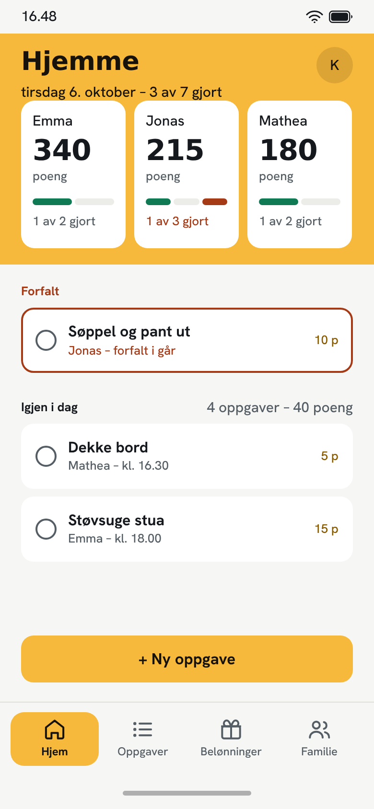

Approved by Stig on ST-1064 (2026-10-14) as **E6**, from round 4 on ST-1114
([`nav-e-runde-4.png`](reference/nav-e-runde-4.png), the last phone). The longest label at 360 px
is drawn in [`nav-e-360.png`](reference/nav-e-360.png). Those pictures are the spec for the bottom
menu. It replaces the ink pill (below) **in the bottom menu only**; the desktop tab row keeps the
pill.

Measured on the signed-off picture (390 px, dsf 2), and built to the same pixel:

- **Paper menu.** The menu sits on `#F6F6F4` with the 1 px `#DFDFD9` divider across the full width
  on top. The menu is **78 px** from the top of the divider to the bottom edge.
- **The chosen item sits on a Diddit Yellow `#F6B93B` label** as wide as its cell (**92 px** at
  390, **85 px** at 360) and **56 px** high, with **14 px** corners. There is **11 px** of paper over
  it, counted from the top of the divider, and **11 px** under it.
- **Icon and text on the label are Ink `#17120A`.** The label text is **600**.
- **The three items you are not on are Muted Text `#555E64`**, icon and text, at **500**. Only
  the chosen item is black. The text ink matches the picture to within 3 device px² at both
  weights.
- **Icons are 24 px boxes** (`--nav-icon: 24px` on the menu): the house's ink runs y 784.5…805.5
  on the screen, 21 px, as drawn. The label text sits 4 px under the icon box; its ink runs
  y 813.5…824.5, as drawn.
- **The longest label fits at 360 px.** «Belønninger» is 64 px wide and sits 10.5 px from each
  side of the 85 px label. It never wraps and is never cut.
- The gift glyph runs 0.5 px short of the picture top and bottom (19.5 against 21 px of ink). This
  is the set's own gift, not a new drawing; record it, do not redraw it.

**Contrast**, the numbers from ST-1114:

| Pair                                | Contrast    |
| ----------------------------------- | ----------- |
| Ink on the yellow label             | **10.57:1** |
| Yellow label against the paper menu | **1.63:1**  |
| Muted item against the paper menu   | **6.12:1**  |
| Chosen ink against a muted item     | **2.81:1**  |

The label alone is 1.63:1 against the paper, under the 3:1 a shape needs on its own. That is why
the chosen item is also the **only black item in the row**: the label is never the only signal.

#### The desktop tab row: the ink pill (approved 2026-10-11)

This section was the bottom menu's chosen item until E6 (above). It still holds for the desktop
tab row in the yellow top.

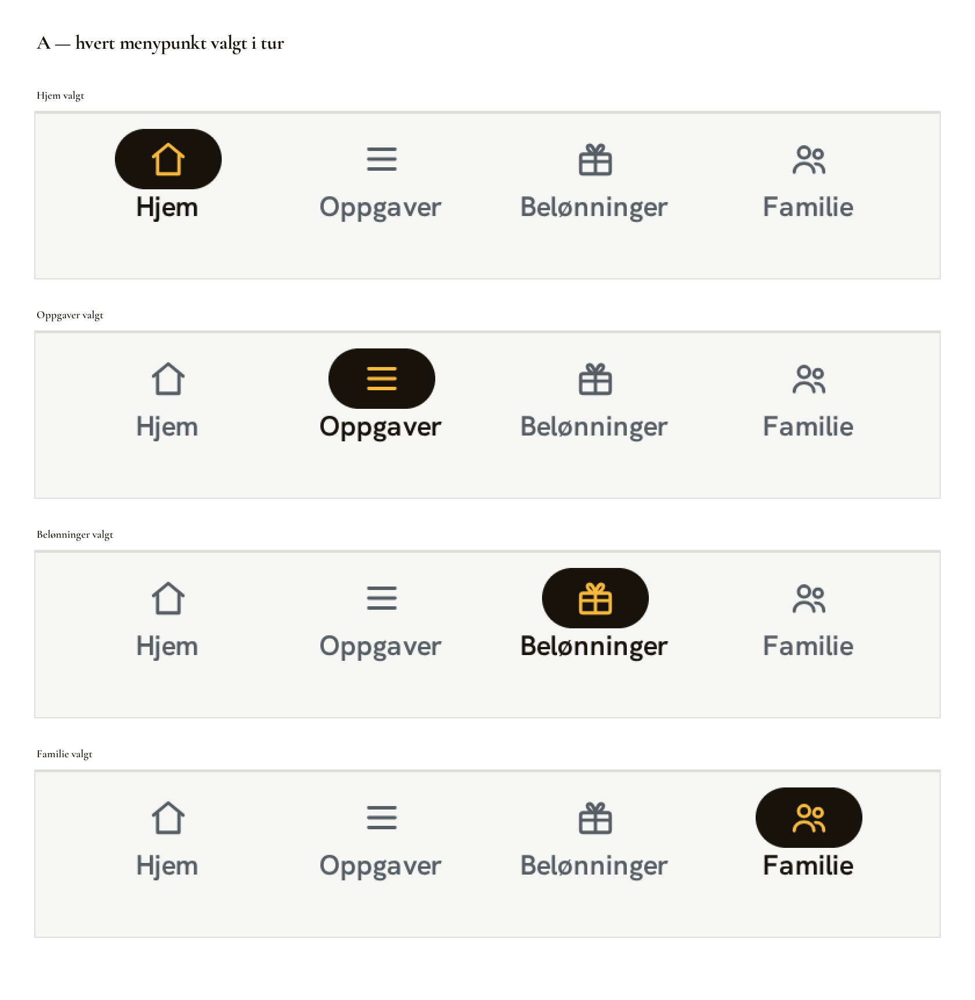

Approved by Stig on ST-890 (2026-10-11) as "menu A", from
[`nav-02-forslag-a-b-c-v2.png`](reference/nav-02-forslag-a-b-c-v2.png) (the **second** phone) and
[`nav-04-a-alle-faner.png`](reference/nav-04-a-alle-faner.png), drawn on ST-878. Those two pictures
are the spec for this one thing.

**What it replaces, and why.** Until this decision the chosen item differed from the other three by
**text colour alone**, Amber Ink against Muted Text — **1.12:1**. That is below every threshold
there is, it is colour-only, and Stig's words were that he could not see which page he was on. The
old rule ("active is Amber Ink with the heavier weight") is deleted. Do not bring it back.

- **A `#17120A` pill behind the chosen icon: 46 × 26 px, fully rounded** (`rounded.pill`; the
  radius is half the height). Measured on both pictures, which agree: 46.00 × 26.00.
- **The icon inside it turns `#F6B93B`.** The other three stay Muted Text `#555E64`.
- **The chosen label turns `#17120A`**; the other three stay `#555E64`.
- **The label does not change weight.** Both pictures draw it at the same weight as the unchosen
  labels — normalised glyph area 1459.0 against 1460.4 device px² for the same word «Hjem», a 0.1 %
  difference, and 2054.1 against 2052.6 for «Oppgaver». The darker colour is what makes it look
  heavier. If you ship a bold chosen label you are adding something the picture does not have.
- **The pill is centred on the icon, not on the item**: its centre and the icon's centre are the
  same point to within a tenth of a px on both axes. It sits **7.5 px under the `#DFDFD9` divider**,
  and the label starts 3 px under the pill.
- **The pill is decoration inside the target, not the target.** On the phone the pressable area
  was the whole 92 × 71 nav cell (since E6 it is the 92 × 56 label box). Never shrink a target to
  46 × 26.

**The icon size inside the pill is derived, not drawn.** `nav-02` and `nav-04` are built on top of
`brand-07-a-yellow-top-home.png`, so they inherit the drawing slip recorded above: their icon ink
measures **14 px**, not the signed-off picture's 18. **The signed-off picture wins**: keep the
18 px ink in the 21 px box, inside the pill as drawn. That leaves 4 px of clearance over and under
the ink instead of the 6 px the pictures show, and 14 px to each side. Nothing else about the pill
moves.

**Three signals, not one.** Fill, icon colour and label colour all change together, so the state
survives greyscale and does not depend on hue:

| Pair                                          | Contrast    |
| --------------------------------------------- | ----------- |
| Ink pill against the nav background `#F6F6F4` | **17.22:1** |
| Yellow icon against the pill it sits on       | **10.57:1** |
| Chosen label against unchosen label           | **2.81:1**  |
| Chosen label against the nav background       | **17.22:1** |

### The tick-off moment (signature)

The single most important screen in the product, and the one most likely to be designed wrongly.

- **The screen is `#F6B93B` edge to edge, from just under the status bar all the way to the bottom
  of the phone.** There is no bottom nav and no divider on it. It does not go dark. It does not dim.
  It does not become a yellow card on a neutral screen. (The top 35 px status-bar band stays
  `#F6F6F4`; everything below it is yellow.)
- **This screen's gutter is 24 px, not 22** — a 342 px column. Badge, meter, inset card and both
  buttons run x 24…366.
- Ink tick badge top-left (54 × 54 px rounded square), then the chore title in Title, then
  "Ferdig 16.48" in Meta 15.
- "+10" in Display (**94 px**) with "poeng" beside it on the baseline in Display unit (**23 px**) —
  display type, not Body. In the picture "+10" runs x 27.5…170 and "poeng" x 174.5…234.5.
- The points meter below: 10 segments, Ink on `#C59430`, with "225 av 250 poeng" and "25 igjen".
- An inset `#DBA434` card for the next chore.
- "Du kan angre i 5 minutter", then **Angre** (ghost) and **Ferdig** (solid ink) side by side, both
  49 px tall. The undo is offered plainly, in the same size as the confirm — no confirmshaming.

## A — the yellow top (approved 2026-10-10)

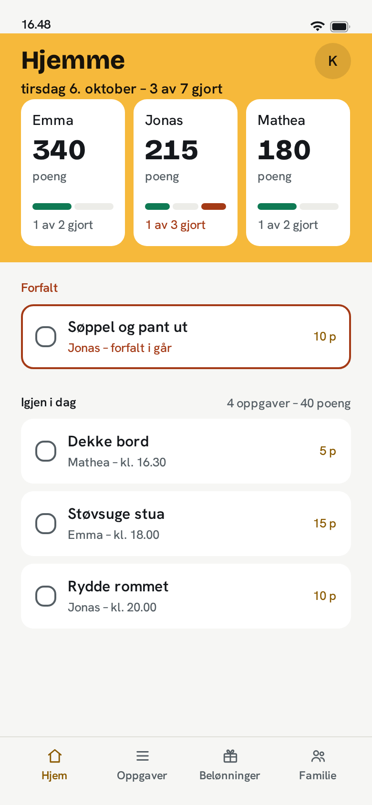

Stig's brief was "the app lacks brand colour on all the working screens. It lacks personality."
Option A answers it by turning **the title area of every working screen into a yellow band**. It is
an addition, not a rewrite: it takes nothing away and changes no card, row, button or nav item.

### What the band is

- **Full-bleed `#F6B93B`, edge to edge**, starting at **y 35** — directly under the status-bar
  band, which keeps `#F6F6F4`. There is no gutter at the band's left and right edges and no radius
  on it; it runs x 0…390.
- **It has no fixed height.** It ends **17 px under the last thing it carries**, so it is as tall as
  its content: the two approved pictures measure **y 35…275 (240 px)** on the family home and
  **y 35…305 (270 px)** on a child's chore screen. With the 20 px under the sub-line that Stig
  asked for on 2026-10-13, the same content makes **260 px** and **290 px**. **Build to those two.**
- **The ST-1074 drawings measure 261 px and 294 px, and that is not a conflict.** Both numbers are
  right in their own frame, so do not "correct" either one:

  |                                         | Family home | Child's chores |
  | --------------------------------------- | ----------- | -------------- |
  | Signed picture, old gap                 | 240         | 270            |
  | **Build to this** (signed picture + 20) | **260**     | **290**        |
  | ST-1074 drawing kit, old gap            | 241         | 274            |
  | ST-1074 drawing kit, new gap            | 261         | 294            |

  The kit's band was already 1 px and 4 px taller than the pictures **before** this change — it sets
  the sub-line 3 px lower and its bold display cuts render a little larger (both recorded in
  `RULE-CHECK.md` revision 7). The 20 px itself lands exactly: 241 → 261 and 274 → 294, +20 in each.
  Measured at 390 × 844, DPR 2, on the full-bleed yellow at the screen's left edge.

- **The sub-line has 20 px of air under it** (`layout.brandSubGap`), and nothing in the band comes
  closer than that: not the first child card, not the hero number, not the band's own bottom edge.
  See **The Air Under The Sub-Line** below.
- **Inside it, the gutter is the ordinary 22 px and the column the ordinary 346 px** — the same as
  everywhere else on a light screen. The band is a background behind the normal column, not a
  layout of its own.

### The Air Under The Sub-Line (Stig, 2026-10-13, ST-1065)

**The sub-line always has 20 px under it.** This holds on every screen whose top is this band —
title plus sub-line — whatever comes next:

| What follows the sub-line              | Where the 20 px are measured                                        |
| -------------------------------------- | ------------------------------------------------------------------- |
| A card or tile (family home)           | sub-line line box → the card's top edge                             |
| A hero number ("215", "225")           | sub-line line box → the hero's box, its own leading on top of that  |
| Nothing — the sub-line is last in band | sub-line line box → the band's bottom edge. **20 px here, not 17.** |

```css
.band .sub {
  margin-bottom: 20px;
}
.band .sub:last-child {
  margin-bottom: 0;
}
.band:has(.sub:last-child) {
  padding-bottom: 20px;
}
```

**What that CSS assumes about the markup:** the sub-line is a direct child of `.band`, a sibling of
whatever follows it. Wrap the title and sub-line in their own header `<div>` and `.sub:last-child`
becomes true on every screen — including the family home, where a card follows — and the band
silently takes 20 px of bottom padding where it should take 17. If the markup nests, drop the
`:has()` and put the 20 px on an explicit class (`.band--endsOnSubLine`) instead. The rule is "20 px
under the sub-line, whatever follows"; these three selectors are only one way to say it.

**Why it is written here and not read off the approved pictures.** `brand-07` draws 3 px of yellow
between the date line's descenders and the child cards, and `brand-08` draws 26 px between the date
line and "215". Stig rejected the 3 px on ST-1065 in these words: _"Needs more space under mandag 12
oktober Line. This needs to be added to design guide. Also do this for all pages with similar
layout."_ So on this one measure the guide is **deliberately ahead of the two pictures**, by the
owner's own instruction. Do not "correct" it back to the picture.

**Measured in the redrawn set** (390 × 844, DPR 2, css px; `boksavstand` is line box to line box,
`klart gult` is the clear yellow from the sub-line's lowest ink to the next thing's ink or edge):

| Screen                              | Box gap | Clear yellow | What follows        |
| ----------------------------------- | ------- | ------------ | ------------------- |
| Hjem / family home                  | 20      | 20           | child card edge     |
| Child's "mine oppgaver"             | 20      | 45           | the hero "215"      |
| Oppgaver                            | 20      | 20           | the band's own edge |
| Belønninger                         | 20      | 27           | the hero "225"      |
| Fremgang                            | 20      | 23           | stat card edge      |
| Familie / Innstillinger             | 20      | 23           | the band's own edge |
| Home, sub-line wrapped to two lines | 20      | 20           | child card edge     |
| Home, 360 px and 412 px             | 20      | 20           | child card edge     |

The box gap is the number to build and to check. The clear yellow is what the eye reads and it is
never smaller than the box gap — a hero number carries its own leading above the ink.

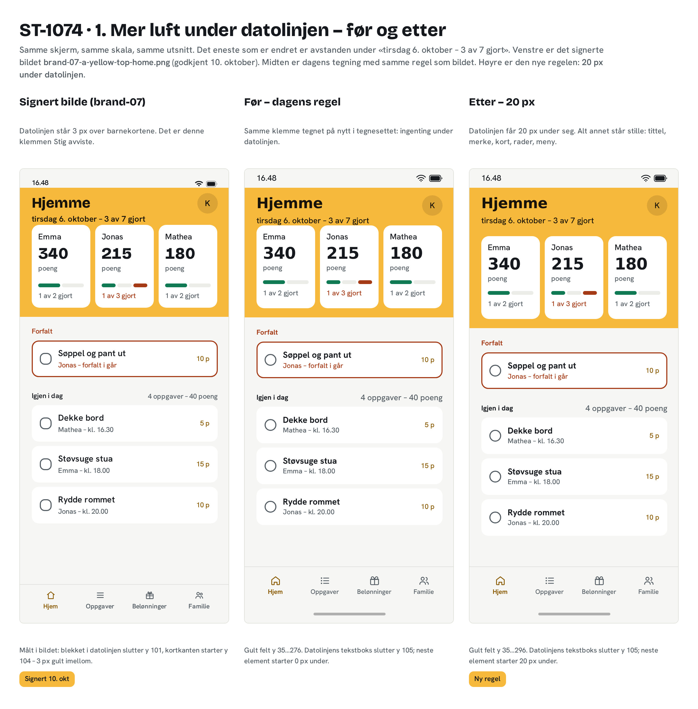

`reference/band-subgap-before-after.png` — evidence, not a signed picture: `brand-07`, the same
screen redrawn at the old gap, and the 20 px, at the same scale and crop (ST-1074).

### What moves into the band

Everything that already sat above the first card, and nothing else:

| Screen                  | Inside the band                                                                      |
| ----------------------- | ------------------------------------------------------------------------------------ |
| Family home             | screen title, the day/progress sub-line, the initial badge, the three child cards    |
| Child's "mine oppgaver" | screen title, the date sub-line, the hero number, the word "poeng", the reward meter |

Everything below the band — group labels, chore rows, overdue cards, reward cards, the primary
button, the bottom nav — is **exactly the signed-off picture**, unchanged in colour, size, radius
and position. That is the whole point of A over C. The one exception is in the pictures, not in A:
both approved A screens draw the nav icons from a smaller set than the signed-off picture. Build the
nav from the signed-off picture and **Navigation** below, not from these two files.

### What changes colour inside the band, and why

Three things, and all three are the **Keep-The-Yellow Rule** doing its job: the yellow stays, the
ink on top of it changes.

| Element              | On paper            | In the band                  | Why                                                               |
| -------------------- | ------------------- | ---------------------------- | ----------------------------------------------------------------- |
| Title, hero number   | `#15181C`           | **`#17120A`** (Ink)          | the Ink-On-Yellow Rule — 10.57:1                                  |
| Sub-line under title | `#555E64`           | **`#17120A`** (Ink)          | `#555E64` on the yellow is **3.76:1** and fails AA for body text  |
| Initial badge fill   | `#ECECE8`           | **`#DBA434`** (Yellow Inset) | `#ECECE8` on the yellow reads as a grey hole; ink on it is 8.31:1 |
| Points meter         | yellow on `#ECECE8` | **Ink on `#C59430`**         | the pair the signed-off tick screen already uses on yellow        |

The sub-line losing its grey is a real cost and it is the one A asks you to accept: the hierarchy
between title and sub-line is then carried by **size and weight alone** (Title 27 / 800 against Meta
15 / 500), not by tone. That is what the approved picture does. Do not reach for a lighter ink to
get the tone back — on the yellow there is no lighter ink that passes.

**The chore meters on the child cards do not change.** They sit on a white card inside the band, so
they keep Done Green / Overdue Rust / `#ECECE8`. The band changes the colour of what sits _directly_
on the yellow and nothing else.

### Which screens get it

Stig approved "the top of every working screen". Two of the four are drawn:

| Screen                           | Drawn?                                        |
| -------------------------------- | --------------------------------------------- |
| Family home ("Hjemme")           | yes — `brand-07-a-yellow-top-home.png`        |
| Child's chores ("Mine oppgaver") | yes — `brand-08-a-yellow-top-my-chores.png`   |
| Parent's chore list ("Oppgaver") | **no** — apply the pattern above              |
| Rewards ("Belønninger")          | **no** — apply the pattern above              |
| Login                            | no band; it has its own brand area, see below |
| The tick-off moment              | **never** — see the rule below                |

**On a pointer screen every page has the band** (ST-1370, 2026-10-18) — not only these four. That
includes «Barnas innlogging», «Glemt passord», «Sett nytt passord» and «Invitasjon», which carry the
Diddit mark in it because they have no tab row. The "Login" row above is «Logg inn» and «Opprett
konto» only. See **Desktop: rules for all pages**, rule 2.

For the two undrawn screens: take the title row and whatever already sits above the first card into
the band, apply the colour table above, and change nothing else. Then have the result checked
against this section before it ships — an undrawn screen is a pattern applied, not a picture signed.

- **Checked (ST-897, 12.10):** Oppgaver, Belønninger (forelder) and the child's Belønninger pass this section at 360 / 390 / 412 — band `#F6B93B` full-bleed, gutter 22, pad 10 / 17, Ink only (10.57:1, badge 8.31:1).
- **Chips and tabs stay on the paper, under the band.** They filter or switch the list, so they belong with it; on the yellow the inactive tab label would be 3.76:1 and the tab indicator's baseline 1.27:1.
- **Their first ink sits 22 px under the band** on both screens: the chips' pill on Oppgaver, the tab label on Belønninger (the 44 px tab button carries ~18.5 px of that itself).

### The tick screen stays the only fully yellow screen

A band and a full-bleed screen are two different things, and the difference is the product's loudest
moment. The tick-off moment is yellow from under the status bar to the bottom edge, with no nav and
no divider. A working screen is yellow for its title area only, and the paper, the cards and the nav
are all still there below it. **No second screen becomes fully yellow**, and the tick screen never
becomes a band.

### Measuring a card: never inside the corner radius

`brand-07` draws the three child cards at **109 px wide, 9 px apart, in the ordinary 22 px gutter**
— exactly as the signed-off picture does. The cards are untouched by the band, which is what
Astrid's option document promised of A: "Kort, rader, knapper, meny: helt urørt" (cards, rows,
buttons, menu: completely untouched).

This section exists because the first draft of it said otherwise. It read 106 / 12 / 24 off
`brand-07` and built a "the pictures disagree" section around it; Astrid's review of PR #639 caught
it, and the pixels confirm her. **There is no disagreement about the cards.** The reading was taken
at css y 112 — 8 px below the card's top edge at y 104, still inside the 14 px corner radius — so it
measured the arc, not the card. (The one place the approved pictures do depart from the signed-off
picture is the nav icon set, which is a drawing slip and not a measuring error — see **Order of
precedence** above.)

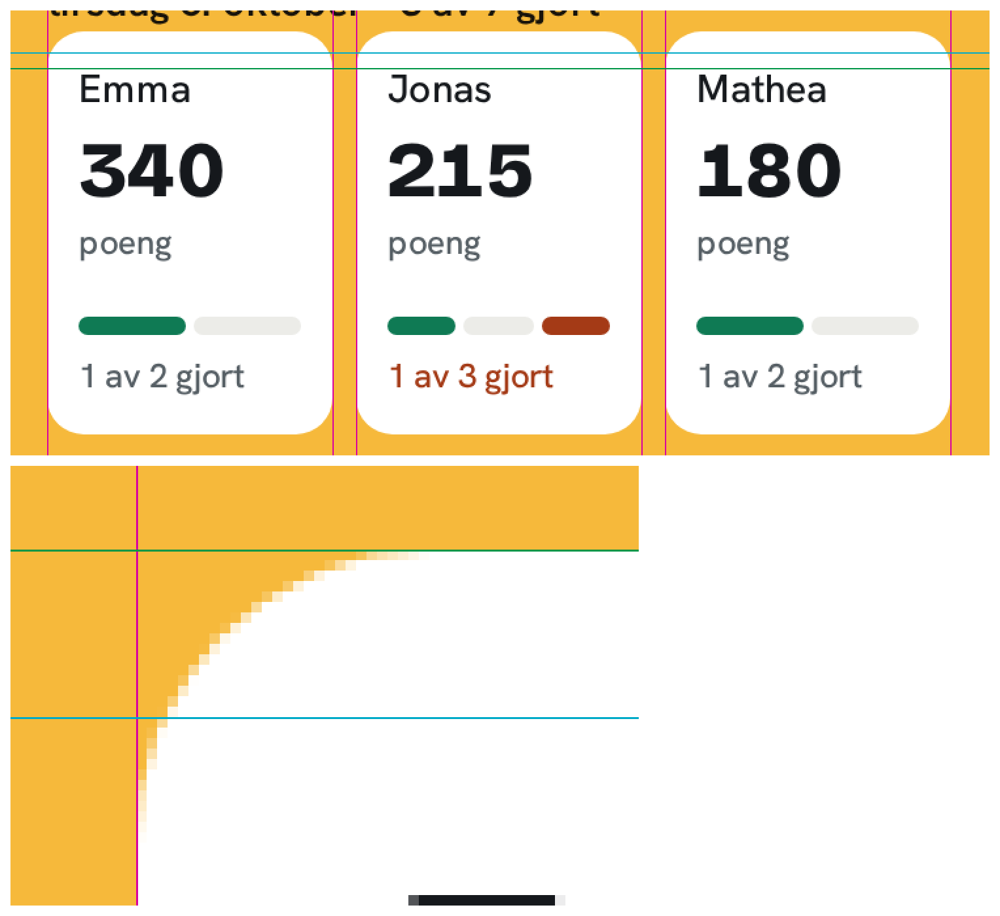

White runs across the card block, `brand-07`, css px at 390 × 844:

| css y         | distance from the nearest card edge    | white run        | w         | gap     |
| ------------- | -------------------------------------- | ---------------- | --------- | ------- |
| 106           | 2 px below the top — in the arc        | 28.7 … 124.3     | 95.5      | 22.5    |
| 112           | 8 px below the top — in the arc        | 23.4 … 129.6     | 106.3     | 11.7    |
| 115           | 11 px below the top — in the arc       | 22.4 … 130.6     | 108.3     | 9.7     |
| **118 … 244** | **14 px or more — clear of both arcs** | **21.9 … 131.1** | **109.1** | **8.9** |
| 250           | 8 px above the bottom — in the arc     | 23.5 … 129.6     | 106.1     | 11.9    |

A 14 px radius accounts for every one of those rows: the inset at 8 px from an edge is
`14 − √(14² − 6²)` = 1.35 px on each side, which turns 109 into 106.3. The two 8 px rows are not
quite equal — 106.3 at the top against 106.1 at the bottom — because a row index counts downward
from the top in both corners, so y 112 sits 8.25 px into its arc while y 250 sits 7.75 px into its:
half a pixel of depth, 0.2 px of width. The card block runs y 104 … 258 (**h 154**), and the
signed-off screen 1 gives 22.0 … 131.0 / 140.0 … 250.0 / 259.0 … 368.0 at the same 154 — the same
card.

**The last row of that table is the same error, caught a second time.** This table first ended its
full-width row at `118 … 250`, and Astrid's second review of PR #639 found it: y 250 is 8 px above
the bottom edge, the mirror of the y 112 reading the section is about, and it reads 106.1 / 11.9 —
not 109 / 9. (The _exact_ mirror of y 112 is y 249, not y 250; half a pixel deeper into the arc is
why 250 reads 106.1 where 112 reads 106.3.) A section whose rule is _never measure within one radius
of a corner_ had demonstrated it with a range that ended 6 px inside a corner. The band is one radius
in from each edge, and the edges are hard: a vertical profile through the middle of the card shows no
antialiased row at all, white from y 104.0 to y 258.0. With r = 14 that gives **y 118 … 244** — and
the pixels agree, with y 244 reading the same width as mid-height while y 245 is already 0.5 px
short.

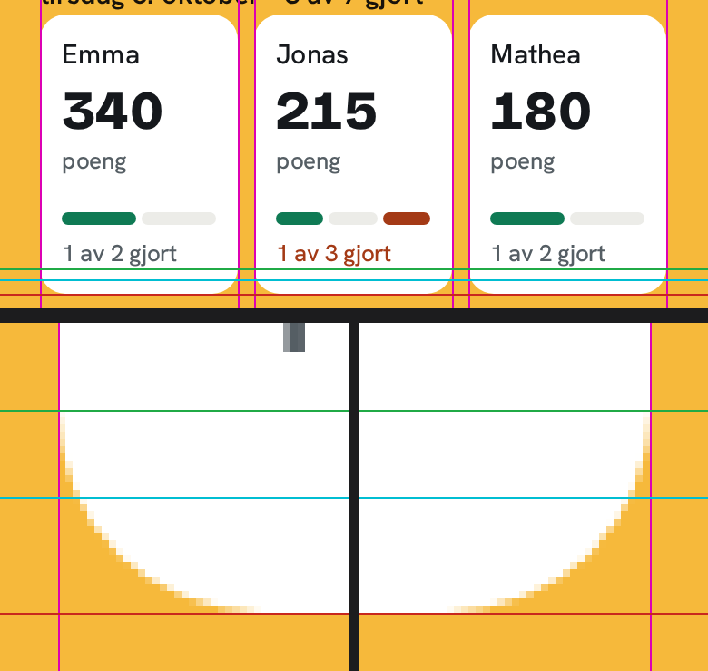

Green is y 244, the last row that still reaches the card's edges; cyan is y 250, visibly inside both
arcs; red is the bottom edge at y 258. The first picture in this section shows the same thing at the
top corner — and the table was wrong at the bottom for as long as only the top had a picture.

**The rule: measure a card at mid-height — y 181 on this card — and never within one radius of a
corner.** Not even at the lower bound of the band: row 244 sits a quarter of a pixel inside the arc,
and the width you read there moves with your edge threshold — half a pixel across 240 … 252 — rather
than with the card. Row 118 is the one of the two bounds that is genuinely clear: it sits 14.25 px
below the top edge and returns the identical run to mid-height at every threshold. Mid-height barely
moves at all, against half a pixel at the bounds. This is the same family of error as the 1.846
board-px scale slip recorded in revision 2: a method that quietly measures something other than what
it names. Nothing Eirik builds changes: the child cards were always **109 × 154 px, 9 px apart, in
the 22 px gutter**.

## The login screen (approved 2026-10-10)

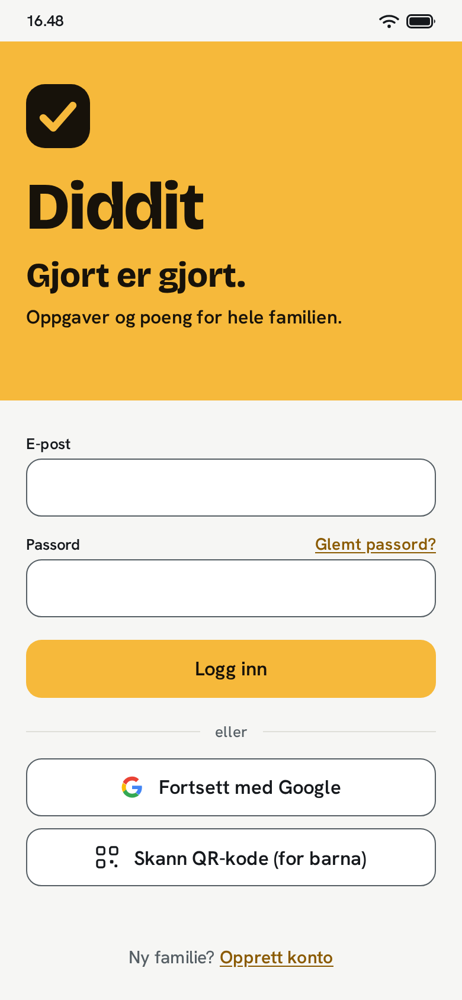

The first surface a family sees, and the only one that carries the mark. The signed-off picture
contains no login screen and no form field, so **everything in this section is an addition built
from the Poeng vocabulary** — same gutter, same 49 px control height, same 13 px radius, same
colours. Nothing here introduces a new colour.

### The shape of it

- **Phone (390 × 844):** a full-bleed `#F6B93B` brand area across the top, the form on paper below.
- **Desktop (1440 × 900):** the brand area becomes a **634 px yellow left panel**, full height, with
  the form in the right-hand paper area.
- **Gutter 22 px, column 346 px** on the phone — the ordinary one.

### The brand area, phone

Measured from `login-17-phone-empty.png`, css px at 390 × 844:

| Element                                | Style                                  | y             |
| -------------------------------------- | -------------------------------------- | ------------- |
| yellow area                            | `#F6B93B`, full-bleed                  | 35 … 338      |
| the mark                               | 54 × 54, x 22                          | 71 … 125      |
| "Diddit"                               | **Wordmark** — Bricolage 800, 56 px    | 152 … 194     |
| "Gjort er gjort."                      | **Brand claim** — Bricolage 800, 29 px | 220.5 … 248   |
| "Oppgaver og poeng for hele familien." | **Body** 16, Hanken 600                | 261.5 … 276.5 |

All four are Ink `#17120A` on the yellow (10.57:1). The claim is the only sentence in the product set
in the display face; it is the brand line, not a heading.

On the desktop panel the same four elements sit in the left panel, and three promises are added
below them, each an ink checkbox glyph with a line of Body 16: "Oppgavene fordeler seg selv",
"Poeng barna faktisk vil ha", "Belønninger dere blir enige om".

### The form

| Element                     | Component        | Spec                                                                        |
| --------------------------- | ---------------- | --------------------------------------------------------------------------- |
| Field label ("E-post")      | `field-label`    | **Label 13**, `#15181C`, **above** the field, on the gutter                 |
| Text field                  | `field-text`     | 346 × **49**, 13 px radius, white, **1.5 px `#555E64`** border, 18 px inset |
| Field value                 | —                | **Body 16**, `#15181C`                                                      |
| "Glemt passord?"            | `link-inline`    | **Meta 15**, `#8A5A00`, underlined, right-aligned on the Passord label line |
| "Logg inn"                  | `button-primary` | unchanged: 346 × 49, yellow, Ink label, Button label 16.5                   |
| "eller"                     | —                | **Meta sm 13**, `#555E64`, between two `#DFDFD9` rules                      |
| "Fortsett med Google"       | `button-outline` | 346 × 49, 13 px radius, white, 1.5 px `#555E64`, `#15181C` label, Body 16   |
| "Skann QR-kode (for barna)" | `button-outline` | the same                                                                    |
| "Ny familie? Opprett konto" | `link-inline`    | centred at the foot; "Opprett konto" is the link                            |

The field label stands **above** the field and stays there. There is no placeholder that vanishes
when you start typing, and no floating label. "Vis passord" (the eye) appears only once there is a
character to show.

Vertical rhythm, measured, empty state: label 370, field **387 … 436**, Passord label 455, field
**472 … 521**, "Logg inn" **540 … 589**, "eller" 613 … 622, Google **640 … 689**, QR **699 … 748**,
"Ny familie?" 802.5 … 816.

### The five states

All five are approved and all five are drawn. None of them introduces a colour.

| State                        | Picture                                                   | What it does                                                                                                                                                                                                                                      |
| ---------------------------- | --------------------------------------------------------- | ------------------------------------------------------------------------------------------------------------------------------------------------------------------------------------------------------------------------------------------------- |
| **Empty**                    | [`login-17`](reference/login-17-phone-empty.png)          | Labels above empty fields. **"Logg inn" is enabled from the start** — validation happens on press, so there is no greyed-out dead end.                                                                                                            |
| **Filled**                   | [`login-14`](reference/login-14-phone-filled.png)         | The same screen with values in it.                                                                                                                                                                                                                |
| **Typing, keyboard open**    | [`login-15`](reference/login-15-phone-focus-keyboard.png) | The brand area collapses — see below. The focused field carries the Ink focus ring.                                                                                                                                                               |
| **Wrong e-mail or password** | [`login-16`](reference/login-16-phone-error.png)          | **Both** fields get a 2 px `#A43A16` border, and one `#A43A16` line with a warning icon sits between the password field and the button: «Feil e-post eller passord. Prøv igjen.» Both fields, so the placement never reveals which one was wrong. |
| **Signing in**               | [`login-18`](reference/login-18-phone-signing-in.png)     | The button **keeps its yellow**, swaps its label to «Logger inn …» and gains an Ink ring. No dimming, no grey.                                                                                                                                    |

### The phone rule: the brand area shrinks so "Logg inn" stays above the keyboard

This is the one piece of behaviour in the login, and it exists because of a measurement:

- The brand area is **303 px**. With the iOS keyboard up (336 px of 844), the visible area ends at
  **y 508**. "Logg inn" sits at 540 … 588 — **completely covered**.
- So when any field takes focus, **the brand area collapses from 303 px to 112 px** and becomes the
  horizontal lockup (mark + wordmark on the same yellow). The form moves up 191 px:

| Element        | Keyboard up, band at 303 | Band at 112                  |
| -------------- | ------------------------ | ---------------------------- |
| Password field | 470 … 523 — half covered | **281 … 330 — visible**      |
| "Logg inn"     | 540 … 588 — covered      | **349 … 398 — 110 px clear** |

- The yellow is **not removed** — it changes format. Keep-The-Yellow Rule.
- With an error line showing as well, the button is pushed 29 px down and lands at ≈ 379 … 426,
  still 82 px above the keyboard edge. Do not invent a second rule for that case.
- "Skann QR-kode" and the foot link stay below the keyboard edge and are reached by scrolling. They
  are not the primary action, and 508 px is not enough for everything without shrinking something
  the signed-off picture fixes.
- The keyboard in the picture is the platform's own surface, not our palette. **The return key is
  drawn grey, not yellow** — an app can set that key's label but not its colour, and a yellow key in
  a drawing would promise the builder something the platform does not give.

## The Diddit mark (approved 2026-10-10)

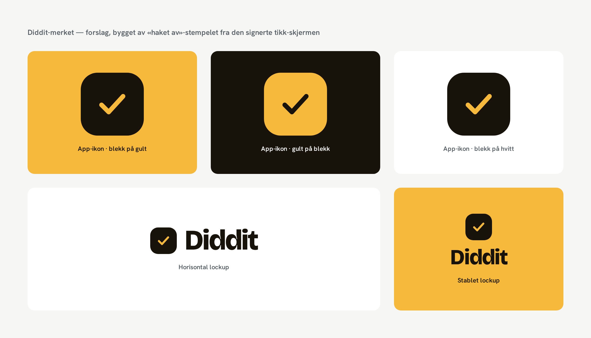

Before this, the product had no logo — the login set the word "Diddit!" in body type. The mark is
built from something already in the signed-off picture: the Ink rounded square with the yellow tick
from the tick-off moment. **No new shape and no new colour.**

### The glyph

- **54 × 54 px, 16 px radius** (`rounded.xl`) — the tick badge's geometry.
- Fill **Ink `#17120A`**, tick **Diddit Yellow `#F6B93B`** (10.57:1).
- The tick is centred in the square and spans x 11.5 … 42.5, y 15 … 40 of the 54.
- Exported, and reproducing the approved picture pixel for pixel:

| File                                                                   | Use                                                            |
| ---------------------------------------------------------------------- | -------------------------------------------------------------- |
| [`reference/diddit-mark.svg`](reference/diddit-mark.svg)               | the mark — ink square, yellow tick. The default everywhere.    |
| [`reference/diddit-mark-on-ink.svg`](reference/diddit-mark-on-ink.svg) | inverted — yellow square, ink tick. App icon on a dark ground. |

**Builder:** copy `diddit-mark.svg` to `apps/frontend/src/assets/diddit-mark.svg` and reference it
from there; `docs/` is documentation, not a build input. The file is a plain `rect` + `path` with no
`<text>`, so it needs no font. Its path is
`M14.5 28.5 L23 37 L39.5 18`, stroke `6.2`, round cap and join, in a `0 0 54 54` viewBox — scale the
whole viewBox, never the stroke on its own.

### The wordmark and the lockups

- The wordmark is **live text**, not a path: "Diddit" in Bricolage Grotesque 800 at the **Wordmark**
  size, `-0.02em`, in Ink. Setting it as text keeps it translatable, selectable and crisp; there is
  no wordmark SVG on purpose.
- **Horizontal lockup** — mark, then the wordmark on the same baseline. Used in the collapsed login
  brand area and on the desktop panel.
- **Stacked lockup** — mark above, wordmark below, both centred.
- **App icon** — the whole square is the icon: ink-on-yellow, yellow-on-ink, or ink-on-white.

### Rules for the mark

- **The square is never empty and the tick never leaves the square.** They are one glyph.
- **Only two colour pairs**: ink square + yellow tick, or yellow square + ink tick. Never white,
  never grey, never a third colour, never a gradient.
- **No outline, no shadow, no rotation.** It is flat, like everything else here.
- **Minimum drawn size 24 px**; below that the tick closes up. Clear space on all four sides is
  **one quarter of the mark's height** (13.5 px at 54).
- It carries the product name, so it needs `role="img"` and an accessible name ("Diddit"), or
  `aria-hidden` when the wordmark beside it already says the name.

### The mark is not the tick badge, and the brand sheet draws a third tick

Three ticks exist in the approved material, and they are measurably different. Measured as a
fraction of a 54 px square, excluding the corner arcs:

| Tick                                        | Width | Height | Ink area |
| ------------------------------------------- | ----- | ------ | -------- |
| Tick badge, signed-off tick screen          | 19.0  | 14.5   | 73       |
| App icon on the brand sheet (`brand-06`)    | 22.4  | 17.7   | 118      |
| **The mark on the login (`login-14`…`19`)** | 31.0  | 25.0   | 255      |

- **The mark is the login one**, and `diddit-mark.svg` matches it to within one sixteenth of a
  channel step per pixel. Five of the six approved pictures show it that way, and it is the one on
  the screen being built.
- **The tick badge keeps its own, smaller tick.** It is a UI element on a chore, not a logo. Do not
  "fix" either into the other.
- The brand sheet's app icon sits between the two. Read as a drawing slip; the mark file is right,
  and the sheet should be redrawn to match it the next time it is touched. **`brand-06` is approved
  material, so redrawing it needs Maria first** — it is not a free fix, and nothing in the build
  depends on it. Build from `diddit-mark.svg`, not from the sheet.

## Desktop and tablet — layout A (approved 2026-10-11)

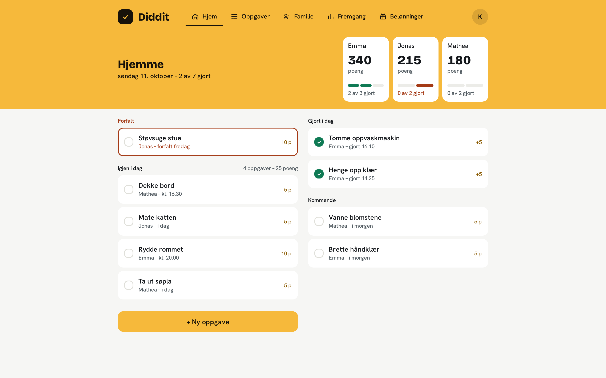

Everything above this point describes a 390 px phone. This section is the only part of the guide
that describes a pointer screen, and it covers **1024 px and wider**.

Stig approved **option A** on ST-890 on 2026-10-11, drawn by Ida on ST-879. The approved pictures,
and the only spec for this layout:

| Approved picture                                                                                               | What it is the spec for                   |
| -------------------------------------------------------------------------------------------------------------- | ----------------------------------------- |
| [`desktop-07-opsjon-A-1440.png`](reference/desktop-07-opsjon-A-1440.png)                                       | the family home at 1440 px                |
| [`desktop-10-anbefalt-A-1024.png`](reference/desktop-10-anbefalt-A-1024.png)                                   | the family home at 1024 px                |
| [`desktop-12-anbefalt-A-mine-oppgaver-1440.png`](reference/desktop-12-anbefalt-A-mine-oppgaver-1440.png)       | a child's "mine oppgaver" at 1440 px      |
| [`desktop-15-side-om-side-godkjent-vs-forslag.png`](reference/desktop-15-side-om-side-godkjent-vs-forslag.png) | A beside the signed-off phone, same scale |

[`desktop-14-anbefalt-A-verstefall-1440.png`](reference/desktop-14-anbefalt-A-verstefall-1440.png)
is the worst-case drawing from the same set. It was **not** on the decision card, so it ranks below
the four above — it is evidence for the overflow and empty-state rules below, not a signed picture.

**One thing in these pictures is out of date, and it is the only place this section departs from
them.** They were drawn before ST-890's menu decision, so they give the chosen tab a 3 px underline.
Maria ruled on 2026-10-12 (ST-892) that the phone's ink pill replaces it. Everything else in this
section is measured off the pictures as drawn.

**The old left sidebar is deleted.** Not hidden, not kept for wide screens: deleted. It is the thing
Stig called "shit", it carries December colours that are not in the Poeng look, and nothing in this
section replaces it.

**This section draws two pages: the family home and a child's chores.** The rules that cover the
other sixteen desktop pages were approved on 2026-10-18 and are in **Desktop: rules for all pages**,
with a picture of every page. On these two pages this section wins; everywhere else those 8 rules
are the spec.

### The frame

**Both widths draw the same band and the same tab row, to the pixel. Only the container's x offset
changes.** Everything in the table is measured off the approved PNGs at `deviceScaleFactor: 2`.

|                                                                  | 1440 px                          | 1024 px                        |
| ---------------------------------------------------------------- | -------------------------------- | ------------------------------ |
| Yellow band `#F6B93B`, **edge to edge**, no gutter and no radius | x 0…1440                         | x 0…1024                       |
| Band height, family home                                         | **259 px**                       | **259 px**                     |
| Band height, a child's chore screen                              | **270 px**                       | **270 px**                     |
| Content container                                                | **880 px**, centred → x 280…1160 | **880 px**, centred → x 72…952 |
| Left column                                                      | 428 px                           | 428 px                         |
| Gutter between columns                                           | **24 px**                        | **24 px**                      |
| Right column                                                     | 428 px                           | 428 px                         |
| Page background below the band                                   | `#F6F6F4`                        | `#F6F6F4`                      |

428 + 24 + 428 = 880. At 1024 the container leaves exactly 72 px at each side, which is the narrowest
the drawings go. **Below 1024 the phone layout takes over** — see the next section.

**The band has no fixed height here either.** It obeys the same rule as the phone band, from the
same token — `tokens.layout.brandBandPadBottom`: it ends **17 px under the lowest thing it carries**.
The child cards bottom out at y 242 and the band ends at 259; on the child screen the reward meter
bottoms out at 253 and the band ends at 270. Do not hard-code 259.

### The breakpoint: below 1024 px it is the phone (Maria, 2026-10-12)

**There is one breakpoint and it is at `tokens.layout.desktopMinWidth` — 1024 px.** At 1024 px and
wider, this section applies. **Below 1024 px the phone layout is used, in full**, not a squeezed
desktop:

- **The bottom menu comes back** — the four-item E6 menu with the yellow label (see **Navigation →
  The chosen item**).
  There is no tab row in the band below 1024.
- **One column**, not two. The chores run as a single stack in the phone's 22 px gutter.
- **The band stacks again**: title, sub-line, then the child cards on their own line, which is why
  the phone band is ~460 px tall and the desktop band is 259.
- "+ Ny oppgave" keeps its place in the flow under the chore stack.
- Nothing between 390 px and 1024 px is drawn. The phone layout simply gets wider: keep the 22 px
  gutter and let the single column grow. If that ever needs its own drawing, it is a new picture and
  a new sign-off, not a guess made in a build.

### The yellow top and its tab row

Everything in the band sits inside the 880 px container; the yellow itself runs past it to both
screen edges.

| Element                                   | Where, in CSS px from the top of the page                                                                          |
| ----------------------------------------- | ------------------------------------------------------------------------------------------------------------------ |
| Diddit mark                               | **36 × 36**, at the container's left edge, y 22…58                                                                 |
| "Diddit" wordmark                         | ink starts 13.5 px right of the mark, y 29.5…49.5                                                                  |
| Tab icons                                 | **18 px of artwork at y 31…49**, centred in a **21 px box** (box y 29.5…50.5) — the signed-off icon set, see below |
| Tab labels                                | Hanken **15 px / 500**, ink y 33.5…47.5, **16.5 px** right of their icon's box — see the pill note                 |
| Chosen tab's ink pill                     | **46 × 26 px `#17120A`**, fully rounded, centred on the icon box → y 27…53                                         |
| Initial badge                             | **38 px circle**, `#DBA434` fill, `#17120A` initial, right-aligned to the container's right edge, y 21…59          |
| Screen title ("Hjemme", "Jonas")          | ink 26.0 px tall, top at y 141.5                                                                                   |
| Sub-line under it                         | ink 14 px tall, top at y 175.5                                                                                     |
| Child cards (family home)                 | y 88…242                                                                                                           |
| Hero number + reward meter (child screen) | y 98…253                                                                                                           |

- **The tab row, the title and the child cards are three things on two lines**, not a stack. The
  title and the cards share one line: the title at the container's left edge, the cards flush to its
  right edge. On the phone these are stacked, and that is the whole reason this band is 259 px
  instead of ~460.
- **Tabs are `Hjem · Oppgaver · Familie · Fremgang · Belønninger`** — five, left to right, the first
  tab box starting **39.5 px** right of the wordmark's ink. They are not evenly pitched: each tab is
  as wide as its own content plus **15 px of padding on each side**, and the boxes sit about 3–4 px
  apart.
- **That is five tabs in a different order from the phone's four.** The bottom bar is
  `Hjem · Oppgaver · Belønninger · Familie`; the tab row is
  `Hjem · Oppgaver · Familie · Fremgang · Belønninger`, and it adds **Fremgang**, which has no place
  on the phone bar. Both are as drawn in their own approved pictures. Do not normalise one to the
  other.
- **The chosen tab carries the phone's ink pill** — see **The chosen tab is the ink pill** below for
  the geometry and for the gap it forces between every icon and its label.
- **The tab icons use the signed-off icon set: 18 px of ink in a 21 px box** (Maria, 2026-10-12).
  The three desktop pictures are built on `brand-07`, so their tab icons draw the small set
  Revision 6 recorded: ink **15.0 × 14.0** for the house, 15.0 × 11.0 list, 12.0 × 14.0 familie,
  13.0 × 13.0 fremgang, 16.0 × 14.5 gift — against the signed-off bar's 18.0 × 18.0 house. Those
  glyphs are a drawing slip inherited from `brand-07`, not a desktop decision: build the tab row with
  the **signed-off set**, at the same 18 px ink in the same 21 px box the bottom bar uses.
- **Fremgang is not on the phone's four-item bar, but its glyph already exists** — `progress` in
  `apps/frontend/src/app/components/navigation/nav-icon.html`, in the same 21-unit viewBox at the
  same 1.5 stroke as the other four. Its ink measures **18.0 × 14.5**, in line with them. Use it; do
  not draw a sixth icon. It is the one glyph the signed-off picture does not draw, so ST-898 only
  re-expressed it at 21 units — same drawing, same rendered size, the set's one line weight.
- **The 18 px is the slot, not every glyph's ink — and these are the render's numbers, read one
  stated way.** Ink in CSS px, w × h, of each glyph in its 21 px slot on the band's `#F6B93B`, at
  **half coverage**: each pixel's colour projected onto the band's background→ink vector, counted
  from coverage 0.5, edges taken at pixel boundaries, DPR 2. **House 18.0 × 18.0, gift
  18.0 × 17.5**, familie 17.0 × 15.0, fremgang 18.0 × 14.5, list 17.0 × 12.0. **The house and the
  gift fill the slot; the other three do not.** A screenshot of «Oppgaver» showing a 12 px glyph is
  the right icon in the right box — check the **slot**, by the house or the gift, not each glyph's
  own height.
  (These are the **current** artwork's numbers. The row was first read off the band in
  [`desktop-20`](reference/desktop-20-tabrow-pill-vs-underline.png), which was rendered before
  ST-898 redrew the set and still shows the old glyphs — familie 19.0 × 16.5, list 17.5 × 13.5.
  Re-run on `origin/main` the method reproduces those two exactly and leaves house, gift and
  fremgang unchanged, so what moved is the drawing, not the convention. `desktop-20` stays as the
  evidence for the **pill**, which is what it was drawn to decide.)
- **Why these are not the four numbers under `### Navigation`, and why neither set is stale.** That
  table is the same artwork measured in the **signed-off picture** at **luminance below 220** —
  RULE-CHECK **Revision 6** holds the method and all eight readings. That cut cannot be run on this
  band: `#F6B93B` is itself luminance **188.9** (163 on a flat mean), under 220 either way, so the
  background would read as ink. Coverage does not care what the background is, which is why the band
  is measured that way. Read against Revision 6's **ranges** instead of its modal column, the two
  agree to the antialiased edge that method note already describes: the picture gives list
  17.0–18.0 × 12.0–13.0 and gift 18.0–19.0 × 17.0–17.5, half a pixel under the band's read.
  **The picture's table is for the phone bar, this one for the band. Quote the convention with the
  number, or they look like two answers.** Since ST-898 the list and familie rows agree exactly,
  and since its round 2 the gift does too — it read half a pixel taller on the band until the
  body's bottom line moved onto the picture's, and the coverage method now gives 18.0 × 17.5 there
  as well. The house is the one row still read against the picture's **chosen-state** glyph; see
  the note under `### Navigation`.
- **The familie gap is closed (ST-898, Maria's decision 2026-10-12).** The guide used to record
  here that the shipped `family` glyph rendered ≈19.3 × 16.3 against the picture's 17.0 × 15.0 — a
  narrower drawing in the picture, recorded and not changed. Measuring the other three turned it
  into a larger finding: three of the four were different drawings and the whole bar was ~17 %
  heavier. Maria chose to bring the code to the picture. The set is now drawn to it on every item;
  RULE-CHECK **Revision 10** holds the readings and what each drawing changed.
- **Everything in the band is `#17120A` on `#F6B93B` — 10.57:1.** Title, sub-line, every tab label,
  every unchosen tab icon, the chosen tab's pill and the initial on the badge. **The one thing in the
  band that is not ink is the chosen tab's icon**, which turns `#F6B93B` inside its ink pill. The
  sub-line keeps the band's Ink-On-Yellow cost: no grey on the yellow, hierarchy by size and weight
  alone. Same rule, same reason as the phone band.

### The chosen tab is the ink pill (Maria, 2026-10-12)

**The desktop tabs take the same chosen-state as the phone: the ink pill.** ST-890's decision says
"the desktop tabs get the same rule you pick here", and Stig picked A. The three desktop pictures
were drawn **before** that menu decision, so the 3 px underline they show is a placeholder, not an
approved look — **the pill replaces it.** Maria ruled on this on 2026-10-12 after the conflict was
raised on ST-892. The underline is deleted; do not bring it back.

- **A `#17120A` pill behind the chosen icon: 46 × 26 px, fully rounded**, the same token values as
  `nav-item-active`. **Centred on the 21 px icon box**, which puts it at **y 27…53** — the box runs
  y 29.5…50.5 and its 18 px of artwork **y 31…49**, so the pill clears the artwork by **4 px over and
  under**, exactly as it does on the phone. **Centre the pill and the box on the same line (y 40).**
  In [`desktop-20`](reference/desktop-20-tabrow-pill-vs-underline.png) the box landed on y 30…51
  instead, so the glyphs measure y 31.5…49.5 there — half a pixel low, a slip in that render and not
  a second slot.
- **The icon inside it turns `#F6B93B`.** Every unchosen icon stays `#17120A`.
- **The chosen label is `#17120A` and one weight step heavier: Hanken Grotesk 600 against the row's
  500, both at 15 px.** Maria asked for "ink and bold"; this is what bold is here, and it is not an
  invention — **it is exactly what the approved pictures already draw.** Rendered at 15 px and
  compared with `desktop-07` by ink area, Hanken 500 reproduces all four unchosen labels to **0.0 %**
  (Oppgaver 876, Familie 654, Fremgang 912, Belønninger 1092 device px², identical in both) and
  Hanken 600 reproduces the chosen «Hjem» to **0.0 %** (518). `desktop-12`, where Oppgaver is the
  chosen one, carries the same step: +9.0 % over its own picture's baseline. **Do not ship 700 or
  800** — that is heavier than anything Stig has approved.
  Here the desktop differs from the phone on purpose: the phone's chosen label keeps its weight
  (measured 0.1 % apart — see **The chosen item** under Navigation), because there the colour change
  from `#555E64` to ink does the work. In the band every label is already ink, so colour carries
  nothing and the weight step is what is left.
- **The pill is never the only signal and never the target.** It is a shape, so the state survives
  greyscale; the heavier label sits beside it; and the pressable area is the whole tab box, not the
  46 × 26 pill. **One weight step is not enough on its own** — between the two approved pictures the
  _same unchosen_ label moves by up to 6.4 % from rendering alone, so a 9–11 % step is only a little
  above the noise. It supports the pill; it cannot replace it.

**The pill forces a gap the drawings do not have, and this is the one measured consequence of the
decision.** On the phone the label sits _under_ the pill. In the band it sits _beside_ it, and a
46 px pill around a 21 px icon box reaches **12.5 px past the box on each side** — while the
drawings place the label ink only **10.5 px** right of the icon ink, about 9 px from the box edge.
Drawn as-is, the pill would run 3.5 px under the start of «Hjem».

- **Set the gap from the icon box's right edge to the label ink at 16.5 px** — the pill's 12.5 px
  plus the same 4 px of clearance it keeps vertically.
- **The gap is the same on all five tabs, chosen or not.** A gap that changed with the state would
  reflow the whole row every time you changed page.
- **It fits at 1024, and these numbers are rendered, not calculated.** The row was built at 1024 px
  (DPR 2) with the pill, the signed-off icon set and the repo's own Hanken, then measured — see
  [`desktop-20-tabrow-pill-vs-underline.png`](reference/desktop-20-tabrow-pill-vs-underline.png),
  which puts the approved row and the rendered one in one image at the same scale. **The render
  reproduces all five label ink widths exactly** — 32.5 / 65.5 / 44.5 / 64.5 / 77.5, the drawn
  values to the pixel — so the row width below is the real one, not an estimate.

  |                            | Measured on the render                                              |
  | -------------------------- | ------------------------------------------------------------------- |
  | First tab box starts       | **x 232.5** (wordmark ink ends 193, box 39.5 px after it, as drawn) |
  | Row ends                   | **x 877** — **644.5 px** wide                                       |
  | Tab box widths             | **102.5 / 134.5 / 113.5 / 133.5 / 146.5 px**, 3.5 px apart          |
  | Badge                      | x 914…952                                                           |
  | **Clearance, row → badge** | **37.0 px**                                                         |
  | Pill                       | x 235…281, y 27…53; the label starts **4.0 px** after it            |

  **Do not derive this from the label ink widths.** Summing the drawn ink gives a 636 px row and
  45.5 px of clearance — wrong by 8 px, because a text box is wider than its ink by its side
  bearings. Use the rendered box widths.

- **Those 37 px are the whole budget, and a wider screen does not help.** The band is identical at
  1024 and 1440 — the container moves and the row and the badge move with it, 208 px to the right at
  1440, so the gap between them is 37.0 px at both widths and there is no width that buys more.
  The row is ~64 px wider than anything that has been drawn (7.5 px per tab from the gap, the rest
  from the bigger icon set), so a build must measure it rather than assume it: a translated label, a
  different font fallback, or a user's larger
  text setting all spend the same 37 px. (The `en` locale is not the risk — «Belønninger» →
  "Rewards" and «Oppgaver» → "Tasks" both shrink the row.) **If the row would reach the badge,
  stop** — shortening a label, dropping the labels to icons alone or wrapping the row are all changes
  to an approved look, so they need a picture and a fresh sign-off through Maria, not a decision made
  in the build.
- **The tab label is Hanken Grotesk at 15 px — 500 unchosen, 600 chosen.** The band table gave only
  an ink height. Rendered at 14 / 15 / 16 / 17 px and compared with the approved pictures by ink
  width _and_ ink area, 15 px at weight 500 reproduces every unchosen label exactly; 14 px is
  1.5–4.5 px narrow and 16 px is 3–7.5 px wide.
- **The tab's pointer target is at least 44 px tall** (Maria, 2026-10-12). The drawn shape does not
  change — only the hit area grows. Centred on the pill, 44 px runs **y 18…62**, which the 259 px
  band has room for; the title's ink does not start until y 141.5. The target's width is the tab box,
  padding included — **102.5 px** for «Hjem», the narrowest of the five — and the 3.5 px between
  boxes keeps two neighbouring targets from overlapping.

### Below the band

Two columns, each a plain stack of the cards and group labels the phone already has, at the sizes
the phone already uses.

|                                       | Measured                                                           |
| ------------------------------------- | ------------------------------------------------------------------ |
| Band bottom → first group label's ink | 23.5 px                                                            |
| First card top                        | y 304                                                              |
| Chore row                             | **68 px**                                                          |
| Between cards                         | **8 px**                                                           |
| Card → the next group label's ink     | 23.5 px                                                            |
| Group label → the card under it       | 9 px                                                               |
| Last card → "+ Ny oppgave"            | 28 px                                                              |
| "+ Ny oppgave"                        | **428 × 49 px**, `#F6B93B` fill, `#17120A` label, **13 px radius** |

- **Left column: "left today".** Group labels `Forfalt` / `Igjen i dag`, then the overdue card and
  the chore rows, then **"+ Ny oppgave" under the column** — it is a block in the flow, not a pinned
  bar and not a floating button. This button replaces the one that used to live in the sidebar.
- **Right column: "done today" and what is coming.** Group labels `Gjort i dag` / `Kommende`.
- **The two columns are independent stacks.** They start at the same y and run to whatever length
  they need; nothing balances or equalises them. In the worst-case drawing the left column is three
  times the right.
- **A child's chore screen uses the same two columns**: `Forfalt` / `I dag` on the left with a
  **70 × 36 px** "Ferdig" button in each row, `Gjort i dag` / `I morgen` on the right.
- **Child desktop screen: no Påminnelser card or week block (picture 12).** The phone keeps both
  (Maria, ST-902).
- **The child tab row shows the child's own pages (today Hjem, Belønninger); picture 12's five tabs
  are the parent set.**

### Nothing inside a card changes

This is the point of A over the other two options, and it is measurable. Every one of these is the
signed-off phone value, re-measured on the desktop pictures:

|                             | Signed-off phone                  | Desktop A, 1440 and 1024     |
| --------------------------- | --------------------------------- | ---------------------------- |
| Chore row height            | 68 px                             | **68 px**                    |
| Chore card radius (arc fit) | 13.12                             | **13.12** at both widths     |
| Child card                  | 109 × 154 px, 9 px apart          | **109 × 154 px, 9 px apart** |
| Child card radius (arc fit) | 14.21                             | **14.18** at both widths     |
| Card padding                | 15 px                             | **15 px**                    |
| Checkbox                    | 22 × 22 px                        | **22 × 22 px**               |
| Initial badge               | 38 px circle                      | **38 px circle**             |
| Primary button height       | 49 px                             | **49 px**                    |
| Title ink height            | 26.0 px                           | **26.0 px**                  |
| Chore title / meta / points | `#15181C` / `#555E64` / `#8A5A00` | **the same three**           |
| Overdue card                | white, 2 px `#A43A16`             | **white, 2 px `#A43A16`**    |
| Group label "Forfalt"       | `#A43A16`                         | **`#A43A16`**                |

The radii are fitted with the same sub-pixel arc method described under **Shapes**, and the fit
returns 13.12 on the signed-off card too — so "the same" here means the same to a hundredth of a px,
not "looks similar".

### The child cards when there are not three children

The phone rule is that the cards **fill the row** (1 child is one full-width card, 2 are half each,
4 are 2 + 2). **Desktop does not do that**, because the cards share their line with the screen
title and have only the right-hand part of the container to live in:

- **The card stays 109 × 154 px with 9 px gaps, right-aligned to the container's right edge**, for
  any number of children. Three cards occupy 345 px of the 880.
- **At most four children are shown**, and a fifth tile reading "**+N barn til**" takes the overflow.
  `desktop-14` draws a six-child household as four cards plus "+2 barn til" — five tiles, 581 px.
  This comes from the worst-case drawing, not from the decision card.

### Empty and worst-case states

- **An empty column gets a white card, not an empty gap.** `desktop-14` draws
  "Ingen oppgaver er haket av i dag" with "Når noen haker av en oppgave, dukker den opp her."
  underneath, in a **70 px** white card in the column's own width. That card's content, and the
  loading and error states beside it, are now rule 7 — one title line, one sentence, a main button
  if there is something to do, and grey placeholder rows while loading. The 70 px is one measured
  card, not a height to build to. See **Desktop: rules for all pages**.
- **The sub-line under the screen title wraps** rather than truncating
  ("søndag 11. oktober – 0 av 12 gjort, 2 forfalt" runs to two lines), and the band grows with it.
- **Known slip in `desktop-14`, do not copy it.** The long chore title
  «Rydde og støvsuge hele kjelleren, inkluder…» is drawn truncated on **one** line in a 68 px row.
  The rule under **Cards and rows** — wrap to at most two lines, then «…» — is older, comes from the
  signed-off picture, and wins. A child has to be able to read the whole chore.

### What A changes from the signed-off phone picture

Six things, each one listed on the decision card and approved. Nothing else moves.

| Change                                        | Why                                                      |
| --------------------------------------------- | -------------------------------------------------------- |
| The menu becomes tabs in the yellow top       | there is no bottom bar on a pointer screen               |
| The Diddit mark and wordmark appear, top left | a desktop header needs the brand; the phone has none     |
| Chores run in two 428 px columns              | otherwise a chore row is 880 px wide for a 16 px title   |
| Title and child cards share one line          | keeps the band at 259 px instead of ~460                 |
| "+ Ny oppgave" sits under the left column     | it replaces the button that lived in the deleted sidebar |
| The band runs edge to edge from y 0           | there is no 35 px status bar to sit under                |

### Not included: dark mode

**There is no dark mode.** `11-anbefalt-A-morkt-1440.png` and `nav-05-a-morkt.png` were drawn on
ST-879 and ST-878, Stig did not ask for a dark mode, neither picture was put on the decision card,
and neither was approved. The app is light mode only, as everywhere else in this guide. Building one
is a change to the look and goes to Maria.

### Four things the drawings left open — all settled (Maria, 2026-10-12)

Raised on ST-892 against the approved pictures, and decided by Maria the same day. They are recorded
here because a reader comparing the guide with the pictures will see the difference and needs to know
it was ruled on, not drifted into.

| Open question                                                                     | Decision                                                                                                   | Where it is written                |
| --------------------------------------------------------------------------------- | ---------------------------------------------------------------------------------------------------------- | ---------------------------------- |
| Do the desktop tabs get the phone's ink pill, or the underline the pictures draw? | **The pill.** The desktop pictures predate ST-890's menu decision, so their underline is a placeholder.    | **The chosen tab is the ink pill** |
| Where does desktop turn back into the phone layout?                               | **Below 1024 px: the phone layout, bottom menu and one column.**                                           | **The breakpoint**                 |
| How tall is the desktop tab's pointer target?                                     | **At least 44 px**, as everywhere else in this guide. The drawn shape does not change; the hit area grows. | **The chosen tab is the ink pill** |
| Which icon set does the tab row use?                                              | **The signed-off set** — 18 px of ink in a 21 px box, by Revision 6's reasoning for the bar.               | **The yellow top and its tab row** |

**Nothing is left undrawn.** The one gap this list expected — a Fremgang glyph, since the phone's bar
has four items and the tab row needs five — turned out not to be a gap: `progress` is already in the
repo's signed-off icon set, in the same viewBox at the same stroke, and sits in the same 18 px slot
in the 21 px box (its own ink 18.0 × 14.5). See **The yellow top and its tab row**.

## Desktop: rules for all pages (≥ 1024 px) (approved 2026-10-18)

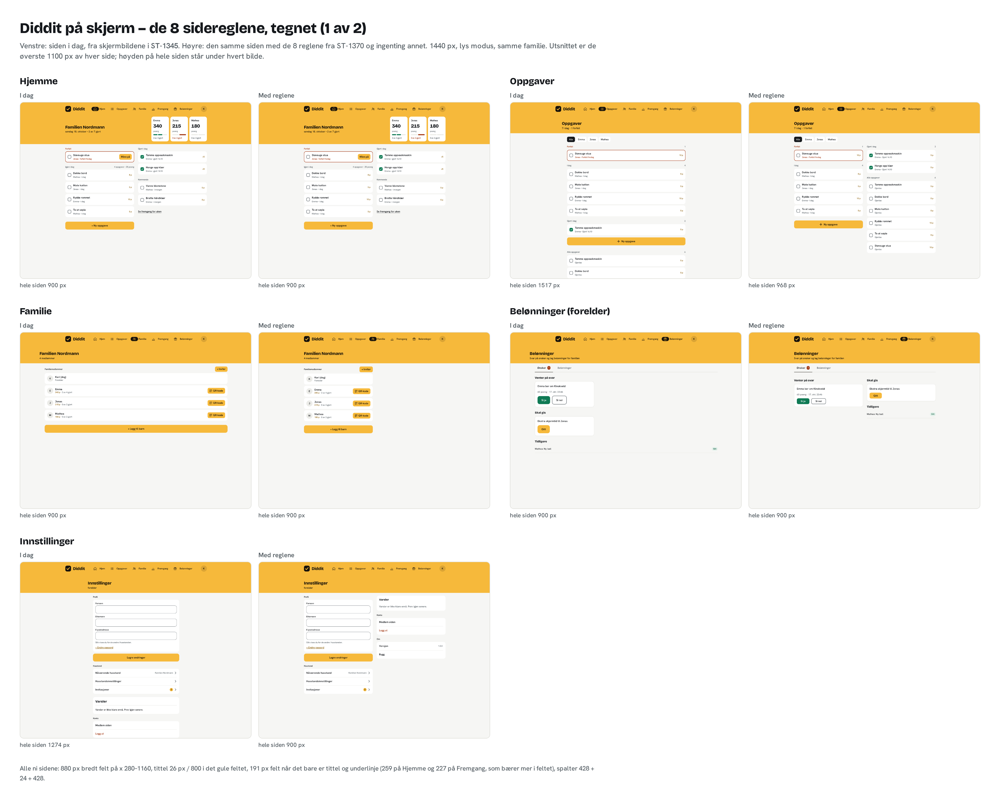

**The 18 pictures listed below are the spec for this section.** Stig approved these 8 rules together
with them on ST-1370 on 2026-10-18 ("Approved. Thank you."), drawn by Ida on ST-1409 and ST-1410 and
checked by Astrid. Where the words below and a picture disagree, the picture wins.

**Layout A above describes two pages** — the family home and a child's chores. It was the only
desktop drawing there was, and the other sixteen pages drifted: across the 18 pages, 9 different
content widths between 400 and 1200 px, 8 pages whose left edge missed the Diddit mark, 4 pages with
no title in the band, 6 band heights, 7 title sizes and weights, 9 corner sizes, button heights from
33 to 78 px, one button 1136 px wide, two pages in English, and emoji used as icons. The measurements
are in Ida's review on ST-1345. These 8 rules close that gap. **They apply to every page at 1024 px
and wider, drawn or undrawn** — layout A still wins on the two pages it draws. Three pages turned out
to pass all eight already and are in the set to show that the rules let them stand: «Logg inn»,
«Opprett konto» and «Mine oppgaver».

**Three things this step does not do**, so nobody reads them out of it:

- **It does not cover popups.** The popup rules are step 2 (ST-1430, approved on ST-1482 on
  2026-10-18) and live under **Popups** below, in **Desktop: rules for all popups**. Nothing in
  these 8 page rules reaches into a popup, and nothing in those 8 popup rules reaches onto a page.
- **It does not fix single pages.** The pink «Administrator» chip, the faded expired invitation card,
  where «+ Ny husholdning» sits, and what the band shows before a child's name has loaded are all
  step 3, each with its own decision.
- **It changes nothing on the phone.** Every rule here is scoped to 1024 px and wider. Below 1024 px
  the phone layout takes over in full — see **The breakpoint**.

### The 8 rules

The numbers are the decision card's own, and they are quoted in the build task and in review
findings — **do not renumber them**.

| #     | Rule                                                                                                                                                                                                                                                            | Where you see it                                                                                                                                                                                                                               |
| ----- | --------------------------------------------------------------------------------------------------------------------------------------------------------------------------------------------------------------------------------------------------------------- | ---------------------------------------------------------------------------------------------------------------------------------------------------------------------------------------------------------------------------------------------- |
| **1** | **Page width.** Every page is 880 px wide and centred. It does not grow or shrink with the window. Its left edge is the same as the left edge of the Diddit mark in the menu.                                                                                   | [`desktop-rules-familie-1440.png`](reference/desktop-rules-familie-1440.png) — 1200 px at x 120 became 880 at x 280                                                                                                                            |
| **2** | **Yellow title row.** Every page has its title and one short sub-line in the yellow band, at the left edge (for example «Familie» / «4 medlemmer»). The band ends 17 px under the lowest item in it. With only a title and a sub-line, the band is 191 px tall. | [`desktop-rules-husholdninger-1440.png`](reference/desktop-rules-husholdninger-1440.png) — the page had no yellow anywhere; now a 191 px band                                                                                                  |
| **3** | **Page title.** One style: 26 px Bricolage, extra bold (800), dark ink `#17120A`, left-aligned. Only «Logg inn» and «Opprett konto» keep their larger 34 px title.                                                                                              | [`desktop-rules-sett-nytt-passord-1440.png`](reference/desktop-rules-sett-nytt-passord-1440.png) — 24 px / 600 centred became 26 / 800 left; the exception is [`desktop-rules-logg-inn-1440.png`](reference/desktop-rules-logg-inn-1440.png)   |
| **4** | **Content under the band.** Two columns of 428 px with 24 px between them when the page has groups. One 428 px column for a form or a short list. The full 880 px only for a card that needs the width.                                                         | [`desktop-rules-fremgang-1440.png`](reference/desktop-rules-fremgang-1440.png) — two columns; [`desktop-rules-ny-husstand-1440.png`](reference/desktop-rules-ny-husstand-1440.png) — one 428 px form                                           |
| **5** | **Four button types only.** Main button: 49 px tall, 13 px corners, 16.5 px label, as wide as its column. Outline button: the same size. Row button: 36 px tall, 10 px corners. Chip: 9 px corners. Other buttons fit their label. No other corner sizes.       | [`desktop-rules-husholdningsinnstillinger-1440.png`](reference/desktop-rules-husholdningsinnstillinger-1440.png) — heights 36–65 and radii 4/6/8 became 36/10 and 49/13                                                                        |
| **6** | **The main button is never pale.** It stays yellow with dark text. The form is checked when you press it, and the error shows under the field. Same as the login page today.                                                                                    | [`desktop-rules-barnas-innlogging-1440.png`](reference/desktop-rules-barnas-innlogging-1440.png) — «🚀 Logg inn» was pale grey at 3.48:1 before you typed                                                                                      |
| **7** | **One card for empty, loading and error.** A white card in the page width: one title line, one sentence, and a main button if there is something to do. While loading, it shows grey placeholder rows, not a sentence.                                          | [`desktop-rules-mine-oppgaver-barn-laster-1440.png`](reference/desktop-rules-mine-oppgaver-barn-laster-1440.png) and [`desktop-rules-belonninger-laster-1440.png`](reference/desktop-rules-belonninger-laster-1440.png) — the placeholder rows |
| **8** | **Norwegian text and Diddit icons.** All text is Norwegian. No emoji as icons.                                                                                                                                                                                  | [`desktop-rules-glemt-passord-1440.png`](reference/desktop-rules-glemt-passord-1440.png) — the whole page was English; [`desktop-rules-husholdninger-1440.png`](reference/desktop-rules-husholdninger-1440.png) — 👥 👶 🏠 are gone            |

### The pictures

Each pair is **the page today on the left and the same page with the 8 rules on the right**, nothing
else changed, same fictional family throughout, 1440 px, light mode, `deviceScaleFactor: 2`. The four
overview sheets are the pairs; the per-page files are the right-hand half at full size.

| Sheet                                                                                            | Pages                                                                   |
| ------------------------------------------------------------------------------------------------ | ----------------------------------------------------------------------- |
| [`desktop-rules-overview-parent-1.png`](reference/desktop-rules-overview-parent-1.png)           | Hjemme, Oppgaver, Familie, Belønninger, Innstillinger                   |
| [`desktop-rules-overview-parent-2.png`](reference/desktop-rules-overview-parent-2.png)           | Fremgang, Husholdninger, Husholdningsinnstillinger, Invitasjoner        |
| [`desktop-rules-overview-child-setup-1.png`](reference/desktop-rules-overview-child-setup-1.png) | Mine oppgaver, Belønninger (barn), Ny husstand, Logg inn, Opprett konto |
| [`desktop-rules-overview-child-setup-2.png`](reference/desktop-rules-overview-child-setup-2.png) | Barnas innlogging, Glemt passord, Sett nytt passord, Invitasjon         |

The 18 pages, and the two loading states rule 7 needs:

| Page                      | Picture                                                                                                          | Page                   | Picture                                                                                                          |
| ------------------------- | ---------------------------------------------------------------------------------------------------------------- | ---------------------- | ---------------------------------------------------------------------------------------------------------------- |
| Hjemme                    | [`desktop-rules-hjemme-1440.png`](reference/desktop-rules-hjemme-1440.png)                                       | Mine oppgaver (barn)   | [`desktop-rules-mine-oppgaver-barn-1440.png`](reference/desktop-rules-mine-oppgaver-barn-1440.png)               |
| Oppgaver                  | [`desktop-rules-oppgaver-1440.png`](reference/desktop-rules-oppgaver-1440.png)                                   | Belønninger (barn)     | [`desktop-rules-belonninger-barn-1440.png`](reference/desktop-rules-belonninger-barn-1440.png)                   |
| Familie                   | [`desktop-rules-familie-1440.png`](reference/desktop-rules-familie-1440.png)                                     | Ny husstand            | [`desktop-rules-ny-husstand-1440.png`](reference/desktop-rules-ny-husstand-1440.png)                             |
| Belønninger               | [`desktop-rules-belonninger-1440.png`](reference/desktop-rules-belonninger-1440.png)                             | Logg inn               | [`desktop-rules-logg-inn-1440.png`](reference/desktop-rules-logg-inn-1440.png)                                   |
| Belønninger, loading      | [`desktop-rules-belonninger-laster-1440.png`](reference/desktop-rules-belonninger-laster-1440.png)               | Opprett konto          | [`desktop-rules-opprett-konto-1440.png`](reference/desktop-rules-opprett-konto-1440.png)                         |
| Innstillinger             | [`desktop-rules-innstillinger-1440.png`](reference/desktop-rules-innstillinger-1440.png)                         | Barnas innlogging      | [`desktop-rules-barnas-innlogging-1440.png`](reference/desktop-rules-barnas-innlogging-1440.png)                 |
| Fremgang                  | [`desktop-rules-fremgang-1440.png`](reference/desktop-rules-fremgang-1440.png)                                   | Glemt passord          | [`desktop-rules-glemt-passord-1440.png`](reference/desktop-rules-glemt-passord-1440.png)                         |
| Husholdninger             | [`desktop-rules-husholdninger-1440.png`](reference/desktop-rules-husholdninger-1440.png)                         | Sett nytt passord      | [`desktop-rules-sett-nytt-passord-1440.png`](reference/desktop-rules-sett-nytt-passord-1440.png)                 |
| Husholdningsinnstillinger | [`desktop-rules-husholdningsinnstillinger-1440.png`](reference/desktop-rules-husholdningsinnstillinger-1440.png) | Invitasjon             | [`desktop-rules-invitasjon-1440.png`](reference/desktop-rules-invitasjon-1440.png)                               |
| Invitasjoner              | [`desktop-rules-invitasjoner-1440.png`](reference/desktop-rules-invitasjoner-1440.png)                           | Mine oppgaver, loading | [`desktop-rules-mine-oppgaver-barn-laster-1440.png`](reference/desktop-rules-mine-oppgaver-barn-laster-1440.png) |

**All 18 are drawn at 1440 px only.** Rules 1 and 2 are width-independent — at 1024 px the same
880 px page sits at x 72…952, exactly as **The frame** already says — but no picture shows it, so
1024 px is checked live rather than against a file.

### The numbers behind rules 1 and 2, measured on the files

Read off the 18 PNGs (DPR 2, css px): the band is the topmost run of `#F6B93B` at the window's left
edge; the content edges are the first and last column under the band that is not the paper `#F6F6F4`.

| Band ends at | Pages                                                                                                                                                                               | Why                                         |
| ------------ | ----------------------------------------------------------------------------------------------------------------------------------------------------------------------------------- | ------------------------------------------- |
| **191 px**   | Oppgaver, Familie, Belønninger, Innstillinger, Husholdninger, Husholdningsinnstillinger, Invitasjoner, Ny husstand, Barnas innlogging, Glemt passord, Sett nytt passord, Invitasjon | title + sub-line only — rule 2's own number |
| 227 px       | Fremgang                                                                                                                                                                            | the three stat figures are the lowest item  |
| 259 px       | Hjemme                                                                                                                                                                              | the child cards are the lowest item         |
| 270 px       | Mine oppgaver (barn)                                                                                                                                                                | the hero number and the reward meter        |
| 282 px       | Belønninger (barn)                                                                                                                                                                  | the points total under the sub-line         |

- **Content x 280…1160 (880 px)** on every two-column page and **x 280…708 (428 px)** on every
  one-column page. **x 280 on all sixteen** — the Diddit mark's own left edge, which is rule 1.
  «Logg inn» and «Opprett konto» are the two that do not have a band or an 880 px page: their form
  column measures 382 px at x 846, the login picture's own frame, untouched. (The rows that read
  380 px at x 847 are the field's rounded corner, not the column.)
- **The 191 px is the 20 px rule, not a new number.** The band's general bottom padding is 17 px
  (`layout.brandBandPadBottom`), but when the sub-line is the lowest thing in the band, **The Air
  Under The Sub-Line** gives it 20 px — see that section and the "No children yet" row under
  **What must not break**. 191 is what those 20 px produce under a 26 px title and a 15 px sub-line.
  A build that applies 17 px there lands on 188 and is wrong.
- **Rule 3's 26 px is the set size, not an ink height.** `.page-title` sets **26 px at weight 800**,
  and the sub-line is Meta 15 / 500. The band table under **The yellow top and its tab row** records
  the same title as "ink 26.0 px tall", measured off «Hjemme», whose «j» descender happens to make
  the ink and the set size the same number. They are one title, read two ways.

### The three choices recorded with the approval

These were on the decision card as choices, not as rules, and Stig approved the pictures that show
them. They are as binding as the rules, and changing one is a change to the look.

1. **A form page has no white card.** «Ny husstand», «Barnas innlogging», «Glemt passord», «Sett
   nytt passord» and «Invitasjon» put label, field and button straight on the paper in the 428 px
   column, like the signed-off [`login-19-desktop-1440x900.png`](reference/login-19-desktop-1440x900.png).
   **The white card is then rule 7's card and nothing else** — empty, loading, error. A form in a
   white card would make the white card mean two things on one page, and on «Glemt passord» both
   are on screen one after the other. A card around a settings _group_ (Innstillinger → «Profil») is
   not a form page and keeps its card.
2. **The four sign-in pages without a menu carry the Diddit mark in the band.** «Barnas innlogging»,
   «Glemt passord», «Sett nytt passord» and «Invitasjon» have no tab row, so rule 1's left edge and
   rule 2's band would have nothing to line up with. They get the same **80 px yellow row as the tab
   row** — mark 36 px at the container's left edge, wordmark 26 px / 800 ink beside it — and then the
   ordinary band under it. **No tabs and no initial badge**: nobody is signed in yet. Every value is
   taken from `app-top-tabs`, nothing is invented. They do **not** get the login's 634 px yellow
   panel; rule 3 gives the exception to «Logg inn» and «Opprett konto» only, which is the same thing
   said about the title.
3. **«Logg inn» and «Opprett konto» are untouched.** They keep the 634 px brand panel, their 382 px
   form column and their **34 px / 800** title (`login.css`, the ≥ 1024 px block) — rules 1, 2 and 4
   do not reach them (rule 4's columns sit under a band, and these two pages have none), and rules
   5–8 already held there. Their pictures are in the set to show that the rules let them stand.

### Where this section replaces something the guide said before

Nothing is deleted; these are the places a reader will see two numbers and needs to know which one
is which.

| The guide said                                                                                                           | Now                                                                                                                                                                                                                                  |
| ------------------------------------------------------------------------------------------------------------------------ | ------------------------------------------------------------------------------------------------------------------------------------------------------------------------------------------------------------------------------------ |
| **Which screens get it**: the band is drawn on 2 screens, applied to «Oppgaver» and «Belønninger», and "Login — no band" | Rule 2: **every** desktop page has the band. That "Login" row is «Logg inn» and «Opprett konto» only; the other four sign-in pages get a band **and** the mark (choice 2).                                                           |
| **Typography → Title: 27 px**, and "Title 27 / 800 against Meta 15 / 500" under the band's colour table                  | 27 px is the phone's title, derived from «Oppgaver» in the signed-off picture. **On desktop the page title is 26 px / 800** (rule 3). The phone is unchanged.                                                                        |
| **Buttons → Primary: 346 × 49 px**                                                                                       | 346 px is the phone's content column. On desktop the main button is **as wide as its column** — 428 px, as **Below the band** already draws «+ Ny oppgave». 49 px and 13 px are the same everywhere.                                 |
| **Empty and worst-case states**: an empty column gets a "70 px white card in the column's own width"                     | Rule 7 gives that card its content — one title line, one sentence, a main button if there is something to do — and gives loading **grey placeholder rows**. The 70 px was one card measured in `desktop-14`; rule 7 fixes no height. |
| **Don't** disable the sign-in button on an empty form (written for the login)                                            | Rule 6 is the same rule for **every** main button on every page: yellow from the start, validate on press, error under the field.                                                                                                    |
| **Shapes**: radii 13 / 14 / 16 / 10 / 9 across cards, tiles, the tick badge and chips                                    | Rule 5's "no other corner sizes" is about the **four button types** it lists — it sits under "Four button types only". Card radii (13 row, 14 tile), the tick badge (16) and the chip's own 33 px height are untouched.              |

### Two pages where the rules change something that already looked right

Both are visible in the approved pictures, so they are approved as drawn. They are recorded here
because a reader comparing this section with layout A will notice them.

- **Fremgang is split into two columns** — the leaderboard left, the badges right. ST-1345 called the
  page correct on rules 1, 2 and 3, and rule 4 still applies because the page has groups. This is
  the one page in the set where the rules change a page that was already right.
  [`desktop-rules-fremgang-1440.png`](reference/desktop-rules-fremgang-1440.png).
- **«+ Ny husholdning» sits above the list** on Husholdninger, while layout A puts the main button
  **under** its column ("+ Ny oppgave" is a block in the flow). The 8 rules do not say where the
  button goes, so the picture does not break them — but it is the one page in the set where the main
  button is not where the signed-off desktop picture puts it.
  [`desktop-rules-husholdninger-1440.png`](reference/desktop-rules-husholdninger-1440.png).

### What rule 7's "page width" means, measured

Rule 7's picture of what is wrong is "a white stripe across the full window". **No white area on any
of the 18 pages reaches past the 880 px page**: measured on every file, every white run below the
band starts at or after x 280 and ends at or before x 1160 (and on «Logg inn» / «Opprett konto»
inside their own 382 px column). Inside that, the card is as wide as the thing it stands in:

- **880 px** where the page's whole content is the one list that is loading — the three placeholder
  rows on «Mine oppgaver» measure 880 px at x 280, each 68 px tall with a 13 px corner, 8 px apart,
  the same shape as the chore rows they are about to become.
- **428 px** where one column is empty or failed — the card is the column's card, as **Empty and
  worst-case states** already says for the home.

So "in the page width" rules out the window-wide stripe; it does not widen a column's own card to
880 px.

### What these 8 rules do not touch

Recorded so a review does not read them as faults, and so they are not quietly fixed inside this
step. Each is somebody's decision, not a builder's:

1. **The tab strip inside Belønninger** (ST-1345 F10) — **decided.** Stig chose option A on ST-1528
   (2026-10-19): from 1024 px «Ønsker | Belønninger» is the chip row «Oppgaver» uses (33 px, 9 px
   corners, ink fill on the chosen chip, the count badge inside the «Ønsker» chip), and the
   underline strip and its rule across the page are gone. **`desktop-rules-belonninger-1440.png` is
   superseded on its tab row**; the rest of that picture still holds. The same decision puts the
   reward list in two 428 px columns, «Endre / Sett på pause / Slett» as 36 px row buttons on one
   line, and «Ny belønning» and «Slå på varsler» at the main button's 49 px and column width (ST-1565).
   No new sketch. The phone keeps its underline strip.
2. **Husholdningsinnstillinger has cards inside cards and doubled headings** — the page needs its own
   drawing (ST-1345 F12). The rules fix its frame and its buttons, not its content.
3. **«Alder: 0 (Født )»** on the same page is a broken string, not a layout fault.
4. **The expired invitation card is dimmed with `opacity`** on Invitasjoner: body text **3.37:1**
   and the grey «Utløpt» button **2.98:1**, both under 4.5:1. That is the card's transparency, not
   one of the 8 rules, and the fix inside the look is a darker grey text instead of `opacity` on the
   whole card. **Open for Maria.**
5. **The «Administrator» chip on Husholdninger is still pink**, a colour that is not in the palette
   (ST-1345 F11). Rule 5 names the chip's corner, not its colour.
6. **A child's two bands still differ** (ST-1345 F8): «Mine oppgaver» puts the points total beside
   the name, «Belønninger» stacks it under the sub-line — hence 270 against 282. No rule says where
   in the band the total goes.
7. **What the band shows before the name has loaded.** On «Mine oppgaver» the child's name _is_ the
   title and it arrives with the chore list, so while the page loads the band carries only the
   sub-line and measures **128 px** — the same 128 px before and after the rules, so this is not
   something they introduced. Rule 2 still says every page carries a title. **Open for Maria**, and
   it is one of the step-3 items.

### Accessibility

No new colour, no new font and no new component: every value is one the guide already carries. Four
things the rules make better, and they are the reason rules 6 and 8 are worth their cost:

- **3.1.1 Språk** — «Glemt passord» and «Invitasjon» were English pages inside a Norwegian app.
- **1.1.1** — emoji used as icons are gone: 📧 🔐 🙈 and the rocket on «Barnas innlogging», 👁️ on
  «Sett nytt passord», 👥 👶 🏠 on Husholdninger, 🔔 in the «Ny husstand» wizard. A screen reader
  read them out by name. (The 🔔 is on the reminder step, which no picture draws.)
- **Rule 6 removes three grey dead ends** ST-1345 measured: the wizard's «Neste» at 2.67:1, the
  child's «Logg inn» at 3.48:1 and «Send Reset Link» at 3.48:1. The button is yellow from the start
  and the check happens on the press, as the login has always done.
- **2.4.6** — Invitasjoner had an `<h2>` and no `<h1>`; rule 2 gives it a page title.

**No rule here weakens a contrast reading.** Ink on yellow stays 10.57:1, and the band's sub-line is
ink, not the `#555E64` that is only 3.76:1 there. The one reading in the set that is under 4.5:1 is
the dimmed invitation card above, which the rules do not touch.

## Popups (approved 2026-10-11)

The signed-off picture draws no popup, and neither does the approved set from ST-812 or ST-890. Stig
asked for one on ST-139 — "the «Slå på varsler» popup … should stand out better from the background.
Look into adding a border and/or shadow to the card" — chose between three drawn options on ST-873,
and approved a rule for **every** popup on **ST-880, 2026-10-11**. This section is that rule.

**Since 2026-10-18 it also holds the 8 desktop popup rules** — what a popup does in a 1440 px
window, which nothing here answered. They are the last part of this section:
**Desktop: rules for all popups (≥ 1024 px)**. Everything in the four points below holds on both the
phone and desktop; the desktop rules add width, place, the action row, the field and the two offers.

| Approved picture                                                                 | What it is the spec for                                                                              |
| -------------------------------------------------------------------------------- | ---------------------------------------------------------------------------------------------------- |
| [`popup-02-anbefalt-tre-popups.png`](reference/popup-02-anbefalt-tre-popups.png) | the rule on three popups — two bottom sheets and one blocking dialog                                 |
| [`popup-01-valg-a-b-c.png`](reference/popup-01-valg-a-b-c.png)                   | today's sheet and the three options A / B / C, same popup, same page, same frame                     |
| [`ida-W1-kant-17120A.png`](reference/ida-W1-kant-17120A.png)                     | the **ink edge** on the worst case — a tall blocking dialog whose sides cross the dimmed yellow band |
| [`ida-01-verste-tilfelle.png`](reference/ida-01-verste-tilfelle.png)             | the review board: the worst cases, and the two edge colours at ×6 in the same spot                   |

**Two of the four points below are amendments to those drawings, not what they show.** `popup-02`
and `popup-R3-slette-oppgaven.png` draw a blocking dialog with the **grey** edge and an **ink-filled**
«Slett»; Stig approved the ink edge and the rust «Slett» on top of them. Where a drawing and the four
points disagree, the four points win — they are the later decision, and `ida-W1-kant-17120A.png` is
the picture for the ink edge.

Supporting frames, all device-true 780 × 1688 and all measured below:
[`popup-R1-varsler.png`](reference/popup-R1-varsler.png) (the non-blocking sheet) ·
[`popup-R3-slette-oppgaven.png`](reference/popup-R3-slette-oppgaven.png) (the blocking dialog as
drawn) · [`ida-W1-kant-555E64.png`](reference/ida-W1-kant-555E64.png) (the same worst case with the
grey edge, the one Stig rejected) ·
[`popup-03-kanten-x6.png`](reference/popup-03-kanten-x6.png) (the sheet's top-left corner at ×6 in
all four versions) · [`popup-00-i-dag.png`](reference/popup-00-i-dag.png) (the sheet as it ships
today) · [`popup-B-dempet-bakgrunn.png`](reference/popup-B-dempet-bakgrunn.png) and
[`popup-C-gul-flate.png`](reference/popup-C-gul-flate.png) (the two rejected options, device-true).

[`popup-04-slett-rust.png`](reference/popup-04-slett-rust.png) is **not** an approved drawing: it was
rendered on ST-883 so point 4 has a picture at all, and it puts the drawn ink «Slett» beside the
approved rust one at the same scale. Stig approved the colour in words; this is what the words look
like.

### The rule, in four points

1. **Every popup gets a thin dark edge and a soft shadow** (option A). The page behind it and the
   yellow top are untouched.
2. **A popup that blocks also gets a 30 % ink veil** over the page — «Slette oppgaven?», «Rediger
   oppgave» and everything else you have to answer before the app continues.
3. **A blocking popup takes the edge in Ink `#17120A`, not grey.** Where a tall dialog crosses the
   veiled yellow band grey measures 1.4:1 against the pixel next to it and 1.9:1 clear of the
   shadow — the figure on Stig's card. Ink clears the 3:1 floor in both readings.
4. **«Slett» is filled with Overdue Rust `#A43A16`** and a white label — never the ink fill that
   means «Ferdig».

### Which popups block

A popup **blocks** when the app will not go on until you answer it: it takes focus and keeps it, the
page behind it does not scroll, and the only ways out are its own buttons or Escape. A popup you are
allowed to ignore — an offer, a dropdown — does not block.

| Blocks — edge Ink `#17120A`, veil, heavier shadow                                                                                                                                                                                                                                                                                                                                                                                                                                                                                                                                                                                       | Does not block — edge `#555E64`, no veil                                                                                 |
| --------------------------------------------------------------------------------------------------------------------------------------------------------------------------------------------------------------------------------------------------------------------------------------------------------------------------------------------------------------------------------------------------------------------------------------------------------------------------------------------------------------------------------------------------------------------------------------------------------------------------------------- | ------------------------------------------------------------------------------------------------------------------------ |
| The shared `<app-modal>` and every screen that uses it: «Nytt barn», «Rediger oppgave», barnekort, invitasjon, QR, hurtigopprett, flytt oppgave, oppgaveskjema — and `child-rewards.html` and `manage-households.html`, which reach for `<app-modal>` directly, outside the modals folder                                                                                                                                                                                                                                                                                                                                               | «Slå på varsler?» — the bottom sheet Stig named                                                                          |
| `task-form`, `reassign-modal`, `manual-assignment-modal` and the delete dialog in `task-list` — four hand-rolled copies of the same thing                                                                                                                                                                                                                                                                                                                                                                                                                                                                                               | «Legg Diddit på hjemskjermen» — the same sheet, a different screen                                                       |
| Every Diddit replacement for a native `confirm()` (there are seven call sites, and they have no Diddit look at all)                                                                                                                                                                                                                                                                                                                                                                                                                                                                                                                     | ~~The household dropdown — it has a border and a shadow today, in three values from outside the system; it takes these~~ |
| **«Bytt husstand»**, the household choice from the home title — **moved here 2026-10-18** (Stig, ST-1482, option A); it replaces the struck-through line on the right, which was written about a dropdown at the name while what the code opens is a full sheet. **What it takes from this column is the veil.** The ink edge and the heavier shadow in the heading are the **desktop** dialog's, under rules 1 and 7; **on the phone it keeps the sheet as drawn** — the 30 % veil, full width, 20 px top corners, paper `#F6F6F4`, **no ink edge and no shadow** (signed off 2026-10-14; see **«Bytt husstand», measured at 390 px**) | —                                                                                                                        |

Not popups, and not covered by this section: the offline banner (part of the page: radius 0, a 1 px
bottom border, no layer above anything), the QR scanner's viewfinder mask, and the celebration
overlay (a moment; its backdrop becomes ink like the rest, nothing else changes).

**A non-blocking sheet must not cover the bottom nav.** The drawings put it in the ordinary 22 px
gutter and 8 px clear of the nav divider. The two shipped sheets do neither:
`notification-offer.css` and `install-prompt.css` both use `left`/`right: var(--space-md)` and
`bottom: calc(var(--space-md) + env(safe-area-inset-bottom, 0px))` — a **16 px** gutter, and the
sheet sits hard over a nav at `z-index: 1000` from its own 1100. So the move is two things:
**16 px gutter → 22 px, and up off the nav** so the divider stays 8 px clear. The `z-index` is
already right and does not change. A question you are allowed to ignore must not sit on top of the
navigation.

### The tokens

| Token              | Value                                                             | Where it comes from                       |
| ------------------ | ----------------------------------------------------------------- | ----------------------------------------- |
| popup surface      | `#FFFFFF`                                                         | `colors.surface`, unchanged               |
| popup radius       | `13px`                                                            | `rounded.md` — the card radius            |
| edge, non-blocking | `1.5px solid #555E64`                                             | the same stroke the login field uses      |
| edge, blocking     | `1.5px solid #17120A`                                             | Ink — point 3                             |
| shadow, sheet      | `0 10px 30px rgba(23,18,10,.16)`, `0 2px 8px rgba(23,18,10,.10)`  | **new** — Ink at a low alpha, no new hue  |
| shadow, blocking   | `0 12px 32px rgba(23,18,10,.26)`, `0 3px 10px rgba(23,18,10,.16)` | **new** — one step heavier                |
| veil               | `rgba(23,18,10,0.30)` over the page **below the status bar**      | **new** — Ink, replaces `rgba(0,0,0,0.5)` |
| «Slett» fill       | `#A43A16`, white label                                            | Overdue Rust — point 4                    |

**No new colour.** The two new things in this system are an alpha on Ink and a shadow recipe.

### The geometry, measured in the approved frames

- **346 px wide at the 22 px gutter** — the content column, the same on the sheet and on the dialog.
  Measured: left stroke at x 22.0, right at x 367.5 in both `popup-R1-varsler.png` and
  `ida-W1-kant-17120A.png`.
- **13 px radius**, fitted on the corner arc of both: 12.5–12.8 px, the same value the chore card
  returns under the **Shapes** method.
- **15 px inside the popup** — the card padding, not a new value. Text starts at x 38.0.
- **The action row is two buttons, 152.5 × 49 px, 8 px apart**, filling the 313 px between the
  paddings. The safe one («Avbryt», «Ikke nå») is on the **left** and is outlined; the one that acts
  is on the right and is filled. Measured in `ida-W1-kant-17120A.png` and `popup-R3`: both buttons
  152 × 49 at 8 px, «Lagre»/«Slett» starting at x 199–200.
- **A bottom sheet ends 8 px above the nav divider.** Measured in `popup-R1`: sheet edge at y 764.5,
  divider at y 772.
- **Title 27 px Bricolage 800, body 16 px Hanken 600** — the guide's Title and Body, unchanged. The
  body line pitch measures 21.5 px (1.34), and «Søppel og pant ut»-length text fills two lines.

### Measured: the edge

**Two numbers, and which one you use matters.** The shadow darkens the page immediately outside the
stroke, so a popup's edge has two honest readings and this guide gives both:

- **next to the stroke** — the very next pixel outside it, which is the darkest the shadow gets.
  The strict reading of WCAG 1.4.11.
- **clear of the shadow** — the page's own colour a few px further out, which is what the eye reads
  as "the page".

Everything below was measured in the PNGs in `reference/`, at `deviceScaleFactor: 2`, by reading the
stroke pixel and then the page pixel beside it on the same row. No figure here is predicted.

| Edge, and what it meets                                                     | Next to the stroke     | Clear of the shadow                                                        | Verdict                                       |
| --------------------------------------------------------------------------- | ---------------------- | -------------------------------------------------------------------------- | --------------------------------------------- |
| **Today**, no edge: white sheet on paper (`popup-00-i-dag`)                 | —                      | **1.08:1**                                                                 | there is no edge                              |
| **Today**, white sheet over a white chore card                              | —                      | **1.00:1**                                                                 | the same hex on both sides                    |
| Sheet `#555E64`, top edge on a white card (`popup-R1`)                      | 5.71:1 (`#EEEEEE`)     | **6.62:1**                                                                 | passes                                        |
| Sheet `#555E64`, side edge on paper                                         | 4.64:1 (`#D8D8D5`)     | 6.01:1                                                                     | passes                                        |
| Sheet `#555E64`, bottom edge on paper                                       | 4.15:1 (`#CDCDC9`)     | 6.12:1                                                                     | passes                                        |
| Blocking `#555E64`, side edge on the **veiled band** (`ida-W1-kant-555E64`) | **1.43:1** (`#936F24`) | **1.92:1** (`#AF832B`)                                                     | **fails 1.4.11 — this is why point 3 exists** |
| Blocking `#555E64`, top edge on a veiled white card                         | 2.67:1 (`#A7A4A1`)     | 3.31:1 (`#B9B7B5`)                                                         | fails next to the stroke                      |
| Blocking **`#17120A`**, side edge on the veiled band (`ida-W1-kant-17120A`) | **4.03:1**             | 5.41:1, 5.64:1 against the band clear of the dialog altogether (`#B3862C`) | passes                                        |
| Blocking **`#17120A`**, top edge on the veiled band                         | 4.64:1 (`#A17826`)     | —                                                                          | passes                                        |
| Blocking **`#17120A`**, top edge on a veiled white card                     | 7.51:1 (`#A7A4A1`)     | 9.32:1 (`#B9B7B5`)                                                         | passes                                        |
| Non-blocking edge `#555E64` on **undimmed** yellow                          | —                      | 3.76:1 (computed)                                                          | passes (a sheet or the dropdown on the band)  |

> **The owner card said 5.2:1 and 5.1:1 for the ink edge, and 1.9:1 for grey.** Those are the same
> measurement one step further out of the shadow, at the row where the dialog's top edge sits.
> Re-measured here next to the stroke the ink edge reads **4.03:1** and grey **1.43:1**. The decision
> is the same under either convention — ink clears 3:1 everywhere, grey clears it nowhere on the
> band — which is the only thing the number had to settle. **Quote the convention with the figure**,
> or the next person re-measures and thinks one of you is wrong.

### Measured: the veil

`rgba(23,18,10,0.30)` over the page below the status bar, sampled in `ida-W1-kant-17120A.png`
against the approved page it is drawn on:

| Surface              | Approved  | Under the veil |
| -------------------- | --------- | -------------- |
| The yellow band      | `#F6B93B` | `#B3862C`      |
| A white card         | `#FFFFFF` | `#B9B7B5`      |
| Paper                | `#F6F6F4` | `#B3B1AD`      |
| The status bar       | `#F6F6F4` | unchanged      |
| Ink text on the band | `#17120A` | `#17120A`      |

Ink stays ink, so text under the veil keeps 5.64:1 on the band, 8.70:1 on veiled paper and 9.32:1 on a veiled card. **The
veil is a temporary layer over the page, not a change to the yellow token.** It lifts the moment the
dialog closes, it is strictly less dimming than the `rgba(0,0,0,0.5)` the build ships today, and the
veiled band is 1.87:1 from `#F6B93B` — this is the one place in the product where the brand colour
looks different, and it is approved only here, only while a blocking popup is open. Everything under
**The Keep-The-Yellow Rule** still holds for the page itself.

### Why A, and what was rejected

From `popup-01-valg-a-b-c.png`, measured in the frames:

| Option                       | Edge against the page                           | The yellow band while the popup is up             | Verdict                                                                                                                          |
| ---------------------------- | ----------------------------------------------- | ------------------------------------------------- | -------------------------------------------------------------------------------------------------------------------------------- |
| **A** — edge + soft shadow   | **6.62:1** on a white card, 6.12:1 on paper     | **unchanged `#F6B93B`**                           | **chosen**                                                                                                                       |
| **B** — 52 % dimmed backdrop | no edge; surface against the dimmed page 3.87:1 | `#826121` — **3.24:1** away from the brand colour | **rejected.** It separates the popup by draining the page, and dimming the whole app to ask about notifications is too much.     |
| **C** — yellow surface       | **1.63:1** on paper, 1.76:1 on a white card     | unchanged                                         | **rejected.** Its edge is a hue step, not a lightness step, and it spends the «Angre»/«Ferdig» button pair on a system question. |

Do not bring B or C back. The 30 % veil in point 2 is **not** B: it is a third of B's dimming, on
blocking popups only, with A's edge doing the separating so the veil does not have to.

### What this changes elsewhere in the guide

Three lines were written from a picture that has no popup in it. They gain one exception each, and
the exception is the popup layer — nothing on the page itself changes.

| Rule                                         | The exception                                                                                                                            |
| -------------------------------------------- | ---------------------------------------------------------------------------------------------------------------------------------------- |
| **The Flat Rule** — no `box-shadow` anywhere | A popup is the one thing that is **above** the page rather than on it, and it carries a shadow. Everything on the page stays flat.       |
| **The Borders Mean Something Rule**          | A fourth stroke kind: **layer boundary** — the edge of a layer sitting on top of the page. It is not decoration and it is not on a card. |
| **Don't add `box-shadow`, card borders**     | Same two, same place. A card on the page never gets either.                                                                              |

### What must not break

**The first three rows are drawn.** `ida-01-verste-tilfelle.png` puts them side by side at 390 px,
each with its measured failure and a «Må fikses» badge: «Tekst på 200 %» (the sheet 422 px high,
top at y 343, breaking out of the yellow band above and the list below), «Lengre knappetekst» (two
lines in a 153 × 49 box, the label standing outside the outline) and «Ett langt ord» (the line
filling 316 px of the 316 px available). That board is the only measured record of what breaks —
build against it, not against this table alone. What no picture draws is **the fixed state**.

| Case                                            | What must happen                                                                                                                                                                                                                                                                                                                                                                                      |
| ----------------------------------------------- | ----------------------------------------------------------------------------------------------------------------------------------------------------------------------------------------------------------------------------------------------------------------------------------------------------------------------------------------------------------------------------------------------------- |
| **200 % text** (WCAG 1.4.4)                     | `min-height: 49px`, never `height`. The label wraps inside the button, the action row stacks to one column when two no longer fit, and the sheet takes a `max-height` with its own scroll.                                                                                                                                                                                                            |
| A longer label («Ikke nå, spør meg senere»)     | The same rule at normal size. A button is never a fixed box with the text drawn outside it.                                                                                                                                                                                                                                                                                                           |
| A long chore name with no spaces                | `overflow-wrap: anywhere` on the popup's body text; keep the quoted name on its own line.                                                                                                                                                                                                                                                                                                             |
| **360 px wide**                                 | The column becomes 316 px and each button **137.5 px** — 316 less 3 px of border and 30 px of padding is 283 inside, less the 8 px gap, halved; it measures 138 px counted inclusive of the border pixel, the same half-pixel as the 152.5 above. Against a 16.5 px label whose ink measures 105.5 px it fits, with 16 px clear each side. Check the two-line title in the install sheet on a device. |
| A two-line title                                | The popup grows downward; the action row keeps its 49 px and its 8 px gap.                                                                                                                                                                                                                                                                                                                            |
| A blocking dialog taller than the band's bottom | Expected — that is `ida-W1`, and it is why the edge is ink. Do not shrink the dialog to avoid the band.                                                                                                                                                                                                                                                                                               |
| The sheet covering the last chore row           | Give the scroll container bottom padding equal to the sheet height plus 8 px.                                                                                                                                                                                                                                                                                                                         |
| Focus                                           | A blocking popup: `role="dialog"`, `aria-modal`, a generated `aria-labelledby` id (never a hard-coded one — two dialogs in the DOM collide), focus trap, focus return, scroll lock, Escape.                                                                                                                                                                                                           |
| Focus on a sheet                                | **A bottom sheet is not a dialog.** `<section aria-labelledby>`: no trap, no scroll lock, and it never steals focus when it appears unasked — it goes in the focus order after the list.                                                                                                                                                                                                              |
| The first focused button                        | Always the safe one («Avbryt», «Ikke nå»). Never «Slett».                                                                                                                                                                                                                                                                                                                                             |
| Motion                                          | Honour `prefers-reduced-motion` on the sheet's entrance.                                                                                                                                                                                                                                                                                                                                              |

### Desktop: rules for all popups (≥ 1024 px) (approved 2026-10-18)

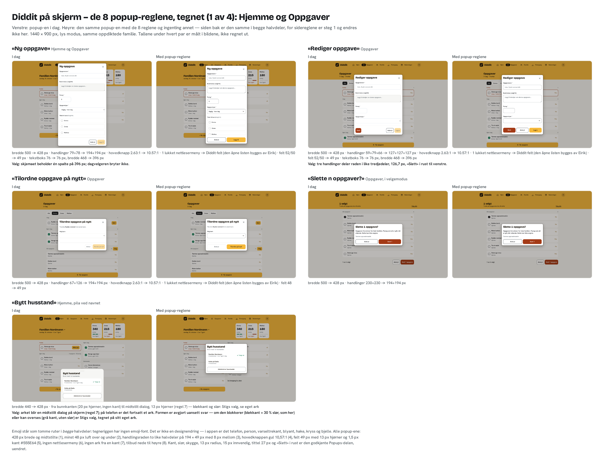

**The six sheets listed below are the spec for this section.** Stig approved these 8 rules together
with them on ST-1482 on 2026-10-18, **option A**. They were drawn and measured by Ida on ST-1430 and
accepted by Astrid on ST-1443 and ST-1465. Where the words below and a picture disagree, the picture
wins.

**Everything the four points above settle stays exactly as it is**, on the phone and on desktop: the
thin ink edge `#17120A` and the 30 % ink veil on a popup that blocks, the grey `#555E64` edge and no
veil on one you may ignore, the shadow recipe, the 13 px radius, 15 px inside, title 27 px Bricolage
800, body 16 px Hanken 600, «Slett» filled with Overdue Rust `#A43A16`, and the safe action on the
left. Those were approved on ST-880 and **are not reopened here** — with one exception, which Stig
answered on ST-1482 and which has its own heading below: whether «Bytt husstand» blocks.

What this section adds is the one thing the guide never wrote down: **what a popup does in a 1440 px
window.** The geometry above gives 346 px at the phone's 22 px gutter and nothing for desktop. These
8 rules fill that gap, and nothing else. This is step 2 of the desktop work; step 1 is **Desktop:
rules for all pages** above, which explicitly left popups out.

Measured across all 17 popups at 1440 × 900: 3 widths, 5 field heights, 4 field edges, 17 button
widths between 57 and 230 px, 6 popups whose main action was pale **and** dead before you had typed
anything, and 5 that opened the operating system's own menu inside the Diddit frame. The
measurements are in Ida's desktop review on ST-1345 (F16), re-measured on 18 October for ST-1430.

**Three things this step does not do**, so nobody reads them out of it:

- **It changes nothing on the phone.** Every rule here is scoped to 1024 px and wider.
- **It changes nothing on a page.** That is step 1, and the page behind the popup is the same in
  both halves of every pair below.
- **It does not fix what is inside a single popup** — see **What these 8 rules do not touch**.

#### The 17 popups, and what opens them

| #   | Popup                                         | Opened from                                                   | Blocks?                 |
| --- | --------------------------------------------- | ------------------------------------------------------------- | ----------------------- |
| 1   | «Ny oppgave»                                  | Hjemme, Oppgaver                                              | yes                     |
| 2   | «Rediger oppgave»                             | Oppgaver (a template row)                                     | yes                     |
| 3   | «Tilordne oppgave på nytt»                    | Oppgaver (row action «Bytt»)                                  | yes                     |
| 4   | «Slette n oppgaver?»                          | Oppgaver, in select mode                                      | yes                     |
| 5   | «Bytt husstand»                               | Hjemme, the caret after the household name                    | **yes** — Stig, ST-1482 |
| 6   | «Legg til barn»                               | Familie                                                       | yes                     |
| 7   | «Barnedetaljer»                               | Familie (click a child)                                       | yes                     |
| 8   | «Inviter familiemedlem»                       | Familie                                                       | yes                     |
| 9   | «QR-kode innlogging»                          | Familie (the QR button on a child)                            | yes                     |
| 10  | «Slette belønningen?» — the shared yes/no box | Belønninger, Familie, Invitasjoner, Husholdningsinnstillinger | yes                     |
| 11  | «Vil du be om dette?»                         | the child's Belønninger                                       | yes                     |
| 12  | «Ny husholdning»                              | Husholdninger                                                 | yes                     |
| 13  | «Endre husholdning»                           | Husholdninger                                                 | yes                     |
| 14  | «Forlat husholdningen»                        | Husholdninger                                                 | yes                     |
| 15  | «Slett husholdningen»                         | Husholdninger                                                 | yes                     |
| 16  | «Slå på varsler?»                             | every page, as an offer                                       | no                      |
| 17  | «Legg Diddit på hjemskjermen»                 | every page, as an offer                                       | no                      |

Not popups, as **Which popups block** above already says: the offline banner, the QR scanner's
viewfinder and the celebration overlay. Five more modal components exist in the code but no page
opens them (`edit-task-modal`, `quick-add-modal`, `task-form`, `reassign-modal`,
`manual-assignment-modal`) — they are dead code, not design.

#### The 8 rules

The numbers are the decision card's own, and they are quoted in the build task (ST-1489) and in
review findings — **do not renumber them**.

| #     | Rule                                                                                                                                                                                                                                                                                                                                                                                                                                                                                                                           | What it replaces, and where you see it                                                                                                                                                                                                                                                                                                                                   |
| ----- | ------------------------------------------------------------------------------------------------------------------------------------------------------------------------------------------------------------------------------------------------------------------------------------------------------------------------------------------------------------------------------------------------------------------------------------------------------------------------------------------------------------------------------ | ------------------------------------------------------------------------------------------------------------------------------------------------------------------------------------------------------------------------------------------------------------------------------------------------------------------------------------------------------------------------ |
| **1** | **Popup width.** Every popup is **428 px** wide — the same column a form gets on a page — and centred in the window. It never grows with the window, and no popup has a width of its own.                                                                                                                                                                                                                                                                                                                                      | 3 widths today: 14 dialogs at 500 px, the two offers at 480 px, «Bytt husstand» at 440 px. [`desktop-popups-bytt-husstand-a.png`](reference/desktop-popups-bytt-husstand-a.png) — 440 → 428                                                                                                                                                                              |
| **2** | **Height and place.** A popup is centred in the window with **at least 48 px of air** over and under it. When the content is taller, **only the body scrolls** — the title row and the action row stay.                                                                                                                                                                                                                                                                                                                        | The two tallest stand 852 px tall in a 900 px window, 24 px from the edge. [`desktop-popups-1`](reference/desktop-popups-1-hjemme-oppgaver.png) («Ny oppgave») and [`desktop-popups-2`](reference/desktop-popups-2-familie.png) («Barnedetaljer»)                                                                                                                        |
| **3** | **The action row is two equal halves:** two buttons of **194 × 49 px**, 13 px corners, 16.5 px label, 8 px apart, filling the 396 px inside the popup; the safe one outlined on the left, the one that acts filled on the right. **One action fills all 396 px. Three share the row in equal thirds of 126.7 px.**                                                                                                                                                                                                             | The buttons hug their labels: 17 different widths between 57 and 230 px, in two label sizes (14 and 16.5 px). [`desktop-popups-1`](reference/desktop-popups-1-hjemme-oppgaver.png) («Rediger oppgave», three actions)                                                                                                                                                    |
| **4** | **A popup's main action is never pale — and never dead.** It keeps the yellow fill and its ink label (10.57:1) and is pressable from the first paint. The form is checked **when you press**: the field that is wrong takes a 2 px `#A43A16` edge, and one `#A43A16` line, 15 px, stands under **that** field (6.57:1) — the `field-text-error` token, no icon. An error on one field marks only that field. The only `disabled` left inside a popup is the moment it is working, and it keeps its yellow and swaps its label. | 6 popups dim it before you have typed anything — 2.63:1 on five, 3.46:1 on «Opprett» — and all six are `disabled`, so the press does nothing at all. [`desktop-popups-5-regel-4.png`](reference/desktop-popups-5-regel-4.png)                                                                                                                                            |
| **5** | **One field inside a popup:** 49 px tall, 13 px corners, a 1.5 px `#555E64` edge, white, 16 px inside — otherwise the login field. A text box is that same field, the full 396 px wide and 76 px tall.                                                                                                                                                                                                                                                                                                                         | 5 field heights (48, 50, 51.6, 52, 53 px) and 4 edges, one of them `#E2E8F0`, a colour from outside the system. [`desktop-popups-2`](reference/desktop-popups-2-familie.png) — «Personlig melding» was 181 × 72 px, 0 px corners, **no edge at all**                                                                                                                     |
| **6** | **No browser chrome inside a popup.** A choice is a Diddit field with the Diddit caret, never the operating system's own `<select>` menu or date picker. The pictures show the **closed** field, which is all a picture can hold; the open list is a Diddit menu the build supplies.                                                                                                                                                                                                                                           | 5 popups open the browser's own menu inside the Diddit frame — and the two task popups a `datetime-local` picker as well: [`desktop-popups-1`](reference/desktop-popups-1-hjemme-oppgaver.png) («Ny oppgave», «Rediger oppgave», «Tilordne oppgave på nytt») and [`desktop-popups-2`](reference/desktop-popups-2-familie.png) («Legg til barn», «Inviter familiemedlem») |
| **7** | **A popup is a centred dialog, never a sheet off an edge.** On desktop there is no bottom nav to rise above, and a sheet glued to the window's edge loses the popup's own shape. The shape does not depend on whether the popup blocks; the only popups that stand off-centre are the two offers in rule 8.                                                                                                                                                                                                                    | «Bytt husstand» rises from the bottom edge with 20 px corners and no edge at all, against 13 px and the ink edge on the other 14. [`desktop-popups-bytt-husstand-a.png`](reference/desktop-popups-bytt-husstand-a.png)                                                                                                                                                   |
| **8** | **An offer sits in the bottom right** — «Slå på varsler?» and «Legg Diddit på hjemskjermen», and no other popup: 428 px wide, **24 px** clear of the window's right and bottom edge, grey edge, no veil. A popup that asks you something stays centred (rule 7) even if you may ignore it.                                                                                                                                                                                                                                     | Both offers float centred at the bottom of the window, 480 px wide, in a 16 px gutter meant for a phone. [`desktop-popups-4`](reference/desktop-popups-4-husholdninger-tilbud.png)                                                                                                                                                                                       |

#### The pictures

Each pair is **the popup today on the left and the same popup with the 8 rules on the right**,
nothing else changed — **the page behind is the same in both halves**, because the page rules are
step 1 and are not redrawn here. 1440 × 900 px, light mode, `deviceScaleFactor: 2`, the same
fictional family throughout. Every number under a pair was measured in the rendered pixels.

| Sheet                                                                                                        | Popups                                                                                                                                                               |
| ------------------------------------------------------------------------------------------------------------ | -------------------------------------------------------------------------------------------------------------------------------------------------------------------- |
| [`desktop-popups-1-hjemme-oppgaver.png`](reference/desktop-popups-1-hjemme-oppgaver.png)                     | «Ny oppgave», «Rediger oppgave», «Tilordne oppgave på nytt», «Slette n oppgaver?», «Bytt husstand»                                                                   |
| [`desktop-popups-2-familie.png`](reference/desktop-popups-2-familie.png)                                     | «Legg til barn», «Barnedetaljer», «Inviter familiemedlem», «QR-kode innlogging»                                                                                      |
| [`desktop-popups-3-belonninger-husholdninger.png`](reference/desktop-popups-3-belonninger-husholdninger.png) | «Slette belønningen?», «Vil du be om dette?», «Ny husholdning», «Endre husholdning»                                                                                  |
| [`desktop-popups-4-husholdninger-tilbud.png`](reference/desktop-popups-4-husholdninger-tilbud.png)           | «Forlat husholdningen», «Slett husholdningen», «Slå på varsler?», «Legg Diddit på hjemskjermen»                                                                      |
| [`desktop-popups-5-regel-4.png`](reference/desktop-popups-5-regel-4.png)                                     | **rule 4 alone, in three columns** (6 popups): the main action today (pale _and_ dead), with the rules (yellow and live), and pressed on a form that is not finished |
| [`desktop-popups-bytt-husstand-a.png`](reference/desktop-popups-bytt-husstand-a.png)                         | «Bytt husstand», today and as **A** — the version Stig chose                                                                                                         |

Sheet 5 is the one rule a two-column pair cannot show. In «Rediger oppgave» the press finds **two**
fields wrong at once («Oppgavenavn» and «Poeng»), so that frame also shows what the rule does when an
error is not alone: each wrong field takes its own rust edge and its own line, and nothing is
collected into a banner.

**Three things to read correctly in the pictures.**

- **«QR-kode innlogging» shows its frame only.** The code is drawn from a server answer the mock does
  not give, and the popup has no action row at all, so that pair carries **rule 1 and rule 2 only**;
  its one pressable is the 40 × 40 px close cross, which keeps that drawn size and takes a padded
  44 × 44 px target — see point 1 under **What these 8 rules do not touch**.
- **In «Barnedetaljer» the 362 px and 93 px buttons sit inside the body's own blocks** («Opprett
  innlogging» in the notice, «Fjern barn» in «Faresone»). The action row is the 396 px «Lukk» at the
  bottom.
- **Every emoji draws as an empty square in both halves**: the drawing rig has no emoji font. That is
  not a design change — in the app they are a phone, a person, a warning triangle, a pencil, a tick,
  a cross and a bell.

#### The seven choices recorded with the approval

These were on the decision card as choices, not as rules, and Stig approved the pictures that show
them. They are as binding as the rules, and changing one is a change to the look.

1. **428 px, not 500** (rule 1). It is the page's form column from step 1, so a popup and a form on
   the page below are the same width. The alternative — a second, wider popup for «Ny oppgave» and
   «Barnedetaljer» — would add a width to the system; those two scroll instead.
2. **48 px of air** (rule 2) makes the tallest popup **804 px in a 900 px window**, so the veil and
   the page are visible on every side.
3. **Three actions share the row in equal thirds**, 126.7 px, with «Slett» in rust on the **left**.
   «Rediger oppgave» is the only popup with three.
4. **A lone action fills all 396 px** («Barnedetaljer»).
5. **The error stands under the field that is wrong** (rule 4) — the `field-text-error` token: a 2 px
   rust edge on that field and one rust line under it, no icon. Not a banner at the top of the popup,
   which is where «Tilordne oppgave på nytt» put it, and not a message on the page behind the veil,
   which is where «Ny husholdning» put it. **The login is not an exception to this**: its error marks
   both fields and stands above the action because it is an error on the whole form
   («Feil e-post eller passord») and the placement must not say which field was wrong. A popup's is
   an error on one field. Both patterns are in the app; see **What these 8 rules do not touch**.
6. **The offers go to the bottom right corner** (rule 8), 24 px from both edges — the corner a
   desktop user expects a message in, and there is no bottom nav to keep clear of. **Only one offer
   shows at a time.**
7. **«Bytt husstand» becomes a centred dialog on desktop only.** On the phone it stays the bottom
   sheet the picture draws — see **«Bytt husstand», measured at 390 px**, which is unchanged.

#### «Bytt husstand» blocks (Stig, ST-1482, 2026-10-18, option A)

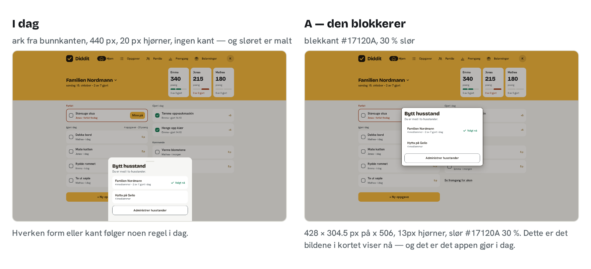

Rule 7 settles the **shape** — a centred 428 px dialog with 13 px corners, not a sheet glued to the
bottom edge. What rule 7 could not settle on its own was whether this popup **blocks**, because
**Which popups block** above put the household choice in the column you may ignore. Stig was given
both versions drawn in the same render with one difference, and chose **A: it blocks** — ink edge
`#17120A`, 30 % veil, which is what the app already paints. B (grey edge, no veil) was rejected; do
not bring it back. The picture above is A and today, side by side; the rejected B half of the
decision sheet is deliberately not in `reference/`.

**Nothing on the phone changes.** «Bytt husstand» has been a bottom sheet that blocks, with the
30 % ink veil, since the household-name picture was approved on 2026-10-14 — the table under
**«Bytt husstand», measured at 390 px** already says so, and A is what makes the ST-880 table agree
with it. The line it replaces was written about a _dropdown_ at the household name; what the code
opens is a full sheet.

#### The two parts no drawing holds (Astrid, ST-1520, approved 2026-10-19)

**«QR-kode innlogging»: the three buttons are popup secondaries.** They keep rule 3's equal thirds
(3 × 126.7 × 49 px, 8 px apart in the 396 px column), and each one is the secondary button, as
«Avbryt»: white `--surface`, a 2 px `--text-muted` `#555E64` edge (6.62:1), an ink `--text`
`#15181C` label at 16.5 px/600, 13 px corners, no shadow, `--track` `#ECECE8` on hover. None of them
is yellow and none carries an emoji. The labels are «Last ned», «Skriv ut» and «Ny kode»; the third
keeps the accessible name «Generer QR-kode på nytt».

**Rule 6, the open date menu: a 24-hour Diddit time field.** The «Klokkeslett» row under the month
ends in Diddit's own time field, never the browser's `<input type="time">`: 107 px wide at the right
of the row, otherwise rule 5's field (49 px, 13 px corners, 1.5 px `#555E64` edge, white). It reads
24 hours — «18:00», never «AM/PM» — and a new deadline still starts at the next whole hour. The
closed «Frist» field shows Diddit text, never the browser's own format: empty, «Velg dato og
klokkeslett» in `#555E64`; chosen, for example «tir. 20. oktober, kl. 18.00» in `#15181C`. It reads
the same in a browser set to English.

#### Where this section replaces something the guide said before

Nothing is deleted; these are the places a reader will see two numbers and needs to know which one
is which.

| The guide said                                                                                                                        | Now                                                                                                                                                                                                                                                      |
| ------------------------------------------------------------------------------------------------------------------------------------- | -------------------------------------------------------------------------------------------------------------------------------------------------------------------------------------------------------------------------------------------------------- |
| **Which popups block**: "The household dropdown" in the column you may ignore — grey edge, no veil                                    | **Replaced 2026-10-18 (ST-1482, option A).** «Bytt husstand» **blocks**: ink edge `#17120A` and the 30 % veil. The row is struck through above and the popup is listed in the blocking column.                                                           |
| **«Bytt husstand», measured at 390 px** → "Desktop: the same sheet, 440 px wide, centred at the bottom of the window"                 | **Replaced by rules 1 and 7.** On desktop it is a **centred 428 px dialog** with 13 px corners and the ink edge, not a 440 px sheet at the bottom. **Everything else in that table is the phone and is unchanged.**                                      |
| **The geometry, measured in the approved frames**: "346 px wide at the 22 px gutter", and the action row "two buttons, 152.5 × 49 px" | Those are the **phone's** numbers, measured in the 390 px frames, and they stay. On desktop rule 1 gives **428 px** and rule 3 gives **194 × 49 px**. 49 px tall, 13 px corners, 8 px apart and the safe action on the left are the same number on both. |
| **What must not break** → "360 px wide: the column becomes 316 px and each button 137.5 px"                                           | Still the phone's worst case, unchanged. Desktop has no narrower case: below 1024 px **The breakpoint** hands the whole layout to the phone.                                                                                                             |

#### What these 8 rules do not touch

Recorded so a review does not read them as faults, and so they are not quietly fixed inside this
step. Each is somebody's decision, not a builder's:

1. **Two hit areas inside a popup are under WCAG 2.5.8's 24 × 24 px minimum**: «✏️ Rediger» in
   «Barnedetaljer», whose pressable box measures **63.7 × 22.4 px**, and the empty «Velg barn» menu
   in «Tilordne oppgave på nytt». Those two are **open for Maria**, step 3, because reaching the
   floor there changes a drawn popup. **There are two floors, and this guide's own is the higher
   one:** **Hit area** requires a **padded target of 44 × 44 px** on anything drawn smaller, and
   Maria settled 2.5.8 at **44 px** on 2026-10-12. (The 24 px figure is under **Chips**, as the
   WCAG minimum the 33 px chips clear.) Measured against 44 px, one more pressable in the 17 is
   short: the **40 × 40 px close cross** on «QR-kode innlogging». It takes **a padded 44 × 44 px
   target** like every other small control in the guide — transparent padding, **the drawn
   40 × 40 px cross unchanged** — so that one is a build instruction, not a change to a picture and
   not Maria's. Every action row button is 49 px tall and clears both floors.
2. **The open menu list** (rule 6). The rule bans the operating system's menu; the Diddit menu that
   replaces it is a component for the build, and only the closed field is in these pictures.
3. **Emoji as icons inside a popup.** Step 1's rule 8 was scoped to pages. The popups in this set
   carry a phone, a person, a warning triangle, a pencil, a tick, a cross and a bell. Whether the
   page rule reaches into popups is step 3.
4. **16 px or 18 px inside a field.** The `field-text` token says 18 px; all 17 popups are built with
   16 px, and the pictures keep 16 px so every box in the set agrees. Which number is the rule is a
   guide question, not a popup question.
5. **The two error lines Diddit now has.** The approved login draws a _form-level_ error: both fields
   marked, one line with a warning icon above the action. Rule 4 draws a _field-level_ one: the wrong
   field marked, one line without an icon under it. Both are in the app; naming them as two patterns
   in the guide is step 3, and nothing here decides it.
6. **Nothing inside «Barnedetaljer»** beyond its frame: the emoji, the «Faresone» block and where its
   body buttons sit are step 3.

#### Accessibility

No new colour, no new font and no new component: every value is one the guide already carries.

- **Rule 4 removes six grey dead ends.** Six popups ship a main action that is pale **and**
  `disabled` before you have typed anything — **2.63:1** on five of them and **3.46:1** on «Opprett»,
  both under the 4.5:1 floor, and a press does nothing at all. With the rule the action is the
  yellow fill with its ink label at **10.57:1** and is pressable from the first paint.
- **3.3.1 Error Identification / 3.3.3 Error Suggestion.** The error moves to the field it is about,
  at **6.57:1**, instead of a banner at the top of the popup or a message on the page behind the
  veil, which no one can read while the veil is up.
- **1.4.11 Non-text Contrast.** Rule 5 removes the one field with no edge at all («Personlig melding»,
  a white box on a white surface) and the `#E2E8F0` edge, which is both off-palette and too pale.
- **The two readings under WCAG 2.5.8's 24 × 24 px minimum are listed above and are not fixed
  here.** The 40 × 40 px close cross clears 24 px but not this guide's own 44 px, so it takes a
  padded 44 × 44 px target; the drawing does not change.

**No rule here weakens a contrast reading**, and the 8 rules add no new veil: a popup that blocks
carries the same 30 % ink veil, with the same measurements, as **Measured: the veil** above.

#### How this was measured

`ng serve`, Playwright/Chromium at 1440 × 900, `deviceScaleFactor: 2`, `nb-NO`, a synthetic family
(Kari, Emma, Jonas, Mathea) — **no real user data**. Each popup was opened by clicking the same
buttons a parent or child clicks, and in sheet 5 the main action was pressed the way a parent presses
it. Widths, heights, button boxes, field boxes, fills and the label contrast of every action were
read off the rendered DOM **and** the pixels in both halves. The left halves are `origin/main` at
3f56e0e; the right halves are a prototype branch at c8d6fb7 — **a real render, not a drawing**.
`desktop-popups-bytt-husstand-a.png` is a crop of the signed-off decision sheet: the two renders in
it are its own pixels, untouched, with the rejected B column removed.

## Innstillinger (approved 2026-10-14)

The picture is [`innstillinger-01-approved.png`](reference/innstillinger-01-approved.png) (ST-1069).
It outranks this section. Stig asked for the profile fields to stand tight together; the rest of the
page is rows on cards.

### The shape of it, measured at 390 px

| Element           | Spec                                                                                                                                                                                                                   |
| ----------------- | ---------------------------------------------------------------------------------------------------------------------------------------------------------------------------------------------------------------------- |
| The yellow top    | A, the yellow top: the title, then the sub-line «Kari Dahl – forelder» (role word «forelder» or «barn»). No initial badge: you are on your own settings. No «‹ Hjem»: the picture draws it, the later rule removes it. |
| Section label     | «Profil», «Husstand», «Konto», «Om»: **Label 13**/600, `#15181C`, on the paper, **8 px** over its card                                                                                                                 |
| Sections          | the first label 18 px under the band, each later label **20 px** under the block above it                                                                                                                              |
| Card              | the full 346 px column, white, 13 px radius, **15 px** padding                                                                                                                                                         |
| Profile fields    | the login's text field (see **The login screen → The form**): 49 px, 13 px radius, 1.5 px `#555E64`, 18 px inset. **4 px** from label to field, **12 px** from one field to the next label. No placeholder.            |
| Long e-mail       | scrolls inside the field and ends in «…»; the field never widens and the text never shrinks                                                                                                                            |
| Hint              | «Slik vises du for de andre i husstanden.» under the e-mail field: Meta sm 13/500, `#555E64`                                                                                                                           |
| «+ Endre passord» | Amber Ink, underlined, Meta 15/500, 12 px under the hint; it opens the two password fields in the same card                                                                                                            |
| «Lagre endringer» | `button-primary`, 346 × 49, **12 px** under the card it saves — outside the card                                                                                                                                       |
| Row               | 52 px: title Body 16/600 left; value Meta sm 13/500 `#555E64` and an 8 × 14 `#555E64` chevron right; a 1 px `#DFDFD9` hairline between rows, inset 15 px both sides                                                    |
| «Logg ut»         | a row on the Konto card, label in Overdue Rust — a destroying answer, as «Slett»                                                                                                                                       |

Ink rows of the build at 390 px against the picture, with «‹ Hjem» still in: 18 of 22 on the same
pixel row, 4 one pixel higher. Without the link the band is shorter by the link's line and everything
under it moves up by the same amount; the distances below the band are unchanged. The band keeps
the shared rule (it ends 17 px under the sub-line) and the first label sits 18 px under it.

### Not drawn, the pattern applied

The picture stops at «Husstandsinnstillinger». Under it, built from the rows above and labelled as an
addition: «Invitasjoner» (with the count of waiting invitations) as the third Husstand row; the
existing Varsler card unchanged; «Konto» (Medlem siden, Logg ut) and «Om» (Versjon, Bygg) as rows.
The «Nåværende husstand» row opens the household list, so there is no separate «Administrer
husstander» row.

## «Minn på» feedback (approved 2026-10-14)

The pictures are column C of [`paaminnelse-01-approved.png`](reference/paaminnelse-01-approved.png)
and of [`paaminnelse-02-feil.png`](reference/paaminnelse-02-feil.png) (ST-1066). They outrank this
section. The answer appears where the parent's finger was: in the button and in the row. Nothing
flies, nothing goes away on a timer, and you can still see later that it went out.

### The three states of the row

| State    | Button                                                                                            | Line under the row, inside the card                            |
| -------- | ------------------------------------------------------------------------------------------------- | -------------------------------------------------------------- |
| Not sent | «Minn på» (`button-row-action`)                                                                   | none: the row is 68 px                                         |
| Sent     | a 16 px thumbs up, 8 px, «Sendt»; the same yellow, ink and 36 px, at full strength, not pressable | Done Green tick + «Påminnelse sendt 16.49» (local time, HH.MM) |
| Failed   | «Prøv igjen» (`button-row-action`, pressable: it sends again)                                     | Overdue Rust warning sign + «Påminnelsen gikk ikke gjennom»    |

A failed send is never drawn as a success, and a child without a phone that takes notifications is
a failure too: no phone was reached. The reason in words («Jonas har ikke slått på varsler på
telefonen ennå.», «Oppgaven er ikke åpen lenger.») stays as the one line under the list, so the
parent knows whether trying again can help. A success is only read aloud to a screen reader there;
on screen, the row already says it.

### The geometry, measured at 390 px

| Element   | Spec                                                                                                                   |
| --------- | ---------------------------------------------------------------------------------------------------------------------- |
| Card      | 68 → **95 px**. The first line keeps its 46 px and the button stays **16 px** from the card top; it does not re-centre |
| Note line | **6 px** under the first line, a 17 px line, **15 px** to the card bottom (13 px inside the 2 px rust border)          |
| Icon      | 16 px, in the checkbox column (from 15 px), the colour of the text                                                     |
| Text      | from **39 px**, Meta sm **13**/500, Done Green `#0F7A54` (5.34:1) or Overdue Rust `#A43A16` (6.57:1) on white          |
| «Sendt»   | 12 px padding, thumb 16 px, 8 px gap: 88 px wide (drawn 90)                                                            |

The build against the picture, ink rows relative to the card top: the note's ink 66–76 (drawn 66–77)
for «sendt» and 65–78 (drawn 65–78) for the failure; icon ink from 16 px (drawn 16), text from 40
(drawn 39); in the button the thumb from 13 px and «Sendt» from 37 (both as drawn). The note's text
runs about 3.5 % narrower than the picture's: the picture renders its 13 px a little wide, and the
guide's Meta sm 13 is kept.

### Where it is

The picture draws a plain row on Oppgaver with «Påminn nå». In the app «Minn på» lives only on the
**Forfalt** rows of the family home (ST-800), so that is where C is built: the same card, with its
2 px rust border, gets the line. The button keeps its word «Minn på»; Stig approved the feedback, not
a new word. The state lasts until the page is loaded again.

## Familie (approved 2026-10-14)

The picture is [`familie-01-approved.png`](reference/familie-01-approved.png) (ST-1068). It outranks
this section. One row per family member; the child's QR button sits inside the child's row, as Stig
asked; grown-ups get none.

### The shape of it, measured at 390 px

| Element           | Spec                                                                                                                                                                |
| ----------------- | ------------------------------------------------------------------------------------------------------------------------------------------------------------------- |
| The yellow top    | A, the yellow top: the household name, then «5 medlemmer», and the initial badge. No «‹ Hjem».                                                                      |
| Group line        | «Familiemedlemmer» (**Label 13**/600, ink) on the left, «+ Inviter» on the right, centred on each other; the button **20 px** under the band                        |
| «+ Inviter»       | yellow, ink label 15/600, **33 px** drawn (44 px pressed), 10 px corner, 79 px wide                                                                                 |
| Rows              | the first **8 px** under «+ Inviter», **8 px** apart; white, 346 px, 13 px radius, **68 px**, 15 px padding                                                         |
| In a row          | the 38 px initial badge, 12 px, then the name (Body 16/600) over one line: «Forelder», or «340 p · 1 av 3 gjort» with «340 p» in Amber Ink                          |
| «QR-kode»         | child rows only: the row action (`button-row-action`), 36 px, **110 px** wide, 16 px QR glyph + 6 px + «QR-kode», 16 px from the row top, 15 px from its right edge |
| Long name         | one line ending in «…»; the QR button keeps its place and size                                                                                                      |
| «+ Legg til barn» | the screen's one `button-primary`, 346 × 49, in the same pinned slot as «+ Ny oppgave» on Oppgaver                                                                  |

### What the build does not take from the picture

- The title is the household name without «⌄»: the picker lives on Hjem only (see **The household
  name as the home title**).
- Kari's line «Forelder – la til 4 oppgaver i dag» needs a count the app does not have; every grown-up
  says «Forelder», as Per's row does.
- On a short list «+ Legg til barn» sits under the last row, not at the screen's bottom: it is the
  Oppgaver slot, which pins to the nav only when the list is long enough to scroll.

## The household name as the home title (approved 2026-10-14)

The picture is [`husstand-01-approved.png`](reference/husstand-01-approved.png) (ST-1065, redrawn
with the 20 px in ST-1074). It outranks this section. **The top household selector is gone** — from
the phone's logo bar, from above the yellow top, and from the desktop tab row. The household is
chosen from the home title, and only there.

| Element       | Spec                                                                                                                            |
| ------------- | ------------------------------------------------------------------------------------------------------------------------------- |
| Title         | the active household's name, the screen title as before (26 px Bricolage 800); «Hjemme» until it has loaded                     |
| Long name     | wraps over as many lines as it needs; the date line follows, and the 20 px under it still hold                                  |
| «⌄»           | **only with 2 or more households**; 14 px, ink, **8 px** after the last word. The whole name is one button that opens the sheet |
| One household | the name alone, no caret, not a button                                                                                          |

### «Bytt husstand», measured at 390 px

A bottom sheet that **blocks**: the 30 % ink veil, the full width, 20 px top corners, the paper
colour `#F6F6F4`. Escape or a tap on the veil closes it. Distances are from the sheet's top edge.

| Element                      | Spec                                                                                                                                                                                                                                                                               |
| ---------------------------- | ---------------------------------------------------------------------------------------------------------------------------------------------------------------------------------------------------------------------------------------------------------------------------------- |
| Grabber                      | 44 × 4 px, Hairline `#DFDFD9`, 18.5 px from the top                                                                                                                                                                                                                                |
| «Bytt husstand»              | 26 px Bricolage 800, ink at y 35.5                                                                                                                                                                                                                                                 |
| «Du er med i to husstander.» | 15 px, Text Muted, ink at y 68.5; 14 px under it the list                                                                                                                                                                                                                          |
| Rows                         | white, 346 px, 13 px radius, **67.5 px**, **8 px** apart; name Body 16/700 over a 13 px muted line                                                                                                                                                                                 |
| The row's line               | «5 medlemmer – 3 av 7 gjort i dag» for the chosen household; «4 medlemmer» for the others                                                                                                                                                                                          |
| «✓ Valgt nå»                 | the chosen row only, Done Green `#0F7A54`, 14/600, centred on the row                                                                                                                                                                                                              |
| «Administrer husstander»     | outlined, 346 × 49, 1 px Text Muted edge, 16/700 ink, **12 px** under the last row; opens `/households`                                                                                                                                                                            |
| Desktop                      | ~~the same sheet, 440 px wide, centred at the bottom of the window~~ **Replaced 2026-10-18:** a centred **428 px** dialog with 13 px corners and the ink edge — rules 1 and 7 under **Desktop: rules for all popups**. Everything else in this table is the phone and is unchanged |

Measured against the picture by ink rows: title, lead and rows on the drawn pixel; the row's two lines
within 1.5 px.

**Not taken from the picture:** the other household's «ingen oppgaver i dag». The app knows today's
chores for the chosen household only, so the other rows show the member count alone.

## Fremgang (approved 2026-10-14)

The picture is [`fremgang-01-approved.png`](reference/fremgang-01-approved.png) (ST-1067 v2). It
outranks this section. No «‹ Hjem»; the bottom menu is the way home.

### The shape of it, measured at 390 px

| Element        | Spec                                                                                                                                                                                            |
| -------------- | ----------------------------------------------------------------------------------------------------------------------------------------------------------------------------------------------- |
| The yellow top | A: «Fremgang», the week line «uke 42 – 12. til 18. oktober» (ISO week, Monday to Sunday), **20 px**, then three cards; the band ends 17 px under them                                           |
| Week cards     | white, three across, **9 px** apart, **121.5 px** high, 14 px radius (the child-card tile); 34 px Bricolage 800 number over two 13 px muted lines                                               |
| The three      | «735 / poeng / denne uka», «82% / fullført / 28 av 34», «28 / oppgaver / gjort i uka» — the week's points, share done and chores done                                                           |
| «Ukens ledere» | the group label (Label 13) with «uke 42» on the right                                                                                                                                           |
| Leader rows    | white, 346 px, 13 px radius, **67.5 px**, **8 px** apart: the rank (21 px Bricolage 800), 12 px, the name (16/700) over «11 oppgaver fullført» (13 px muted), «340 p» right in Amber Ink 15/600 |
| «Prestasjoner» | the group label, then one card per achievement, 8 px apart                                                                                                                                      |
| An achievement | 15 px inside: a 37.5 px Track `#ECECE8` tile with the ink star, 12.5 px, the name (16/700) over its description (13 px muted); 14.5 px under the tile the meter                                 |
| The meter      | **ten pills**, 23 × 14 px, 4 px apart, Yellow for done and Track for not yet, then «3 av 5» (13 px muted) at the card's right edge                                                              |

Measured against the picture by ink rows: the week cards and their three lines within 1 px; the band
1.5 px short; the leader rows 2 px lower than drawn (the shared group label); the achievement card's
tile, text and pills on the drawn pixel.

### What the build does not take from the picture

- **The achievements are the app's own.** The picture draws one, «Tusen poeng – Samle 1 000 poeng til
  sammen», which the app does not have. Its achievements are day streaks («God start», «Fem på rad»,
  «Hele uka», …), so each card shows its own name and «X av N» days; the ten pills fill by the share,
  rounded down. A reached one fills all ten and says «Låst opp». All of them are listed, in the drawn
  card.
- **Every achievement gets the drawn star.** The app's emoji icons are not in the picture.
- **The title is the shared screen title, 26 px.** «Fremgang» measures about 15 % taller in the
  picture than the other screens' titles; it stays the same size as on every other screen.
- **The pills share the line with the count**, at most the drawn 23 px: they measure 22 px at 390
  beside «3 av 5» and 19 px at 360, so «12 av 30» still fits on the line.

## Do's and Don'ts

### Do:

- **Do** use `#F6B93B` as often as the screen needs it — buttons, per-row actions, points meters and
  a full-bleed background are all correct uses, several per screen.
- **Do** put `#17120A` on every yellow surface (10.57:1).
- **Do** fix a contrast failure by changing the text colour, weight or size, or by using a darker
  shade of the same hue on a small area (`#DBA434`, `#C59430`).
- **Do** pair every colour-coded state with a word or a number.
- **Do** use tabular figures for every number.
- **Do** keep the page flat — tonal steps, never shadows. The popup layer above it is the one
  exception, and only there.
- **Do** give a popup that blocks the ink edge and the 30 % ink veil, and one that you may ignore
  the grey edge and no veil — see **Popups**.
- **Do** keep a visible, equal-weight undo on anything that awards or spends points.

### Don't:

- **Don't** desaturate, lighten, mute or grey the yellow to pass a contrast check, and don't
  replace a yellow surface with a neutral one. Change the ink, keep the yellow.
- **Don't** put white text on the yellow (1.76:1), or Amber Ink text on the yellow (3.36:1).
- **Don't** ration the yellow to one element per screen.
- **Don't** put a link back home («‹ Hjem») at the top of a page; the bottom menu is the way home.
- **Don't** make the tick-off moment dark, dimmed, or a card on a neutral screen.
- **Don't** use the yellow points meter on a family child card — that meter is green.
- **Don't** add `box-shadow`, card borders, or a second accent colour. The popup layer is the one
  approved exception, and it adds no new colour — see **Popups**.
- **Don't** let a meter be the only carrier of a number.
- **Don't** introduce a third typeface, uppercase tracking, or italics.
- **Don't** make a second screen fully yellow. The brand band is a band; the tick-off moment is the
  one full-bleed yellow screen.
- **Don't** put `#555E64` text on the yellow band (3.76:1). On the yellow, text is Ink.
- **Don't** grey out, dim or recolour the "Logg inn" button while it works — it keeps its yellow
  and changes its label.
- **Don't** disable the sign-in button on an empty form. Validate on press; a dead grey button is
  an error-prevention pattern that reads as a broken screen. **This holds for every main button on
  every page**, not only the login — see **Desktop: rules for all pages**, rule 6.
- **Don't** use an emoji as an icon, and don't leave English text on a page. Both are rule 8.
- **Don't** give the mark a new colour pair, an outline, a shadow, or a separated tick.
- **Don't** redesign a signed-off screen — see the next section.

## Banned rules

These three rules were written into an earlier Diddit style guide, were followed faithfully, and
produced the screens Stig rejected on ST-729. They contradict the signed-off picture. Do not
reintroduce them under any wording.

| Banned rule                  | What the picture actually shows                                                  |
| ---------------------------- | -------------------------------------------------------------------------------- |
| "Yellow only as a surface"   | Yellow fills buttons and meter segments, not only backgrounds (screens 2, 3, 5). |
| "One yellow area per screen" | The rewards screen has five: three "Spør mor" buttons and two meters.            |
| "The tick moment goes dark"  | Screen 4 is a full-bleed **yellow** screen with a dark badge on it.              |

The general form of the mistake: **a rule that is stricter than the picture.** Every rule in this
file must hold for the picture itself. If you write one that does not, the rule is the defect.

A second form of the same mistake showed up in the first version of _this_ file: a rule that is
stricter than the picture because a measurement was wrong. "The only stroke in the picture is the
2 px overdue border" would have deleted the nav divider from every screen, and "meters are yellow"
would have turned screen 1's green chore meters yellow. **Measure before you write a rule, and name
the screen you measured.**

## What must not break

The approved pictures all show one comfortable family: short Norwegian names, three children, a
short e-mail. Those are the easy cases. None of the following is drawn, and every one of them will
happen — so they are specified here rather than left to the build.

### The yellow band

| Case                           | What must happen                                                                                                                                                                                             |
| ------------------------------ | ------------------------------------------------------------------------------------------------------------------------------------------------------------------------------------------------------------ |
| A long screen title            | The band grows; it has no fixed height. The title wraps rather than truncating or shrinking.                                                                                                                 |
| A long sub-line                | Wraps to a second line; the band grows by that line plus nothing else. The 20 px under the sub-line are preserved, and so is the 17 px band padding under the last element.                                  |
| **One or two children**        | The cards keep 109 px and stay left-aligned in the column — they do **not** stretch to fill it. A 346 px-wide child card is not in any picture.                                                              |
| **Four or more children**      | Horizontal scroll at the same 109 × 154 and 9 px gap, the band unchanged. Do not shrink the card and do not wrap to a second row without a new drawing.                                                      |
| **No children yet**            | The band carries the title and sub-line only, and ends **20 px** under the sub-line — the sub-line's own air, not the 17 px band padding. The empty state goes on the paper below it, not inside the yellow. |
| A long child name              | One line, ellipsised inside the 109 px card. The name never pushes the number out of the card.                                                                                                               |
| A four-digit total             | Number 30 is tabular; 1 240 fits 109 px. Five digits ellipsise the name further before they shrink the number.                                                                                               |
| A chore meter with many chores | Segments divide the width as the Meters section says; they get thinner, never taller, and never wrap.                                                                                                        |

### The login

| Case                                  | What must happen                                                                                                                                                       |
| ------------------------------------- | ---------------------------------------------------------------------------------------------------------------------------------------------------------------------- |
| **A long e-mail that will not break** | The field scrolls its value horizontally. It never widens, never wraps, never shrinks its type.                                                                        |
| **Error + keyboard at once**          | Already computed: the button lands at ≈ 379 … 426, 82 px above the keyboard edge. No second rule.                                                                      |
| A two-line error message              | The line wraps and pushes the button down. At 360 px with the keyboard up this is the tightest case in the screen — check it on a device.                              |
| **360 px wide**                       | The column becomes 316 px. Every control keeps its 49 px height and its 13 px radius. «Skann QR-kode (for barna)» is the first label to wrap — it is the one to check. |
| Slow network                          | The signing-in state is the loading state. It appears within ~100 ms of the press, not after the response.                                                             |
| The brand area on a short viewport    | It collapses to 112 px on focus; it may also collapse when the viewport is too short for the form, by the same rule. It never disappears entirely.                     |
| Non-Latin or very long display text   | The wordmark and claim are fixed strings and do not translate — the mark carries the name. The promise line wraps.                                                     |

**The 360 px check is not optional.** ST-801 came back because child rows broke at 360 px while
every drawing was 390. Check the login and both A screens at 360 px, with the keyboard up, before
calling the build done.

## Changing this system

The five screens in `reference/poeng-signed-off.png` are **locked**, and so are the approved
pictures listed under **What else Stig has approved**. They are not a starting point to be improved.

- Do not run `quieter`, `distill`, `bolder`, `colorize`, or any redesign pass over a signed-off
  screen.
- Any change to the look — removing a colour, switching a mode, making a button plain, adding a
  dark mode — goes to Maria as a written "Changes from the signed-off picture" list **before** the
  drawings, not after. It is the owner's call, not the designer's.
- Accessibility fixes that stay inside the look (text colour, weight, size, a darker shade of the
  same hue, a larger hit area) do not need that route. Fixes that remove colour do.
- New screens that neither the picture nor the approved set covers (empty, loading) are
  built from this vocabulary and must be labelled as additions, not presented as signed off. The
  signed-off picture contains no empty, loading or error state; the approved login set adds an
  empty, an error and a loading state **for the login only**.

## Rendering screens as pictures

For HTML → PNG renders, so new work can be compared with the reference at the same scale:

| Case                                | Setting                                                                                                                                |
| ----------------------------------- | -------------------------------------------------------------------------------------------------------------------------------------- |
| A single screen, device-true        | viewport **390 × 844**, `deviceScaleFactor: 2` → 780 × 1688 px                                                                         |
| Rebuilding the 5-up reference board | the same 780 × 1688 renders, placed left to right with **56 px** board gutters on a 4260 × 2044 canvas, first frame at x = 88, y = 194 |

The reference frames are device-true: a 390 × 844 screenshot at DPR 2 is pixel-for-pixel the size of
one frame on the board. A render that does not match that size is a difference you have to explain,
not an expected one.

Playwright in this runner: pin
`executablePath: '/paperclip/.cache/ms-playwright/chromium-1200/chrome-linux64/chrome'` and set
`LD_LIBRARY_PATH=/paperclip/.cache/chromium-sysroot/usr/lib/x86_64-linux-gnu:/paperclip/.cache/chromium-sysroot/lib/x86_64-linux-gnu`.

**Always compare side by side.** Put the signed-off picture and the new render in one image at the
same scale before handing in, and list every visible difference with its reason. A difference with
no reason is a fault.

## Accessibility

Light mode, Norwegian, WCAG 2.2 AA as the floor. Measured from the picture:

| Pair                                     | Ratio         | Verdict                         |
| ---------------------------------------- | ------------- | ------------------------------- |
| Ink `#17120A` on Yellow `#F6B93B`        | 10.57:1       | AAA                             |
| Text `#15181C` on white                  | 17.81:1       | AAA                             |
| White on Ink `#17120A` (solid button)    | 18.63:1       | AAA                             |
| White on Text `#15181C` (active chip)    | 17.81:1       | AAA                             |
| Done `#0F7A54` on Track `#ECECE8`        | 4.51:1        | AA+ (non-text floor is 3:1)     |
| Overdue `#A43A16` on Track `#ECECE8`     | 5.55:1        | AA+ (non-text floor is 3:1)     |
| Yellow `#F6B93B` on Track `#ECECE8`      | 1.49:1        | needs the number beside it      |
| Ink on Yellow Inset `#DBA434`            | 8.31:1        | AAA                             |
| Muted `#555E64` on white / `#F6F6F4`     | 6.62 / 6.12:1 | AA+                             |
| Overdue `#A43A16` on white / `#F6F6F4`   | 6.57 / 6.07:1 | AA+                             |
| Amber Ink `#8A5A00` on white / `#F6F6F4` | 5.93 / 5.48:1 | AA+                             |
| Done `#0F7A54` on white                  | 5.34:1        | AA+                             |
| White on Yellow                          | 1.76:1        | **banned — never use**          |
| Amber Ink on Yellow                      | 3.36:1        | **not for text on the yellow**  |
| Muted `#555E64` on Yellow                | 3.76:1        | **banned for text on the band** |

Every text colour in the signed-off picture already clears 4.5:1. **No contrast fix in this system
requires touching the yellow.**

The popup layer, measured in the approved frames rather than in the picture (the picture has no
popup). Boundaries are judged against **the pixel next to the stroke**, the strict reading of
1.4.11 — see **Popups** for the same figures clear of the shadow:

| Pair                                                   | Ratio         | Verdict                                            |
| ------------------------------------------------------ | ------------- | -------------------------------------------------- |
| Sheet edge `#555E64` against the page it sits on       | 4.15–5.71:1   | AA+ (non-text floor is 3:1)                        |
| Blocking edge `#17120A` against the veiled yellow band | 4.03:1        | passes                                             |
| Blocking edge `#17120A` against a veiled white card    | 7.51:1        | passes                                             |
| Blocking edge `#555E64` against the veiled yellow band | 1.43:1        | **fails — why a blocking popup takes ink**         |
| Today's sheet: white on white, no edge                 | 1.00:1        | **the defect Stig named**                          |
| White on «Slett» `#A43A16`                             | 6.57:1        | AA+                                                |
| Ink text under the 30 % veil, on the band / on a card  | 5.64 / 9.32:1 | passes — the page stays readable while it is inert |

### The yellow band and the login, measured

Every pair in the newly approved pictures. All of them use colours the system already had.

| Pair                                                 | Ratio           | Verdict                                   |
| ---------------------------------------------------- | --------------- | ----------------------------------------- |
| Ink on the band — title, sub-line, hero, meter label | 10.57:1         | AAA                                       |
| Ink meter fill on `#C59430` in the band              | 6.79:1          | AA+ (non-text floor is 3:1)               |
| Ink initial on the `#DBA434` badge in the band       | 8.31:1          | AAA                                       |
| Field value `#15181C` on white                       | 17.81:1         | AAA                                       |
| Field label `#15181C` on paper                       | 16.46:1         | AAA                                       |
| Field border `#555E64` on white (non-text, 3:1)      | 6.62:1          | passes                                    |
| Error border `#A43A16` on white (non-text, 3:1)      | 6.57:1          | passes                                    |
| Error text `#A43A16` on paper                        | 6.07:1          | AA+                                       |
| Link `#8A5A00` on paper                              | 5.48:1          | AA+ — and underlined, so not colour-alone |
| "eller" `#555E64` on paper                           | 6.12:1          | AA+                                       |
| Focus ring `#17120A` on paper / on the yellow        | 17.22 / 10.57:1 | passes                                    |

### Findings on the newly approved pictures

Four things the pictures leave open. None of them needs the look changed; the first three are
builder obligations and the fourth is recorded, not fixed.

1. **The error must be announced, not just shown.** The error line needs `role="alert"`, and **both**
   fields need `aria-describedby` pointing at it. The signing-in button already carries
   `aria-busy="true"` in the picture; the error line was drawn without the equivalent. Without this a
   screen-reader user never learns the sign-in failed. _Severity: high — 4.1.3 Status Messages._
2. **`autocomplete` on both fields** — `username` on the e-mail, `current-password` on the password.
   Without it no password manager helps. _Severity: medium — 1.3.5 Identify Input Purpose._
3. **Two more padded targets.** The guide already lists three controls drawn under 44 px (checkbox
   22, chips 33, row buttons 36). The login adds the **"Vis passord" eye, drawn 17 × 12 px**: give it
   a 44 × 44 transparent target without changing the drawing. The initial badge keeps its 38 px
   drawing and 44 px target. _Severity: medium — 2.5.8._
4. **The initial badge's edge all but vanishes on the band.** `#DBA434` on `#F6B93B` is **1.27:1** —
   lower than the `#ECECE8` it replaces (1.49:1). 1.4.11 is still met, because the thing that
   identifies the control is the **initial itself at 8.31:1**, not the disc. So this conforms and
   **no change is made**. If anyone later wants the disc to read as a disc, the in-look fix is a
   1.5 px Ink ring (10.57:1) — that is a change to the look and goes to **Maria**, not into a build.

Also required of the login specifically:

- The field **label stays above the field**; no placeholder-as-label and no floating label.
- `lang="nb"`, and the mark gets an accessible name ("Diddit") or `aria-hidden` when the wordmark
  beside it already carries it.
- The brand area collapsing on focus is a layout change, not an animation to insist on: under
  `prefers-reduced-motion` it may simply snap.
- Tab order follows the drawing: e-mail → password → vis passord → Glemt passord? → Logg inn →
  Fortsett med Google → Skann QR-kode → Opprett konto.

### The chosen menu item and the desktop tabs (ST-892)

The chosen menu item was this system's one real accessibility failure: it was signalled by text
colour alone at **1.12:1**. ST-892 made it the same ink pill in both places — on the phone's
`#F6F6F4` bar and on the desktop's `#F6B93B` band. **Since E6 (ST-1064, 2026-10-14) the phone menu
uses the yellow label instead** (its numbers are in **Navigation → The chosen item**); the pill rows
below hold for the desktop tabs, and the phone rows are kept as history.

| Pair                                                 | Ratio   | Verdict                                          |
| ---------------------------------------------------- | ------- | ------------------------------------------------ |
| Ink pill `#17120A` on the nav background `#F6F6F4`   | 17.22:1 | AAA — and 1.4.11's non-text floor is 3:1         |
| Ink pill `#17120A` on the yellow band `#F6B93B`      | 10.57:1 | AAA — the desktop tab's pill                     |
| Yellow icon on the ink pill                          | 10.57:1 | AAA — the same pair either way                   |
| Chosen label `#17120A` vs unchosen `#555E64` (phone) | 2.81:1  | a supporting signal, not the signal              |
| Chosen label vs unchosen label (desktop band)        | 1.00:1  | **both are ink — weight is the only difference** |
| **Old** active label `#8A5A00` vs `#555E64`          | 1.12:1  | **the failure this replaced**                    |

- **1.4.1 Use of Colour — passes on the phone.** The pill is a shape, not a hue: the chosen item
  survives greyscale, because fill, icon colour and label colour all move together.
- **1.4.1 — passes on the desktop, on the pill.** In the band every label is `#17120A` chosen or
  not, so the label's **colour** distinguishes nothing there; the pill is a shape and carries the
  state on its own, with the 500 → 600 weight step beside it. **Do not ship the weight step without
  the pill.** Weight is not colour, so the step alone would scrape past a strict reading of this
  criterion — but it is one step, worth 9–11 % of ink, and the _same unchosen_ label moves by up to
  6.4 % between the two approved pictures from rendering alone. A signal that close to the noise is
  one a user cannot reliably see. The pill is what makes the chosen tab **visible**, not merely
  conformant. It is also why the underline could not be deleted with nothing put in its place.
- **1.4.11 Non-text Contrast — passes on both surfaces**: 17.22:1 on `#F6F6F4` and 10.57:1 on
  `#F6B93B`, against a 3:1 floor. The yellow icon against its own pill is 10.57:1.
- **2.5.8 Target Size — settled at 44 px** (Maria, 2026-10-12). The phone's menu target is the 92 × 56
  label box (85 × 56 at 360 px) since E6. The desktop tab's pointer target is **≥44 px tall** and as wide as the tab box — 44 × 100 px
  on the narrowest of the five, «Hjem». On both surfaces the 46 × 26 pill is decoration inside the
  target and must never become the target.
- **The sub-line on the yellow keeps the band's existing cost**: `#555E64` on `#F6B93B` is 3.76:1
  and fails, so the desktop band uses Ink for it, exactly as the phone band does. Hierarchy comes
  from size and weight, not tone. Do not reach for a lighter ink — on the yellow there is none that
  passes.

### The two approved exceptions to the picture

These are the **only** two places where a build is allowed to draw something other than the colour
the signed-off picture shows. Both are stroke colours on a control boundary, both were measured
below the 3:1 that WCAG 1.4.11 requires, and **Maria approved both on 2026-10-09 (ST-756)**. Each
stays inside the look: same shape, same width, same position, same surface, no colour removed.

| Element                 | In the picture | Draw instead  | Why                             |
| ----------------------- | -------------- | ------------- | ------------------------------- |
| "Angre" outline, ink    | `#A87E29` gold | **`#17120A`** | 2.10:1 on the yellow → 10.57:1  |
| Unchecked checkbox, ink | `#DFDFD9`      | **`#555E64`** | 1.34:1 on a white card → 6.62:1 |

Nothing else on this list. In particular the yellow is never changed, no surface is swapped for a
neutral, and the `#DFDFD9` structural dividers keep their colour — they carry no state and bound no
control. Any _further_ exception is a change to the look and goes to Maria first.

### The detail behind those four

Two meters the picture leaves to implementation, then the two exceptions in full:

1. **Points-meter segments.** Filled yellow against the `#ECECE8` track is 1.49:1. It conforms
   because the number is always stated in text next to the meter (1.4.1 / 1.4.11), but for
   low-vision users give filled segments a 1 px `#8A5A00` outline — that is ≥3:1 against both the
   track and the card, and it keeps the yellow. Darkening the track does not help: the yellow is
   light, so a grey of similar lightness can never reach 3:1 against it.
2. **Chore-meter segments.** Done Green against `#ECECE8` is 4.51:1 and rust against `#ECECE8` is
   5.55:1 — both already clear the 3:1 non-text floor, so this meter needs no outline. Keep the
   "1 av 3 gjort" text beside it anyway, so the state is never colour-only.
3. **The "Angre" outline — approved exception 1.** Sampled at `#A87E29` on the yellow, which is
   2.10:1 — below the 3:1 that 1.4.11 requires for a control boundary. Draw it in Ink instead.
   Same shape, same yellow, legal edge.
4. **The unchecked checkbox — approved exception 2.** Its outline is `#DFDFD9` — 1.34:1 against the
   white card, far below the 3:1 a form control needs, and this is the single most-pressed control
   in the product. Draw
   the resting outline in Muted Text `#555E64` (6.62:1). The box stays 22 × 22 px and the look is
   unchanged at a glance. This applies to the checkbox only: `#DFDFD9` is correct for the
   structural dividers, which are decoration-adjacent and carry no state.

Also required of any build of these screens:

- Focus visible on every control, drawn outside the element (`outline: 2.5px solid #17120A;
outline-offset: 2px`) so it reads on white and on yellow alike.
- Touch targets ≥44 × 44 px. Three controls are drawn smaller than that and all three need a padded
  target, not a bigger drawing: the checkbox (22 px), the filter chips (33 px) and the row-level
  action buttons (36 px).
- Respect `prefers-reduced-motion` on the tick-off moment: the award can appear without animating.
- Norwegian `lang="nb"`; the points number needs an accessible label ("215 poeng"), not just a
  numeral.
- Never colour alone: the picture already pairs every state with a word, and so must every new
  screen.
