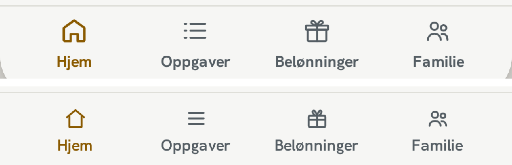
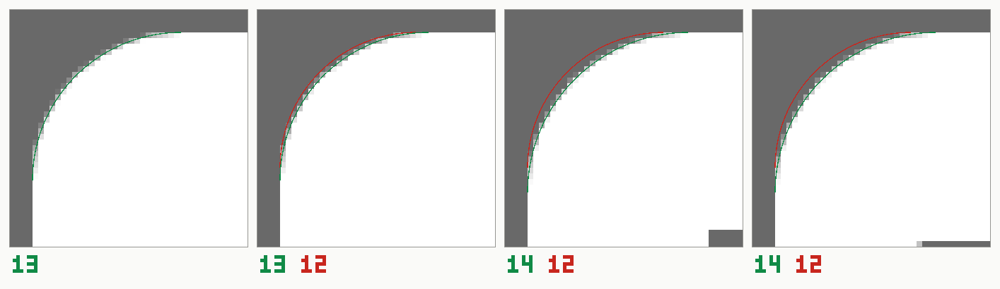
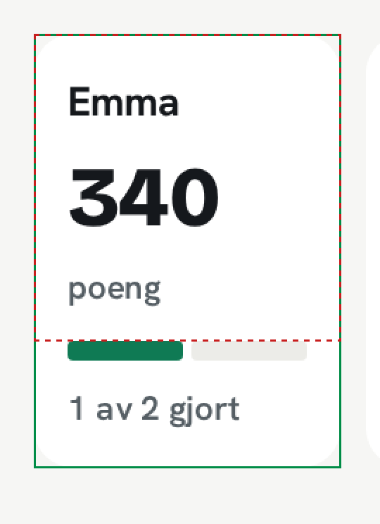
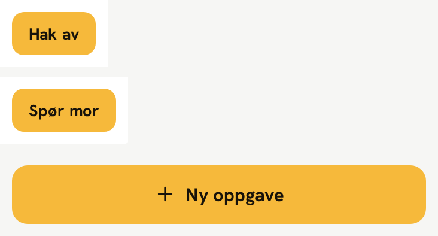

# Rule check: every rule in the guide, against the signed-off picture

The test for [DESIGN-GUIDE.md](DESIGN-GUIDE.md) is not "is this rule sensible" but **"does the
signed-off picture visibly do this"**. A rule the picture does not show is a rule that will drain
the picture, which is exactly what went wrong on ST-729.

Reference: [`reference/poeng-signed-off.png`](reference/poeng-signed-off.png) — five screens,
left to right:

| #   | Screen                     | Frame x (board px) |
| --- | -------------------------- | ------------------ |
| 1   | Familiens hjem             | 88 – 867           |
| 2   | Forelder: oppgaveliste     | 924 – 1703         |
| 3   | Barn: mine oppgaver        | 1760 – 2539        |
| 4   | Barn: haker av en oppgave  | 2596 – 3375        |
| 5   | Barn: poeng og belønninger | 3432 – 4211        |

Crops used as evidence below:
[`meter-evidence.png`](reference/meter-evidence.png) ·
[`screen-4-tick-moment.png`](reference/screen-4-tick-moment.png) ·
[`screen-5-rewards.png`](reference/screen-5-rewards.png) ·
[`row-chore.png`](reference/row-chore.png) ·
[`row-overdue.png`](reference/row-overdue.png) ·
[`nav-icon-signed-off-vs-brand-07.png`](reference/nav-icon-signed-off-vs-brand-07.png)

---

## Revision 10 — the nav glyphs redrawn to the picture (2026-10-12, ST-898)

> Numbered 10 because it merges after **Revision 9** (the popup layer, ST-883), which landed on
> `main` first while this branch was in review. Same convention: the order is the order they merged.

Revision 6 settled the nav icon's **size** and left its **drawings** untested. ST-898 was opened for
one number — «Familie» measuring ~2 px wider than the picture — and measuring the other three turned
it into a larger finding:

> **Three of the four shipped glyphs were different drawings from the signed-off picture, and the
> whole bar was drawn ~17 % heavier.** The size gap on «Familie» was a symptom of the wrong drawing,
> not a sizing mistake.

Maria's decision on 2026-10-12: **bring the code to the picture.** The alternatives (keep it; give
each glyph its own box; rescale the same drawings) were measured and all three leave at least one
wrong drawing — a per-glyph box cannot fix «Oppgaver» at all, because its shipped shape needs a
20.8 px box for the picture's width and an 18.5 px box for its height, and no single number
satisfies both. Not a new look, so it did not need Stig.

**Method.** Revision 6's, re-run from scratch rather than quoted, and it reproduced exactly: nav
band of each light screen, ink = every pixel under a luminance threshold, bounding box per item,
thresholds 200 and 220, board px ÷ 2 = css px; divider at board y 1738–1739, icon ink y 1759–1794,
item centres cx 200.5 / 384.5 / 570.5 / 754.5. The render is measured from the **real
`nav-icon.html`**, parsed per git ref, not from a copy of the path data. Exact ink is read from a
**10× solo render** of that glyph on white — every pixel under luminance 250, ÷ 20 — which takes the
numbers off the half-pixel raster to ~0.05 px. The table therefore carries two conventions: the
picture's column is the board at threshold 220, the two render columns are the 10× solo. **Quote the
convention with the number.**

| Item            | picture     | was (PR #645) | now           | what the drawing changed                                       |
| --------------- | ----------- | ------------- | ------------- | -------------------------------------------------------------- |
| **Hjem**        | 18.0 × 18.0 | 17.70 × 18.00 | 18.00 × 18.00 | same house, re-expressed at 21 units                           |
| **Oppgaver**    | 17.0 × 12.0 | 17.15 × 13.60 | 17.00 × 12.00 | **dashes, not dots** — the picture's bullet is a 1.5 dash      |
| **Belønninger** | 18.0 × 17.5 | 18.20 × 18.10 | 18.00 × 17.00 | **lid band** over a narrower box, **small two-loop bow**       |
| **Familie**     | 17.0 × 15.0 | 19.30 × 16.35 | 17.00 × 15.05 | **a small second head** — a parent and a child, not a crescent |

The **now** column is round 2's artwork. «Belønninger» reads 17.00 rather than 17.50 there because
its body's bottom line moved onto the picture's; in the picture's own convention — the 2× band at
threshold 220 — the same glyph reads **18.00 × 17.50**, the picture's number exactly. Round 2 below
has both readings and why they differ.

«Familie» reads 17.0 × 15.0 on **all four light screens at both thresholds**. It does not drift, so
it was never a measuring convention — it was a narrower drawing.

**The line weight, which affected all four.** A vertical cut through the three «Oppgaver» rules
(luminance under 210) gives the picture **1.5 / 2 / 1.5** px — the middle rule straddles a pixel
boundary. PR #645 rendered **2 / 2 / 2**: a drawn stroke of 1.75 px, because an 18-unit drawing
stretched into a 21 px box multiplies every number, the stroke included, by 1.167. The redrawn set
reproduces 1.5 / 2 / 1.5.

**Box, no longer derived.** This supersedes Revision 6's box derivation. The set is drawn in a
**21-unit viewBox**, so one unit is one rendered pixel in the 21 px box and the ink numbers above
are literally the path data. `--nav-icon: 21px` is unchanged and no CSS changed. Revision 6's
arithmetic (18.0 ÷ 15.40 × 18 = 21.04) was right about the box and is why the number is still 21;
it only ever fitted the house, which is the one glyph the picture draws square and full.

**The bow, measured as openness rather than as a shape.** The picture's two loops are
**10.00 × 3.50** of ink standing **3.50 px above the lid**, with a slit open at each inner foot:
**7 enclosed near-white pixels** (greys 216–246, so right at the antialiasing floor — only 1
survives a 245 cut). PR #645's two large round loops are **15.10 × 5.35**, stand 5.35 px above the
lid and enclose far more. The shipped redraw is **10.10 × 3.50**, standing 3.50 — the picture's bow
to a tenth of a pixel. A first attempt matched the 10.0 × 3.5 box but closed the slit solid
(**0 px**), which is a different fault, not a smaller one. The shipped drawing is two loops leaning
8° outward with the ribbon carried up into the bow: **6 enclosed px**, and the channel the picture
keeps between the loops closes at the foot the same way (centre light-run per row, top down:
picture 12/6/4/2/0/0/0, shipped 8/4/2/2/0/0/0).

**`progress` (Fremgang), the fifth glyph.** Not in the signed-off picture, so there is nothing to
redraw it against. It was only re-expressed at 21 units: same drawing, ink 18.1 × 14.6 → 17.9 ×
14.4, which is the lighter line and not a size change. Left at 18 units it would have been the one
glyph in the desktop tab row still drawn 17 % heavier.

**The desktop band's half-coverage table moved with the artwork.** The guide's tab-row numbers are
measured on `#F6B93B` by coverage, not by a luminance cut (the yellow is itself luminance 188.9).
Re-run on both refs, the method reproduces the recorded old numbers exactly and gives the new ones:
house 18.0 × 18.0 (unchanged), fremgang 18.0 × 14.5 (unchanged), **list 17.5 × 13.5 → 17.0 × 12.0**,
**familie 19.0 × 16.5 → 17.0 × 15.0**, and after round 2 below, **gift 18.0 × 18.0 → 18.0 × 17.5**.
All four now agree exactly with the picture's table.

## Round 2 — the two interiors, and a reading trap underneath them (2026-10-12)

Ida measured the merged redraw against the picture and sent back two glyphs. Both findings hold;
both are fixed here. Everything below was re-measured from the picture and from the real
`nav-icon.html` per git ref, not taken from the review.

**1. «Belønninger» — the box under the lid.** The redraw put the body's own top line 1.5 px below
the lid's, so the shoulder read as a doubled band over a box 1.5 px too wide, with square feet
where the picture rounds them. The body now starts **on** the lid's bottom line and its feet are
rounded: body span c2c **15.50 → 14.00**, the picture's number exactly; overhang per side
**0.50 → 1.25** against 1.27; one line under the lid's hollow instead of two (the row run in a
column band inside the box is `6.5→17` on both, where the redraw gave `6.5→9.5`, a gap, then
`16→17.5`); ink on the bottom row **17.00 → 13.00**, the picture's.

**One change beyond what the review suggested, because the suggestion left a measurable gap.** The
suggested body kept its bottom edge on 18.5. Measured, that leaves the body's bottom line at 16.75
against the picture's **16.13**, and the whole glyph 18.00 tall against the picture's **17.50** —
at every sub-pixel offset and at thresholds 220 and 240, so it is geometry and not raster phase.
Moving the bottom to 18.0 lands both (16.25 and 17.50) and touches nothing else: lid, ribbon, bow
and the 18.00 width are unchanged. Ink agreement with the picture goes **63.4 % → 90.5 %**
(shared coverage ÷ combined coverage, 2× tiles aligned on the ink box).

**2. «Hjem» — the doorway.** Door jambs c2c **6.06 → 5.24** against the picture's **5.23 active /
5.25 inactive**, and the opening at threshold 220 **4.0 → 3.0** against 3.0. Both numbers read the
same on all four light screens, so neither depends on the chosen state. The door's **height is not
touched**: a pass that also lowered the lintel (door 5.6 units) puts it at 11.95 from the ink top,
further from the picture's 12.32 than the 12.55 the redraw already had, so it was dropped.

**3. Found while measuring: the picture bolds the chosen item, and one of our reference numbers is
a chosen-state reading.** Amber `#8A5A00` names the chosen item in the picture — and that item also
carries about **20 % more ink**. Per light screen, ink box at 220 and total coverage:

| item            | inactive                           | chosen (amber)                                     |
| --------------- | ---------------------------------- | -------------------------------------------------- |
| **Hjem**        | 18.0 × 17.5, cov 98.1, stroke 1.49 | 18.0 × 18.0, cov 117.9, stroke 1.84 (screens 1, 3) |
| **Oppgaver**    | 17.0 × 12.0, cov 68.4              | 18.0 × 13.0, cov 82.4 (screen 2)                   |
| **Belønninger** | 18.0 × 17.5, cov 142.9             | 19.0 × 17.5, cov 168.9 (screen 5)                  |
| **Familie**     | 17.0 × 15.0, cov 81.9              | never chosen in the picture                        |

Three of the four reference numbers are inactive readings. **The house's is not**: Revision 6 read
it on screen 1, where the picture draws it chosen and bolder. Our bar does not bold the chosen item
— since ST-892 the ink pill carries that state — so the comparable reading is the inactive one, and
against it our house is larger: wall c2c **16.50 against 15.75**, geometric ink **17.85 × 17.46
against 17.20 × 16.65**, about 0.7 px on both dimensions. It is why «Hjem» reaches only **71.1 %**
ink agreement where «Belønninger» now reaches 90.5 % and «Oppgaver» 94.7 %.

**This is recorded, not fixed.** Narrowing the house moves the one glyph this review passed, and it
moves it off 18.0 × 18.0 — the number Revision 6's 21 px box derivation rests on. That is a
decision about the set and the box, not a round-2 correction, so it goes to Maria with its
numbers. The other three glyphs are unaffected: they were already read inactive and match within
0.2 px.

**What remains different from the picture, with reasons** (a difference without a reason is a fault):

1. **«Belønninger» reads 17.5 tall on the 390 px band at both cuts**, against the picture's 17.0
   (threshold 200) and 17.5 (220) — exact at 220, half a pixel over at 200, which is the picture's
   own read floor. The 10× solo render of the same glyph reads 17.00, the geometry; the two
   conventions differ by the antialiased edge, as the guide's method note describes.
2. **«Hjem» is ~0.7 px larger than the picture's inactive house** — point 3 above, with Maria.
3. **«Familie» measures 15.05 against 15.00** — 0.05 px, below anything the picture can be read to.
4. **The bow's loops are a touch rounder than the picture's**, which draws them slightly more
   pointed at the top outer edge. At 10 × 3.5 px of ink with a 1.5 px stroke the slit is one pixel
   of near-white, so the shape is held by three numbers rather than by its outline: the box
   (10.10 × 3.50 against 10.00 × 3.50), the height above the lid (3.50 on both) and the openness
   (6 enclosed px against 7). Maria's one allowed pass at the tilt is the 8° lean that is shipped;
   a second pass would close the slit before it sharpened the point.

---

## Revision 9 — the popup layer (drawings 2026-10-11, decision ST-880 2026-10-11, written ST-883)

The third thing in this guide the signed-off picture **cannot** test: it contains no popup. The
rules under **Popups** are tested against the pictures Stig chose from on ST-873 and the four-point
rule he approved on ST-880, and against the signed-off picture for everything the popups reuse —
surface, radius, column, padding, button size, the ink-on-yellow rule.

**Method.** Every figure was re-measured on ST-883 in the PNGs now in `reference/`, at
`deviceScaleFactor: 2`: read the stroke pixel, then the page pixel on the same row immediately
outside it, then the page clear of the shadow. Radii use the arc fit from the guide's **Shapes**
section. No figure was copied from the ST-873 documents or from the owner card.

| Rule                                                          | Evidence                                                                                                                                                                                                                                                                                                                                                                                                                                                                                                              |
| ------------------------------------------------------------- | --------------------------------------------------------------------------------------------------------------------------------------------------------------------------------------------------------------------------------------------------------------------------------------------------------------------------------------------------------------------------------------------------------------------------------------------------------------------------------------------------------------------- |
| The problem is real: today's sheet has no edge                | `popup-00-i-dag.png`: the sheet is `#FFFFFF` on `#F6F6F4` — **1.08:1** — with a white chore card 2 px above it. Where the shipped sheet overlaps that card the two sides are the same hex: **1.00:1**. Its position read in the CSS, not guessed: `notification-offer.css` and `install-prompt.css` both set `left`/`right: var(--space-md)` and `bottom: calc(var(--space-md) + env(safe-area-inset-bottom, 0px))`, and `--space-md: 1rem` in `styles.css` — a **16 px** gutter, `z-index: 1100` over a nav at 1000. |
| A popup reuses the page's geometry, nothing new               | Left stroke x 22.0, right x 367.5 (346 px column) in `popup-R1-varsler.png` and `ida-W1-kant-17120A.png`; corner arc 12.4–12.8 → **13 px**; padding 15; buttons **152 × 49 at 8 px**, first at x 38.0, second at x 199–200.                                                                                                                                                                                                                                                                                           |
| Every popup takes the same edge and shadow                    | `popup-02-anbefalt-tre-popups.png` draws it on three: two sheets on two different screens and one blocking dialog. Sheet edge `#555E64`: **5.71:1** top, 4.64:1 side, 4.15:1 bottom next to the stroke; 6.62 / 6.01 / 6.12:1 clear of the shadow.                                                                                                                                                                                                                                                                     |
| A blocking popup takes an **ink** edge                        | `ida-W1-kant-555E64.png` vs `ida-W1-kant-17120A.png`, the same frame: grey **1.43:1** against the veiled band next to the stroke (1.92:1 clear), ink **4.03:1** (5.41:1 clear, 5.64:1 against the undisturbed veiled band). Side edges are the worst case, not the top.                                                                                                                                                                                                                                               |
| The veil is 30 % Ink, and the page keeps its colours under it | Sampled against the approved page: `#F6B93B` → `#B3862C`, `#FFFFFF` → `#B9B7B5`, `#F6F6F4` → `#B3B1AD`, status bar untouched, ink text still `#17120A` (5.64:1 on the band, 9.32:1 on a veiled card). `rgba(23,18,10,.30)` composited over each of those hexes reproduces the sampled pixel to within one channel step (179/135/44 predicted against 179/134/44 sampled on the band), so the alpha in the drawings is the alpha in the token.                                                                         |
| The yellow band is not re-coloured, only veiled               | The veiled band is 1.87:1 from `#F6B93B` and returns to it when the dialog closes. It is also strictly less dimming than the `rgba(0,0,0,0.5)` the build ships today. Stig approved this on the card; it is the one place the brand colour looks different.                                                                                                                                                                                                                                                           |
| «Slett» is rust, not ink                                      | **No approved picture shows it** — the drawings fill «Slett» with ink. `popup-04-slett-rust.png` was rendered on ST-883 from the repo's own fonts, at the measured 152 × 49, to give the point a picture: white on `#A43A16` is **6.57:1**.                                                                                                                                                                                                                                                                           |

**Dropped from the drawings, recorded rather than copied:**

- **B — 52 % dimmed backdrop.** Band `#826121`, **3.24:1** from the approved yellow; the popup gets
  its separation by draining the page. Rejected. The approved 30 % veil is a third of it, on
  blocking popups only.
- **C — yellow surface.** Edge **1.63:1** on paper: a hue step, not a lightness step. Rejected.
- **The grey edge and the ink «Slett» in `popup-02` / `popup-R3`.** Superseded by points 3 and 4 of
  the same decision. The drawings stand for everything else they show.

**Known gap.** The breaking cases **are** drawn: `ida-01-verste-tilfelle.png` carries «Tekst på
200 %», «Lengre knappetekst» and «Ett langt ord» at 390 px, each measured and badged «Må fikses»,
and it is the record the build works from. What nothing in the approved set draws is the **fixed**
state, a frame at **360 px**, or the rust «Slett» in place on a real screen. The build (ST-884)
must send phone screenshots of «Slå på varsler», a blocking popup, «Rediger oppgave» and a dialog
tall enough to reach the yellow band, with the edge measured in those screenshots.

---

## Revision 8 — desktop A and the chosen menu item (pictures 2026-10-11, decisions 2026-10-12, ST-890 → ST-892)

> Numbered 8 because it merges after **Revision 7** (the yellow top, the login and the mark,
> ST-815), which landed on `main` first. Same convention that revision used for its own number:
> the order is the order they merged, not the order they were written.

The first two rules in this guide that the signed-off picture **cannot** test, because it draws
neither of them: a pointer-screen layout, and a chosen-state for the menu. They are tested against
the pictures Stig approved on ST-890 instead, and against the signed-off picture for everything
those pictures reuse.

**Two rows in the table below are decisions _against_ the pictures, and are marked as such.** The
desktop drawings were made before ST-890's menu decision, so their chosen-tab underline is a
placeholder; Maria ruled on 2026-10-12 that the phone's ink pill replaces it, and that the tab row
uses the signed-off icon set rather than the small `brand-07` glyphs the drawings inherit. Every
other row is a measurement of the approved pictures.

**What was deleted.** "Active is Amber Ink with the heavier weight; inactive is Muted Text. Two
signals, not one." On the phone that was `#8A5A00` against `#555E64` — **1.12:1**, colour-only, and
Stig could not tell which page he was on. Replaced by the ink pill.

**Method.** Measured on the approved PNGs at `deviceScaleFactor: 2`
(`desktop-07-opsjon-A-1440.png`, `desktop-10-anbefalt-A-1024.png`,
`desktop-12-anbefalt-A-mine-oppgaver-1440.png`) and at scale 4 on `nav-04-a-alle-faner.png`, whose
scale is fixed by the 46.00 px pill it shares with `nav-02-forslag-a-b-c-v2.png`. Radii use the
sub-pixel arc fit from the guide's **Shapes** section; it returns **13.12** on the signed-off chore
card, which is the calibration.

**The pill in the band had to be rendered, because no picture contains it.** The tab row was built at
1024 px, `deviceScaleFactor: 2`, with the pill, the repo's signed-off nav icons
(`nav-icon.html`, `progress` included) and the repo's own `hanken-500.ttf` / `hanken-600.ttf`, using the Playwright
pinning in the guide's **Rendering screens as pictures**. Ink is measured on that render with the
same column-run method used on the approved PNGs, so the two are comparable:
[`desktop-20-tabrow-pill-vs-underline.png`](reference/desktop-20-tabrow-pill-vs-underline.png) puts
the approved row and the rendered one in one image at the same scale.

| Rule                                                                 | Evidence                                                                                                                                                                                                                                                                                                                                                                                                                                                                                                                     |
| -------------------------------------------------------------------- | ---------------------------------------------------------------------------------------------------------------------------------------------------------------------------------------------------------------------------------------------------------------------------------------------------------------------------------------------------------------------------------------------------------------------------------------------------------------------------------------------------------------------------- |
| The band and tab row are identical at 1440 and 1024                  | Every y in the band matches to the pixel across the two pictures; only the container's x offset moves (280 vs 72).                                                                                                                                                                                                                                                                                                                                                                                                           |
| Container is 880 px, centred                                         | 1440: x 280…1160. 1024: x 72…952. (1440−880)/2 = 280, (1024−880)/2 = 72.                                                                                                                                                                                                                                                                                                                                                                                                                                                     |
| Columns are 428 + 24 + 428                                           | Measured on both pictures and on the worst case. 428+24+428 = 880.                                                                                                                                                                                                                                                                                                                                                                                                                                                           |
| The band ends 17 px under its lowest content                         | Home: cards end y 242, band ends 259. Child: meter ends 253, band ends 270. Same rule as the phone band.                                                                                                                                                                                                                                                                                                                                                                                                                     |
| Nothing inside a card changed                                        | Row 68 px; card radius **13.12** (phone 13.12); child card 109 × 154 at 9 px, radius **14.18** (phone 14.21); padding 15; checkbox 22 × 22; badge 38; button 49; `#15181C`/`#555E64`/`#8A5A00`/`#A43A16` all unchanged.                                                                                                                                                                                                                                                                                                      |
| Everything on the yellow is `#17120A`                                | Title, sub-line, all five tab labels and icons, the badge initial — sampled. 10.57:1. The chosen tab's pill is ink as well; its icon is the one yellow thing in the band.                                                                                                                                                                                                                                                                                                                                                    |
| The chosen **desktop** tab is the phone's ink pill                   | **Not measurable in the pictures — it is a decision against them.** They draw a 3 px underline, 89 px under «Hjem» and 121 px under «Oppgaver», and no pill anywhere: the five-tab strip holds 4 607 device px² of ink, while one 46 × 26 pill alone would be 4 784. The pictures were drawn before ST-890's menu decision, so that underline is a placeholder; **Maria ruled on 2026-10-12 that the pill replaces it** (ST-892).                                                                                            |
| The pill forces the icon→label gap from 9 px to 16.5 px              | A 46 px pill centred on the 21 px icon box reaches **12.5 px** past the box each side; the drawings place the label ink **10.5 px** right of the icon ink, ~9 px from the box edge. Drawn as-is the pill runs 3.5 px under «Hjem». 12.5 + the pill's own 4 px of clearance = **16.5 px**, applied to all five tabs so the row does not reflow on a page change.                                                                                                                                                              |
| The widened row still clears the badge at 1024                       | **Rendered, then measured** — not derived. Row built at 1024 (DPR 2) with the pill, the signed-off icon set and the repo's Hanken; the render reproduces all five drawn label ink widths **exactly** (32.5 / 65.5 / 44.5 / 64.5 / 77.5). First tab box x 232.5, row ends **x 877** = **644.5 px**; box widths 102.5 / 134.5 / 113.5 / 133.5 / 146.5 at 3.5 px apart; targets 44.0 px tall at y 18…62; label starts exactly **4.0 px** after the pill. The 38 px badge starts at x 914: **37.0 px clear**. Identical at 1440. |
| Arithmetic over the label **ink** gets this wrong by 8 px            | Summing the drawn ink widths predicts a 636 px row ending at x 868.5 with 45.5 px of clearance. The render says 644.5 and 37.0: a text box carries side bearings beyond its ink. The rendered box widths are the build numbers.                                                                                                                                                                                                                                                                                              |
| The tab label is Hanken Grotesk 15 px — **500 unchosen, 600 chosen** | Ink **area** against `desktop-07`, rendered at 15 px: weight 500 reproduces all four unchosen labels to **0.0 %** (Oppgaver 876, Familie 654, Fremgang 912, Belønninger 1092 device px², identical), and weight 600 reproduces the chosen «Hjem» to **0.0 %** (518). `desktop-12`, where Oppgaver is chosen, shows the same step: +9.0 % over its own baseline. The drawings' "weight step" is exactly 500 → 600 — not 700, not 800. Sizes 14 / 16 / 17 px are out by 1.5–7.5 px of width.                                   |
| One weight step cannot carry the state on its own                    | Same word, chosen vs not: «Hjem» +11.0 %, «Oppgaver» +9.0 % of ink area. But the _same unchosen_ label moves between the two pictures by −6.4 % («Familie»), −4.6 % («Fremgang»), −3.8 % («Belønninger») from rendering alone. A 9–11 % step sits just above a ~5 % floor, which is why the pill is the signal and the weight only supports it.                                                                                                                                                                              |
| The **phone** pill is 46 × 26, fully rounded                         | Both pictures agree to 0.00 px. The run-width profile matches a stadium: 43.0 measured against 42.5 predicted at 6.5 px off centre, 37.0 against 36.6 at 10 px off centre.                                                                                                                                                                                                                                                                                                                                                   |
| The pill's label does **not** change weight                          | Normalised glyph area, chosen vs not: «Hjem» 1459.0 vs 1460.4, «Oppgaver» 2054.1 vs 2052.6 device px². 0.1 % apart. The colour change is the whole difference.                                                                                                                                                                                                                                                                                                                                                               |
| Three signals, not one                                               | Pill against the bar **17.22:1**; yellow icon against the pill **10.57:1**; chosen label against unchosen **2.81:1**.                                                                                                                                                                                                                                                                                                                                                                                                        |
| The pill's icon size is **derived**, not drawn                       | `nav-02`/`nav-04` are built on `brand-07`, so they carry the Revision 6 slip: 14 px of ink, not 18. The signed-off picture wins; the pill geometry is still theirs.                                                                                                                                                                                                                                                                                                                                                          |

**Dropped from the drawings, recorded rather than copied:**

- `desktop-14` truncates a long chore title to **one** line. The two-line rule under **Cards and
  rows** is older and comes from the signed-off picture, so it stands.
- `11-anbefalt-A-morkt-1440.png` and `nav-05-a-morkt.png` draw a dark mode. Neither was on the
  decision card and Stig did not ask for one. There is no dark mode.

**Four things the drawings left open — raised on ST-892, all settled by Maria on 2026-10-12:**

1. **The desktop tabs take the phone's ink pill**, not the underline the pictures draw. ST-890's
   decision says the desktop tabs get the rule Stig picked for the phone, and the desktop pictures
   predate that decision.
2. **Below 1024 px the phone layout is used** — bottom menu, one column.
3. **The desktop tab's pointer target is ≥44 px tall.** The drawn shape is unchanged; the hit area
   grows.
4. **The tab row uses the signed-off icon set** — 18 px of ink in a 21 px box — by the same
   reasoning Revision 6 applied to the bar, against the `brand-07` glyphs the desktop pictures
   inherit.

**The one gap this list expected is not a gap.** Fremgang is not on the phone's four-item bar, so a
fifth glyph looked missing — but `progress` is already in the repo's signed-off set
(`apps/frontend/src/app/components/navigation/nav-icon.html`, same 18 × 18 viewBox, same 1.5 stroke,
built by ST-881 from the approved source) and renders **18.0 × 14.5 px of ink** in the 21 px box —
width, then height, at half coverage on the band, the convention the guide's tab-row section states.
Nothing in this revision is left for someone to draw.

---

## Revision 7 — the yellow top, the login and the mark (2026-10-10, ST-815)

> Written on 2026-10-10 and numbered 7 because it lands after **Revision 6** (the nav icon, ST-887,
> 2026-10-11), which merged first. Only the number and the cross-references moved; nothing in this
> section was re-measured for the renumbering.

Stig approved three things the signed-off picture does not contain: **option A, the yellow top**,
the **login screen** and the **Diddit mark**, all "as drawn" (ST-812, 15:23). Astrid's pictures are
on ST-810 and are now copied into `reference/`. This section checks every rule those three added to
the guide, the same way the rest of this file checks the signed-off picture: **does the approved
picture visibly do this?**

Everything below is measured from the PNGs at 390 × 844, `deviceScaleFactor: 2`, in css px.

### A — the yellow top

| Rule in the guide                                        | Where the picture shows it                                                                                                   |
| -------------------------------------------------------- | ---------------------------------------------------------------------------------------------------------------------------- |
| The band is full-bleed `#F6B93B`                         | `brand-07` and `brand-08`: columns at css x 5 and x 380 both read `#F6B93B` through the band. No gutter, no radius.          |
| It starts at y 35, under the status-bar band             | Both: `#F6F6F4` from y 0 to 35, `#F6B93B` from 35.                                                                           |
| It has no fixed height; it ends ~17 px under its content | `brand-07` ends at **275**, child cards end at 257 → 18. `brand-08` ends at **305**, meter ends at 288 → 17.                 |
| Inside it, the gutter is the ordinary 22 px              | `brand-08`: the reward meter runs x **22 … 367.5** — the 346 px column. `brand-07`: the child cards run x **21.9 … 367.1**.  |
| Title, sub-line and hero number are Ink on the band      | Darkest pixel in each is `#17120A`, not `#15181C` and not `#555E64`.                                                         |
| The points meter in the band is Ink on `#C59430`         | `brand-08` y 281: nine `#17120A` segments and one `#C59430`, 30.5 px wide at 35 px pitch — 14 px tall, 4 px gaps.            |
| The initial badge in the band is `#DBA434` with Ink      | `brand-07`: disc fill `#DBA434`, y 45 … 83 → **38 px**, the signed-off diameter. The initial is `#17120A`.                   |
| Chore meters on the child cards do **not** change        | `brand-07`: the meters inside the white cards are still Done Green / Overdue Rust / `#ECECE8`.                               |
| Everything below the band is unchanged                   | `brand-07`: the overdue card runs x **22 … 368** with its 2 px `#A43A16` border — the signed-off gutter and column.          |
| The tick screen is still the only fully yellow screen    | Both A screens are yellow for 240 / 270 px of 844 and keep paper, cards and nav below. Screen 4 is yellow to the frame edge. |
| Hero sizes are unchanged by the band                     | `brand-08`: «215» ink y 128 … 185 against the signed-off 128.5 … 185. "poeng" 211 … 222 against 211.5 … 221.5.               |

**One exception to "everything below the band is unchanged", found after this section was written:**
both A pictures draw the bottom nav with a smaller icon set than the signed-off picture — 14.0–14.5
px of house ink against 18.0. Cards, rows, buttons, divider, pitch and labels below the band are
unchanged; the icon glyphs are not. It is a drawing slip in the pictures, not a rule — **Revision 6**
below.

### Withdrawn finding — `brand-07`'s child cards are **not** the wrong width

This revision first reported that `brand-07` drew the child cards 106 px wide, 12 px apart, in a
24 px gutter, and called it the one place an approved picture contradicts the signed-off picture.
**That was a measuring error, found by Astrid in her review of PR #639 and confirmed on the pixels
here.** `brand-07` draws 109 / 9 / 22 — the signed-off values. On the child cards, the gap, the
gutter and the column the approved pictures and the signed-off picture agree, and no "they disagree"
rule survives into the guide from this reading. The nav icons are a separate slip, and a real one —
**Revision 6** below.

| Measurement       | Signed-off screen 1   | `brand-07` at css y 112 (in the arc) | `brand-07` at mid-height   |
| ----------------- | --------------------- | ------------------------------------ | -------------------------- |
| Child card width  | **109** (x 22 … 131)  | 106.3 (x 23.4 … 129.6)               | **109.1** (x 21.9 … 131.1) |
| Gap between cards | **9**                 | 11.7                                 | **8.9**                    |
| Gutter / column   | **22 / 346**          | 23.4 / 343                           | **21.9 / 345.2**           |
| Card height       | **154** (y 104 … 258) | —                                    | **154** (y 104 … 258)      |

The card's top edge is y 104 and its radius is 14, so a scanline at y 112 crosses the corner arc and
is inset `14 − √(14² − 6²)` = 1.35 px on each side — 109 becomes 106.3, to the tenth. The first
reading measured the arc and named it the card.

The same error then recurred one row over: the method note's own table first gave the full-width
band as y 118 … **250**, and 250 is 8 px above the bottom edge — the mirror of the y 112 reading the
note is about. Astrid caught that too. The card's edges are hard (white from y 104.0 to y 258.0, no
antialiased row), so with r = 14 the band is **y 118 … 244**; y 245 is already short.
y 250 reads **106.1 / 11.9**, not the 106.3 / 11.7 of y 112: a row index counts downward from the top
in both corners, so y 250 sits 7.75 px into its arc against y 112's 8.25, and reads 0.2 px narrower.
Row 244 still dips a quarter of a pixel into the arc and its width moves half a pixel across edge
thresholds 240 … 252, so the row to actually use is **mid-height, y 181**, which barely moves at all.

**The build value never changed: 109 × 154 at 9 px in the 22 px gutter.** What changed is the guide,
which now carries the method note — _measure a card at mid-height, never within one radius of a
corner_ — in place of the withdrawn disagreement section, with
`reference/child-card-measure-method.png` (top corner) and `reference/child-card-bottom-arc.png`
(both bottom corners, y 244 · 250 · 258 marked) as its evidence.

### The login

| Rule in the guide                                          | Where the picture shows it                                                                                                                              |
| ---------------------------------------------------------- | ------------------------------------------------------------------------------------------------------------------------------------------------------- |
| Gutter 22 px, column 346 px                                | `login-17`: field, primary button and outline buttons all run x 22 … 368.                                                                               |
| Brand area `#F6B93B`, y 35 … 338 (303 px)                  | `login-17`, `-14`, `-16`, `-18`: identical in all four.                                                                                                 |
| It collapses to 112 px when a field has focus              | `login-15`: `#F6B93B` y 35 … **147**. The keyboard surface begins at y **508**.                                                                         |
| "Logg inn" clears the keyboard after the collapse          | `login-15`: the button sits above 508 with room to spare; at 303 it would be at 540 … 588, fully covered.                                               |
| The mark is 54 × 54 at x 22, y 71                          | `login-17`: Ink bbox x 22 … 76, y 71 … 125.                                                                                                             |
| Wordmark Bricolage 800 **56 px**, −0.02em                  | Picture ink: w 146.5, band 42.0, D-cap 37.0. Rendered in the repo's bundled Bricolage at 56 px: **146.5 / 42.0 / 37.0 — 0.0% on all three.**            |
| Brand claim Bricolage 800 **29 px**, −0.02em               | Picture ink: w 183.5, band 27.5, G-cap 20.0. Rendered at 29 px: 179.5 / 27.5 / 20.0 — heights exact, width −2.2%.                                       |
| The promise line is **Body 16**                            | Picture ink: w 265.5, band 15.0, O-cap 11.5. Rendered Hanken 600 at 16 px: **265.5 / 15.0 / 11.5 — 0.0%.**                                              |
| Field 346 × 49, 13 px radius, 1.5 px `#555E64`             | `login-17`: white y 388 … 435 with a `#555E64` line at 387 and 435.5 → 49 px tall, 1.5 px border.                                                       |
| Field value is Body 16                                     | `login-14`: "mari.tangen@example.com" ink w 195.5. Rendered Hanken 600 at 16 px: 195.5 — 0.0%.                                                          |
| "Logg inn" label is Button label 16.5                      | `login-17`: ink w 59.5. Rendered at 16.5 px: 59.5 — 0.0%. The same token as the signed-off primary button.                                              |
| Field label is Label 13, above the field, on the gutter    | "Passord" ink w 43.5, cap 9.0, left edge x 23. Rendered at 12.5 px: 43.5 — inside the guide's font residual.                                            |
| "Glemt passord?" is `#8A5A00`, right-aligned to the column | Darkest pixel `#8a5a00`; right edge x **368**.                                                                                                          |
| "eller" is Meta sm 13 in `#555E64`                         | ink w 26.5, darkest `#555e64`. Rendered at 13 px: 26.5 — 0.0%.                                                                                          |
| Error: **both** field borders rust, one rust line          | `login-16`: both field borders sample `#A43A16`; the message line samples `#A43A16`.                                                                    |
| Signing in keeps the yellow                                | `login-18`: the button is still `#F6B93B`; only the label and the ring change.                                                                          |
| Desktop: 634 px yellow panel of 1440                       | `login-19`: `#F6B93B` from x 0 to **634**, `#F6F6F4` after.                                                                                             |
| No new colour anywhere in the login                        | Every colour sampled — `#F6B93B`, `#17120A`, `#15181C`, `#555E64`, `#8A5A00`, `#A43A16`, `#FFFFFF`, `#F6F6F4`, `#DFDFD9` — is already in the token set. |

### The mark

| Rule in the guide                              | Evidence                                                                                                                             |
| ---------------------------------------------- | ------------------------------------------------------------------------------------------------------------------------------------ |
| 54 × 54, 16 px radius, Ink square, yellow tick | `login-17`: bbox 54 × 54; the corner arc reaches the straight edge at dy ≈ 15 css and fits a circular R of 15–16.                    |
| It is the tick badge's geometry                | Signed-off screen 4: the tick badge is also 54 × 54 (y 81 … 135) at a fitted 16 px radius (32.27 board px, revision 5).              |
| `diddit-mark.svg` reproduces the approved mark | Rendered at 108 × 108 and differenced against the mark in `login-17`: **mean 0.004 of 765 per pixel, worst pixel 15, none over 30.** |
| The tick is centred, x 11.5 … 42.5, y 15 … 40  | Measured with the four corner arcs excluded, so the ground does not leak into the bbox.                                              |

### Finding — three different ticks exist in the approved material

Measured as a fraction of a 54 px square, corner arcs excluded:

| Tick                                       | w    | h    | ink area |
| ------------------------------------------ | ---- | ---- | -------- |
| Tick badge, signed-off screen 4            | 19.0 | 14.5 | 73       |
| App icon on the brand sheet `brand-06`     | 22.4 | 17.7 | 118      |
| **The mark on the login, `login-14`…`19`** | 31.0 | 25.0 | 255      |

The mark is the login one — five of the six approved pictures draw it that way, and it is the one
on the screen being built. The tick badge keeps its own smaller tick; it is a UI element, not a
logo. The brand sheet's app icon is read as a drawing slip; `brand-06` is approved material, so
**redrawing it needs Maria before anyone touches it**. Nothing in the build depends on the sheet —
Eirik builds from `diddit-mark.svg`. The middle number (22.4) is this revision's own measurement and
has not been independently checked; it is not load-bearing either way. Written into the guide so
nobody normalises one tick into another.

### Rules deliberately **not** written in this revision

| Candidate rule                                       | Why not                                                                                                                                               |
| ---------------------------------------------------- | ----------------------------------------------------------------------------------------------------------------------------------------------------- |
| "The brand band is N px tall"                        | The two approved screens measure 240 and 270. The band is content-sized; a fixed height would contradict both.                                        |
| "A yellow pill under the active nav item"            | Astrid offered to carry it over from option B. Stig approved A **as drawn**, and neither A picture has one.                                           |
| "Give the initial badge an ink ring on the band"     | `#DBA434` on `#F6B93B` is 1.27:1, but the initial at 8.31:1 is what identifies the control, so 1.4.11 is met. A ring is a change to the look → Maria. |
| "Disable the sign-in button until the form is valid" | The approved empty state draws it **enabled**. Validating on press is the drawn behaviour.                                                            |
| "The keyboard return key is yellow"                  | Drawn grey on purpose: an app can set that key's label, not its colour.                                                                               |
| Any colour added for the login or the band           | Every pair measured resolves to an existing token. Adding one would be a change to the look.                                                          |

### Still open after this revision

- **Two of the four working screens are not drawn** — the parent's chore list and the rewards
  screen. The guide gives the pattern; the result needs a look before it ships.
- **Nothing is drawn at 360 px.** ST-801 came back for exactly that. The guide says to check the
  login and both A screens at 360 with the keyboard up.
- **`brand-06`'s app-icon tick** should be redrawn to match `diddit-mark.svg` the next time the
  sheet is touched — **Maria's call, since `brand-06` is approved material.**

---

## Revision 6 — the nav icon: a box number written as if it were ink (2026-10-11, ST-887)

`nav-item.iconSize: '17px'` had no ink measurement behind it. ST-881 built to it (PR #644, merged),
which made the bottom-nav icons a fifth smaller than the signed-off picture draws them. Maria's
decision on ST-881: the nav icon follows the signed-off picture. This revision puts the measurement
in the guide and separates the two numbers — `iconInk: 18px` is what the picture shows,
`iconSize: 21px` is what you set to get it out of the current artwork.

**Method.** Nav band of each light screen in [`poeng-signed-off.png`](reference/poeng-signed-off.png):
the `#DFDFD9` divider is board y 1738–1739, so the band is y 1740–1881 (142 board px = 71 px). Ink
is every pixel under a luminance threshold; bounding box per item, run at thresholds 200 and 220.
Board px ÷ 2 = css px.

Eight readings per item (four screens × two thresholds). The css column is the **modal** reading,
the range column is all of it; the low ends are the muted glyphs losing their antialiased edge at
the tighter threshold, not smaller icons.

| Item        | Ink w × h, all 8 readings (board px) | Modal (css px) |
| ----------- | ------------------------------------ | -------------- |
| Hjem        | 34–36 × 34–36                        | 18.0 × 18.0    |
| Oppgaver    | 34–36 × 24–26                        | 17.0 × 12.0    |
| Belønninger | 36–38 × 34–35                        | 18.0 × 17.5    |
| Familie     | 34 × 30 (all eight)                  | 17.0 × 15.0    |

The four items sit at cx 200.5, 384.5, 570.5, 754.5 board px on screen 1 — pitch 184, 186, 184
board px, i.e. the 92 px of the existing rule, unchanged. The label band is 22 board px (11.9 px
caption), unchanged. Only the icon size was wrong.

**Box, derived.** The shipped glyphs do not fill their own `viewBox="0 0 18 18"`. The house path
runs y 2.1…16 with a 1.5 stroke, so its ink is 15.40 of 18 units: 18.0 ÷ 15.40 × 18 = **21.04 px**
of box for 18.0 px of ink. The same sum on the other three glyphs gives 20.2 (list), 20.3 (gift)
and 19.3 (familie) — a 19.3–21.0 px spread, because the artwork is a redraw of the picture's set,
not the set itself. 21 px is the house, which is the one glyph the picture draws square and full.
Maria's "about 20.5 px" from ST-881 sits inside that spread; PR #645 ships 21 px, and the guide now
says 21 px.

> **Superseded in part by Revision 10.** The box is still 21 px, but it is no longer derived: ST-898
> redrew the set in a **21-unit viewBox**, so one unit is one rendered pixel. The 19.3–21.0 spread
> read above was the symptom this revision could not yet name — three of the four were different
> drawings. Revision 10 holds that reading. Everything else here, including the eight readings and
> the ink table, stands and was reproduced from scratch.

### The brand-07 nav slip

The precedence note in this family of documents said nothing in the approved set disagreed with the
signed-off picture. It does, in one place. The approved yellow-top pictures
(`brand-07-a-yellow-top-home.png`, `brand-08-a-yellow-top-my-chores.png`, ST-812) draw the bottom
nav with a **different and smaller icon set**: the house has no door, the list is three bare rules
with no bullets, and the ink measures 28–29 board px — **14.0–14.5 px** — against the signed-off
picture's 36 (18.0). Divider, 92 px pitch, 11.9 px labels and the amber/muted pair are all the same;
the glyphs and their size are not.

Those pictures were approved for the yellow band above the content, which is what ST-812 was asked
about. They do not re-specify the nav. **The signed-off picture wins here**, and the slip is
recorded, not fixed inside the approved files — no approved picture is redrawn without a new
sign-off.

Three things the signed-off picture does not contain — **the yellow top, the login screen and the
Diddit mark** — were approved separately by Stig on 2026-10-10 (ST-812). For those, the approved
picture is the reference and the same test applies. See **Revision 7** above; the pictures are
listed in the guide under "What else Stig has approved".

---

## Revision 5 — the last stale radius, and two more it turned up (2026-10-10)

Astrid's review of revision 3 (ST-744, 2026-10-07 06:46) accepted every number in it except one:
`rounded.md: 12px`, the only radius still carrying its revision-1 hand value while the guide claimed
all radii were fitted. Revision 4 did not touch it — the redraw corrected type sizes and geometry,
not radii — so it was still open. She asked me to check it against my own scan rather than take her
fit.

I rebuilt the measurement instead of reusing the revision-3 dy-scan, because that scan is what
produced the wrong value. The new one takes the sub-pixel edge of every scanline by integrating
pixel coverage, takes the shape's own straight edges the same way, and least-squares an arc through
each of the four corners. It uses no calibration constant, so the primary button is a control rather
than an input: it returns 13.10 css there, against a true 13.

| #   | Finding                                                                                 | Status                                                                                     |
| --- | --------------------------------------------------------------------------------------- | ------------------------------------------------------------------------------------------ |
| 1   | `rounded.md: 12px`; the chore card measures 13.                                         | Confirmed and fixed — 26.21 board px over four corners, rms ≤ 0.11. `md` is now 13 px.     |
| 2   | Reward and child cards are **14 px**, not 13 — a disagreement with the review.          | Fixed — new `rounded.cardTile`. See below.                                                 |
| 3   | Chip radius 9 px, unresolvable in revision 3.                                           | Now measured — 18.15 board px on four corners of three chips, rms ≤ 0.08. The 9 px stands. |
| 4   | Child-card radius, unresolvable in revision 3.                                          | Now measured — 28.43 board px on four corners of all three cards, rms ≤ 0.16 → 14 px.      |
| 5   | Row action and tick badge carried ±1 px from the dy-scan.                               | Re-measured: 19.97 and 32.27 board px → 10 and 16 px exactly. The ± is gone.               |
| 6   | The child card is **109 × 154 px**, not the 109 × 109 square this revision first wrote. | Fixed — Astrid's review, 2026-10-10. See below.                                            |

### Finding 2: where this revision departs from the review

Astrid's table read every card as 13 and concluded that `rounded.md` and `rounded.lg` are the same
value "across five card components". Three of the five are: the chore card (26.21 board px), the
overdue card (26.22) and the inset card on the yellow screen (26.16). The other two are not.

| Shape                      | Four-corner fit | rms    | Reads as  |
| -------------------------- | --------------- | ------ | --------- |
| Primary button (control)   | 26.20 board px  | ≤ 0.11 | 13 px ✅  |
| Chore card                 | 26.21           | ≤ 0.11 | **13 px** |
| Overdue card               | 26.22           | ≤ 0.11 | 13 px     |
| Inset card on yellow       | 26.16           | ≤ 0.10 | 13 px     |
| Reward card, screen 5 (×3) | 28.43           | ≤ 0.16 | **14 px** |
| Child card, screen 1 (×3)  | 28.43           | ≤ 0.16 | **14 px** |
| Filter chip (×3)           | 18.15           | ≤ 0.08 | 9 px      |
| Row action (×3)            | 19.97           | ≤ 0.10 | 10 px     |
| Tick badge                 | 32.27           | ≤ 0.16 | 16 px     |

The 14 does not depend on trusting the fit. The reward card, the child card and the chore card are
all white on the same `#F6F6F4` ground, rendered with the same anti-aliasing, so their corners can
be compared pixel for pixel with no model at all. Measured from each shape's own top-left origin,
the row where the fill first reaches full white runs u = 25 on the chore card and u = 27 on the
reward and child cards; the next rows are 19/21, then 16/18. The two families differ by exactly
2 board px — 1 css px — at every scanline of the arc. The chore card equals the button, which is 13.
So the others are 14.

Why the fit's 14.21 is read as 14 and not 15: on the three shapes whose value is independently
known the fit reads high by 0.00–0.14 css (9.99 against 10, 13.10 against 13, 16.14 against 16).
Correcting 14.21 by that same small bias lands on 14.1.

**This is not a change to the look and does not go to Maria.** It is the same class as the 12 → 13
correction Astrid cleared in her section 5: a 1–2 px radius move _toward_ what the picture shows. It
removes nothing, switches no mode, drains no yellow and makes no button plain. The five screens stay
locked.

### Finding 6: the child card is 109 × 154, and why the bad box mattered

The first draft of this revision wrote the child card as "a 109 × 109 px square". The width was
never in doubt; the height was asserted, not measured, and it is wrong by 45 px. Sub-pixel edges on
all four sides of child card 1: L 132.00, T 434.00, R 350.00, B 742.00 → **218 × 308 board px =
109 × 154 css**. All three cards measure 154 tall; the three widths come out 109, 110, 109 with 9 px
gaps, which is the 346 px content column divided three ways.

The crop shows the cost of the error: at 109 tall the card ends above its own chore meter, so the
meter and the "1 av 2 gjort" line — both of which this guide _requires_ on that card — fall outside
it. A build that followed the guide would clip them.

The same assumed box is why the child card's bottom corners would not resolve: the fit was handed
`yB: 651`, which is 217 board px below the top and lands in the middle of the card, so BL and BR
came back at rms 3.12 while every other shape resolved on four corners. With `yB: 741` all four
resolve — **28.40 / 28.44 / 28.41 / 28.45, spread 0.05** — on each of the three cards, and they are
identical to the reward card's four to 0.01 board px, which is the cleanest proof that the two are
one shape. Same 14. The guide's claim that every radius is fitted "on all four corners of each
shape" is true as written only after this fix.

`card-child` now carries `height: '154px'` next to its `width: '109px'`: a width-only token is what
let the square through. Checked the revision's other new size the same way — the reward card is
L 3476.00, T 614.00, R 4168.00, B 798.00 → **346 × 92 css**, so "92 px tall" is right.

Also not a change to the look: a height corrected _toward_ what the picture draws removes nothing
and tones nothing down.

## Revision 4 — what the redraw found (2026-10-09, ST-756)

Revision 3 was checked by reading the reference board. Revision 4 was checked by **building the five
screens and measuring the renders against the board** (ST-740) — which is a stronger test, and it
found ten lines of the guide wrong. Maria approved every correction below. All are in the guide now.

| #   | Guide line in revision 3                       | What the picture measures                                    | Depends on the font? |
| --- | ---------------------------------------------- | ------------------------------------------------------------ | -------------------- |
| 1   | "Display sm 83 px — '215', '225'"              | Two sizes: «215» **83 px**, «225» **59 px** (ratio 0.71)     | no                   |
| 2   | "Display 100 px"                               | **94 px** — «+10» ink is 133 board px, not 137               | no                   |
| 3   | «poeng» beside «+10» — no size given           | **23 px**, display type, ink 60 px wide                      | no                   |
| 4   | "Screen gutter 22 px / 346 px column"          | True on 1, 2, 3, 5; screen 4 is **24 px / 342 px**           | no                   |
| 5   | Bottom nav — no pitch given                    | **92 px pitch**, ≈11 px edge padding; not four quarters      | no                   |
| 6   | Initial badge — absent from the guide          | **38 px circle**, `#ECECE8`, `#15181C` initial, 44 px target | no                   |
| 7   | "Body 20 px"                                   | **16 px** — «Dekke bord» ink is 80.0 px wide                 | **yes**              |
| 8   | "Meta 15 px"                                   | 15 px outside a card; **13 px inside** one                   | **yes**              |
| 9   | "Row action … Body 20 px", "Primary … Body 20" | **16 px** and **16.5 px**                                    | **yes**              |
| 10  | "Label 13 px", "Title 27 px"                   | Both check out — unchanged                                   | —                    |

Items 1–6 are wrong regardless of which face the picture used: they are ratios and geometry inside
the picture. Items 7–9 all point the same way and the likeliest single cause is the one this file
already flags — **the two font names are a guess.** The guide now carries a note that those four
sizes must be re-derived if the real face turns up.

Also recorded in the guide on ST-756: the **two accessibility exceptions** Maria approved — the
"Angre" outline in Ink `#17120A` (the picture's gold is 2.10:1) and the unchecked checkbox outline in
Muted `#555E64` (the picture's `#DFDFD9` is 1.34:1). They are the only two places a build may draw a
colour the picture does not show, and both keep the shape, the width and the surface unchanged.

## Revision 3 — what changed and why (2026-10-07)

Astrid's re-check of revision 2 confirmed every correction in it and found one more token that had
been written rather than measured.

| #   | Finding                                                                  | Status                                                                  |
| --- | ------------------------------------------------------------------------ | ----------------------------------------------------------------------- |
| 1   | `button-row-action` documented at 44 px; every instance is 36 px.        | Confirmed and fixed — 36 px drawn, 44 px padded target.                 |
| 2   | The hit-area line exempted only the chips, implying 44 px row buttons.   | Fixed — the line now names all three sub-44 controls.                   |
| 3   | The font caveat lived only in this file, not in the guide.               | Fixed — the caveat is now a block quote under the two font names.       |
| 4   | "Points meter … spanning the content column" overstates screen 5.        | Fixed — width follows the space given; only height and gap are fixed.   |
| 5   | Row-button and tick-badge radii still unmeasured (found while fixing 1). | Fixed — both measured: 10 px and 16 px. The badge was documented at 18. |

### Finding 1, verified independently

Flood-filled every `#F6B93B` region on all five frames and took the bounding boxes. Five row-action
buttons, none of them 44 px:

| Button     | Screen | Board box                | CSS size    |
| ---------- | ------ | ------------------------ | ----------- |
| "Ferdig"   | 3      | x 2328–2467, y 912–983   | 70 × **36** |
| "Ferdig"   | 3      | x 2328–2467, y 1146–1217 | 70 × **36** |
| "Spør mor" | 5      | x 3964–4137, y 702–773   | 87 × **36** |
| "Spør mor" | 5      | x 3964–4137, y 902–973   | 87 × **36** |
| "Spør mor" | 5      | x 3964–4137, y 1104–1175 | 87 × **36** |

The picture draws the chore button as «Hak av». Stig renamed it «Ferdig» on 10.10 (ST-808); the
board boxes above are the drawn button.

The same sweep returns 346 × 49 for the primary button on screen 2 and a 166 × 49 ghost interior on
screen 4, both exactly as documented — so the 49 was measured and the 44 was not. The widths differ
between the two labels, which is why the token now carries a height and no width.

### Finding 5, in detail

> **Superseded by revision 5.** The dy-scan described here is accurate to ±1 board px and is what
> left `rounded.md` at 12. The radii in the guide are now fitted sub-pixel on four corners; this
> section is kept as the record of revision 3, not as the current method.

The radii were the last values in the guide marked "not measured". They are measurable with the same
bounding boxes: walk down the left edge and find the first scanline where the fill reaches the box,
which lands one board px short of the radius. Calibrated against the primary button, where it
returns the 13 px that was measured by hand (first zero at dy = 25 → 26 board px).

| Shape          | First zero | Radius    | Was documented as      |
| -------------- | ---------- | --------- | ---------------------- |
| Primary button | dy = 25    | 13 px     | 13 px ✅ (calibration) |
| Row action     | dy = 19    | **10 px** | 12 px, "not measured"  |
| Tick badge     | dy = 30    | **16 px** | ~18 px, "not measured" |

Both new values are ±1 px and the guide says so.

## Revision 2 — what changed and why (2026-10-07)

Astrid reviewed revision 1 against the picture and found two rules that, followed literally, would
have redrawn parts of it. Re-measuring to confirm them turned up a third, larger problem: the board
scale was wrong, so every CSS px value in revision 1 was off.

| #   | Finding                                                                 | Status                                                        |
| --- | ----------------------------------------------------------------------- | ------------------------------------------------------------- |
| 1   | The family-screen meter was documented as yellow. It is green.          | Confirmed and fixed — two meter components now.               |
| 2   | "The only stroke in the picture" was wrong; a nav divider exists.       | Confirmed and fixed — `hairline` token, three strokes.        |
| 3   | Filter chips are not 44 px tall.                                        | Confirmed and fixed — 33 px, documented with a padded target. |
| 4   | No component entry for the reward card or the "Hentet før" history row. | Fixed — both added.                                           |
| 5   | **Board scale was 2.0, not 1.846** (found while verifying the above).   | Fixed — every size re-measured.                               |

### Finding 5, in detail

Revision 1 read the phone frame as 720 board px wide and derived 1.846 board px per CSS px. The
frame is **780 board px** wide (88–867 on screen 1, and the same width on all five). 780 ÷ 390 =
**exactly 2**, and the frame's content height, 1688 board px, is exactly 2 × 844. The board is five
device-true 390 × 844 screens at `deviceScaleFactor: 2`.

Two consequences:

- Every CSS px value in revision 1 was ~8% too large.
- Revision 1 read screen 1's **three side-by-side child cards** (x 132–349, 368–587, 606–823) as a
  single full-width card spanning 132–823. That is where "screen gutter 8 px" came from. The real
  gutter is 22 px, and the child cards are 109 px wide with 9 px between them.

The type scale was re-derived from scratch rather than rescaled, because the two errors did not
affect every value the same way (Body and Meta came out _larger_, not smaller).

---

All hex values and sizes below were sampled from the PNG, not estimated by eye. Sizes are CSS px at
390 × 844 (2 board px per CSS px).

## Colour rules

| Rule                                                            | Where the picture shows it                                                                                                                                                         |
| --------------------------------------------------------------- | ---------------------------------------------------------------------------------------------------------------------------------------------------------------------------------- |
| One yellow, `#F6B93B`                                           | Sampled identical on screen 2's "Ny oppgave" button, screen 3's meter, screen 4's whole background, screen 5's "Spør mor" buttons. Four different roles, one hex.                  |
| Yellow is a fill colour, not only a surface                     | Screen 2 primary button, screen 3 "Ferdig" button and meter segments, screen 5 three reward buttons + two meters — all filled yellow.                                              |
| Yellow is used freely, several times per screen                 | **Screen 5 has five yellow elements.** See [`screen-5-rewards.png`](reference/screen-5-rewards.png).                                                                               |
| **Yellow is not used on the family-screen meters**              | Screen 1, y = 658: Emma `#0F7A54`+`#ECECE8`; Jonas `#0F7A54`+`#ECECE8`+`#A43A16`; Mathea `#0F7A54`+`#ECECE8`. No yellow. See [`meter-evidence.png`](reference/meter-evidence.png). |
| Ink `#17120A` on every yellow surface                           | Screen 4: title, "+10", meter fill, tick badge, "Ferdig" fill — all sampled `#17120A`. 10.57:1.                                                                                    |
| White on yellow never appears                                   | No white type anywhere on screen 4 or on any yellow button. Computed 1.76:1.                                                                                                       |
| Amber Ink `#8A5A00` is a white-background colour                | "5 p" on a white row ([`row-chore.png`](reference/row-chore.png)). It appears nowhere on the yellow. It is **no longer** the active nav label — see Revision 8.                    |
| Reward costs are Muted Text, not Amber Ink                      | "60 p" on screen 5 sampled `#555E64`, unlike "5 p" on a chore row. Two different points colours, two different meanings.                                                           |
| Overdue Rust `#A43A16`                                          | The word "Forfalt", the 2 px card border, and the overdue meter segment on Jonas's card. See [`row-overdue.png`](reference/row-overdue.png).                                       |
| Done Green `#0F7A54`                                            | Filled check on completed rows (screen 2), "Du har nok poeng" (screen 5), filled chore-meter segments (screen 1).                                                                  |
| Hairline `#DFDFD9`                                              | Nav divider on screens 1, 2, 3, 5; the "Hentet før" divider on screen 5; the unchecked checkbox outline on every chore row. One hex, three uses.                                   |
| Active filter chip is `#15181C`, not Ink                        | Screen 2, chip fill sampled `#15181C` (Text), not `#17120A` (Ink). Revision 1 had this as Ink.                                                                                     |
| Surface `#FFFFFF` on background `#F6F6F4`                       | Every card on screens 1, 2, 3, 5.                                                                                                                                                  |
| On-yellow neutrals are darker shades of the same hue, not greys | Screen 4: inset card `#DBA434`, meter track `#C59430`. No grey appears on the yellow screen.                                                                                       |
| **The Keep-The-Yellow Rule**                                    | The picture never needs it: every text colour in it already clears 4.5:1, and the one hard case (type on yellow) is solved with black at 10.57:1.                                  |
| **The Ink-On-Yellow Rule**                                      | Screen 4, every element.                                                                                                                                                           |
| **The Say-It-In-Words Rule**                                    | "Forfalt" beside the red border; "Gjort 16.10" beside the green tick; "25 igjen" beside the meter; "225 av 250 poeng" on screen 4. No state in the picture is colour-only.         |

## Type rules

Each size was derived as: ink height in board px ÷ 2 ÷ the glyph run's ink-height-per-em, read from
the actual font file (`bricolage800.ttf`, `hanken500/600.ttf`). Measurements were stable across two
luminance thresholds.

| Rule                        | Measured from                    | Ink height   | Em ratio | Derived |
| --------------------------- | -------------------------------- | ------------ | -------- | ------- |
| ~~Display 100 px~~ → 94 px  | "+10", screen 4                  | 137 board px | 0.687    | 99.7 px |
| Display sm 83 px            | "215", screen 3                  | 115 board px | 0.691    | 83.2 px |
| Number 30 px                | "340" on a family card, screen 1 | 41 board px  | 0.687    | 29.8 px |
| Title 27 px                 | "Oppgaver", screen 2             | 46 board px  | 0.859    | 26.8 px |
| ~~Body 20 px~~ → 16 px      | "Dekke bord", screen 2           | 29 board px  | 0.706    | 20.5 px |
| Meta 15 px (outside a card) | "Mathea – kl. 16.30", screen 2   | 22 board px  | 0.716    | 15.4 px |
| Label 13 px                 | "Forfalt" group label, screen 2  | 18 board px  | 0.705    | 12.8 px |
| Caption 12 px               | bottom-nav labels, screen 1      | 22 board px  | 0.925    | 11.9 px |

> **Two rows in this table were re-measured and corrected on ST-756 (2026-10-09).** Drawing the
> screens against the picture (ST-740) and measuring the renders found both:
>
> - **Display is 94 px, not 100.** The 137 board px above included the word «poeng». Isolated,
>   «+10» ink runs x 27.5…170 and is **133 board px** tall; «poeng» runs x 174.5…234.5 and is its
>   own size, **23 px**.
> - **Body is 16 px, not 20.** The ink-height route is unreliable at text sizes — a 1 board px
>   threshold error is 3.5 % of a 29 px measurement. Ink _width_ is not: the picture's «Dekke bord»
>   is **80.0 px** wide, and Hanken Grotesk needs 16 px to reach it, where 20 px renders 100.5 px.
>   The same re-measure splits Meta in two — 15 px outside a card, **13 px inside one** — and puts
>   row-button labels at 16 px and the primary label at 16.5 px.
>
> **Measure text sizes by ink width, and the display sizes by their ratio to «215».** «215» stays
> the 83 px anchor; «225» and «+10» are 0.709 × and 1.137 × its ink, giving 59 and 94. «poeng» came
> from ink width (60 px) like the text sizes. The three ratio-derived sizes are consistent at
> 0.703–0.707 ink height per em, against Bricolage's own 0.687–0.691 — so running them back through
> the font file returns **97, 85 and 60** where the picture's own ratios give **94, 83 and 59**. All
> three are wrong in the same direction by the same ~2 %, which is the signature of the guessed face,
> not of three bad measurements. The guide's numbers are the ratio ones.
>
> **The lever is one measurement:** «215» ink reads 117 board px at ST-740's threshold and 115 at
> revision 3's. 94 is the value that reproduced the picture in a render measured against the board,
> so it stands, but Display, Display xs and Display unit are **±1 px** and the guide says so. Only
> re-measure them from a render, never from a font file — and re-derive all of them if the real
> source face is identified.

| Rule                                                               | Where the picture shows it                                                                                                       |
| ------------------------------------------------------------------ | -------------------------------------------------------------------------------------------------------------------------------- |
| Two faces only: a heavy display grotesque and a humanist text face | No third face, no italic and no uppercase tracking appears anywhere in the five screens. (Which faces exactly — see Unverified.) |
| **The Tabular Numbers Rule**                                       | "215" renders 7.7% wider than proportional figures of the same height would — that extra width is the tabular `1`.               |
| **The One Hero Rule**                                              | Screen 3 has one 83 px number; screen 4 has one 94 px number; screen 5 has one **59 px** number. Never two — but not one size.   |
| Label is _smaller_ than Meta                                       | Group label 13 px vs row meta 15 px, both on screen 2. Counter-intuitive, but that is what the picture does.                     |

## Layout, depth and shape rules

| Rule                                                          | Where the picture shows it                                                                                                                         |
| ------------------------------------------------------------- | -------------------------------------------------------------------------------------------------------------------------------------------------- |
| Viewport 390 × 844 at DPR 2                                   | Frame content is 780 × 1688 board px on all five screens (x 88–867 etc., y 194–1881).                                                              |
| Screen gutter 22 px; content column 346 px                    | Screen 2's chore card spans x 969–1658 inside a frame at 924–1703 → 45 board px each side; 690 board px wide.                                      |
| **Screen 4 is the exception: 24 px gutter, 342 px column**    | Badge, meter, inset card and both buttons all run x 24–366 in CSS. Corrected on ST-756; the 22 px line held for screens 1, 2, 3, 5 only.           |
| **Bottom nav: 92 px pitch, not four equal quarters**          | Icon ink runs x 47.5–341.5 → 92 px between items, ≈11 px padding at each frame edge. Four quarters of 390 would pitch 97.5. Added on ST-756.       |
| **Initial badge: 38 px circle, `#ECECE8`, `#15181C` initial** | Title row y 49–87, right edge on the gutter, on all four light screens. Missing from revision 3 of the guide entirely; added on ST-756.            |
| 8 px between cards                                            | Screen 2 row gaps measured 16 board px (964–979, 1118–1133, 1504–1519).                                                                            |
| Chore row 68 px tall; 15 px padding                           | Screen 2 rows 980–1117, 1134–1269: 136 board px. First ink 27 board px in from the card edge.                                                      |
| Family screen: three cards across, 109 px wide, 9 px apart    | Screen 1, y = 620: white at 132–349, 368–587, 606–823, with `#F6F6F4` gaps at 350–367 and 588–605.                                                 |
| Primary button 346 × 49 px                                    | Screen 2, "Ny oppgave": x 968–1659, y 1616–1713 → 692 × 98 board px.                                                                               |
| On-yellow buttons 49 px tall                                  | Screen 4, "Angre" and "Ferdig" both y 1744–1841 → 98 board px.                                                                                     |
| Row-action buttons 36 px tall; width follows the label        | Five instances, all 72 board px tall: "Ferdig" 140 board px wide (screen 3), "Spør mor" 174 (screen 5).                                            |
| Points meter 14 px tall, 4 px gaps                            | Screen 5 y 1308–1335 (28 board px), gaps 8 board px. Screen 4 y 968–995, same.                                                                     |
| Chore meter 7 px tall, 3 px gaps                              | Screen 1 y 652–665 (14 board px), gaps 6 board px. **Exactly half the points meter.**                                                              |
| Meter segments divide the width; they are not fixed           | Screen 1: 2 segments at 82 board px. Screen 5: 10 segments at 44–46 board px. Screen 4: 10 segments at 60–62 board px.                             |
| Filter chips 33 px tall, 9 px radius                          | Screen 2, chip band y 430–495 → 66 board px. Radius fits 18.15 board px on all four corners of three chips (rms ≤ 0.08) → 9 px.                    |
| Checkbox 22 × 22 px, 2 px outline                             | Screen 2, `#DFDFD9` bbox x 996–1039, y 1028–1071 → 44 × 44 board px.                                                                               |
| Tick badge 54 × 54 px                                         | Screen 4, `#17120A` bbox x 2644–2751, y 356–463 → 108 × 108 board px.                                                                              |
| Row radius 13 px — chore, overdue and inset-on-yellow cards   | Four-corner sub-pixel arc fit: 26.21, 26.22 and 26.16 board px (rms ≤ 0.11). Astrid's independent fit returns 13.00 css on the chore card.         |
| Button radius 13 px — the same corner as a row                | 26.20 board px over four corners (rms ≤ 0.11), fitted with no calibration constant, so it no longer rests on the old hand measurement.             |
| Reward-card and child-card radius 14 px                       | Both fit 28.43 board px (rms ≤ 0.16). Independent of any fit: their arcs run exactly 2 board px wider than the chore card's, scanline by scanline. |
| Row-action radius 10 px, tick-badge radius 16 px              | 19.97 and 32.27 board px, four corners each (rms ≤ 0.16) — replacing the ±1 dy-scan values of revision 3.                                          |
| **The Flat Rule** — no shadows                                | The pixel immediately left of every card edge is exactly `#F6F6F4`. There is no gradient, so there is no shadow.                                   |
| **The Borders Mean Something Rule** — three strokes           | State: 2 px `#A43A16` overdue border. Control boundary: 2 px `#DFDFD9` checkbox. Divider: 1 px `#DFDFD9`. Nothing else.                            |
| Nav divider: 1 px `#DFDFD9`, full 390 px bleed                | y = 1738–1739 (2 board px), spanning x 88–867 on screen 1 — the **entire** frame width — and the same y on screens 2, 3, 5.                        |
| The yellow screen has no nav and no divider                   | Screen 4 at y 1730–1748 is `#F6B93B` throughout.                                                                                                   |
| "Hentet før" divider: 1 px `#DFDFD9`, inset to the column     | Screen 5, y = 1628, x 3476–4167 → 692 board px, exactly the content column.                                                                        |
| Bottom nav sits on the background, not a white bar            | Column samples through the nav band read `#F6F6F4`, not `#FFFFFF`.                                                                                 |
| Active nav = colour **and** weight                            | "Hjem" is Amber Ink and heavier; "Oppgaver" is Muted Text.                                                                                         |

## The tick-off moment

| Rule                                          | Where the picture shows it                                                                                                |
| --------------------------------------------- | ------------------------------------------------------------------------------------------------------------------------- |
| The screen is full-bleed yellow               | Screen 4 is `#F6B93B` from y = 264 to the bottom of the frame at y = 1881, edge to edge horizontally. No nav, no divider. |
| …below a 35 px status-bar band                | y 194–263 is `#F6F6F4`. Revision 1 said the yellow ran "behind the status bar"; it does not. Corrected.                   |
| It does not go dark                           | There is no dark surface on screen 4 except the tick badge and the "Ferdig" button.                                       |
| Depth on yellow is a darker shade of yellow   | Inset card `#DBA434` (x 2644–3327), meter track `#C59430`.                                                                |
| Undo is offered plainly, same size as confirm | "Angre" and "Ferdig" are both 98 board px tall, side by side, with "Du kan angre i 5 minutter" above. No confirmshaming.  |

## Rules the picture does **not** support — dropped

| Candidate rule                                       | Why it was not written                                                                                                                        |
| ---------------------------------------------------- | --------------------------------------------------------------------------------------------------------------------------------------------- |
| "Yellow only as a surface" (from the ST-729 guide)   | Contradicted: yellow fills buttons and meters on screens 2, 3 and 5.                                                                          |
| "One yellow area per screen" (from the ST-729 guide) | Contradicted: screen 5 has five.                                                                                                              |
| "The tick moment goes dark" (from the ST-729 guide)  | Contradicted: screen 4 is full-bleed yellow.                                                                                                  |
| "The only stroke is the overdue border" (revision 1) | Contradicted: a `#DFDFD9` divider runs above the nav on all four light screens.                                                               |
| "Meters are yellow" (revision 1)                     | Contradicted: the family-screen chore meters are green, rust and track. Yellow is for points meters only.                                     |
| "Every button is at least 44 px" (revisions 1–2)     | Contradicted: the row-action buttons are 36 px and the filter chips 33 px. Still AA-conformant; both documented with a padded target instead. |
| "Points chips sit on a sunk grey background"         | The picture shows "5 p" as plain amber type on white, no chip background. Sampled `#FFFFFF` behind it.                                        |
| "Overdue rows get a pink fill"                       | The picture shows a **white** fill with a rust border. See [`row-overdue.png`](reference/row-overdue.png).                                    |
| "Primary buttons carry a darker gold border"         | The picture's primary button goes straight from `#F6F6F4` to `#F6B93B` with no border line.                                                   |
| Any dark-mode token set                              | The picture is "lys modus" only. A dark mode is a new sign-off, not a rule.                                                                   |

The last four are differences from the **earlier ST-729 CSS**, not from the picture. The ST-729
sources use `--bg: #EDEFEC`, `--text: #101316`, a pink `--late-bg`, a grey points chip, a bordered
primary button and a `.dark` block "used only by the points moment". The signed-off picture matches
none of those. **Do not treat the ST-729 stylesheet as the token source.**

## Known gaps in the picture

Not faults — just things the five screens do not cover, which therefore are **not** signed off and
must be labelled as additions when they are designed:

- empty, loading, error and offline states — **except the login's**, which revision 7 adds;
- settings and onboarding screens; auth is now covered for sign-in only, not for sign-up,
  password reset or the child QR flow;
- any dark mode;
- landscape and tablet widths;
- motion: the picture is still, so no timing or easing is signed off.

## Unverified in this pass

- **Font identity.** Hanken Grotesk and Bricolage Grotesque ship with the earlier Diddit design
  sources and their ink _heights_ fit the picture well, which is how the sizes above were derived.
  Their ink _widths_ do not fit as cleanly: at the derived sizes, "Dekke bord" renders ~8% wider
  than the picture shows and "340" ~5% wider. Negative tracking of about −0.04em would close that
  gap, but so would a slightly narrower face. Revision 1 claimed the faces were "confirmed … within
  ~3%"; that claim does not reproduce at the corrected scale and has been withdrawn. **Treat the
  two faces as the best available match, not as fact**, and confirm against the source HTML if it
  turns up. ~~The derived sizes do not depend on this: ink height is what was measured.~~
  **Withdrawn on ST-756: four of them do.** Button label, Body, Meta and Meta sm are now fitted by
  ink width against Hanken Grotesk and will move if the face changes; the display and Number sizes
  are fitted by ink height and move much less. The ink measurements are the picture's and stand
  either way — the px sizes are what to re-derive. Re-derive them before changing anything else if
  the real face is identified.
- **The size of the initial inside the 38 px badge.** The circle, its fill and its ink colour were
  all measured; a single letter at this scale is too small to size from ink width with confidence.
  The guide carries Meta 15 px as a fit to the circle and flags it as unverified.
- ~~Radii for the row-level action buttons and the tick badge were not measured directly.~~
  ~~Measured in revision 3: 10 px and 16 px, ±1 px, by the corner-arc fit described above.~~
  **Closed in revision 5.** Every radius in the guide is now fitted on all four corners by the
  sub-pixel method, including the chip and the child card that revision 3 could not resolve. No
  radius is ±1 any more, and none is left stated flat.
- **Line heights and letter-spacing** are carried over from revision 1 and were not re-measured;
  only font sizes were.
